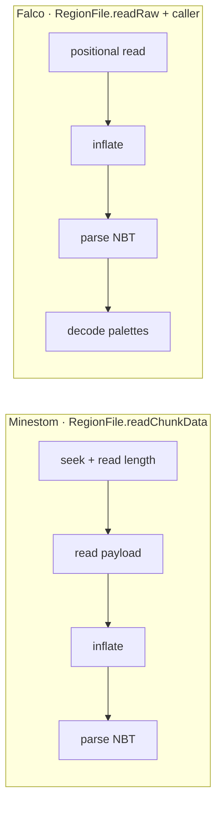
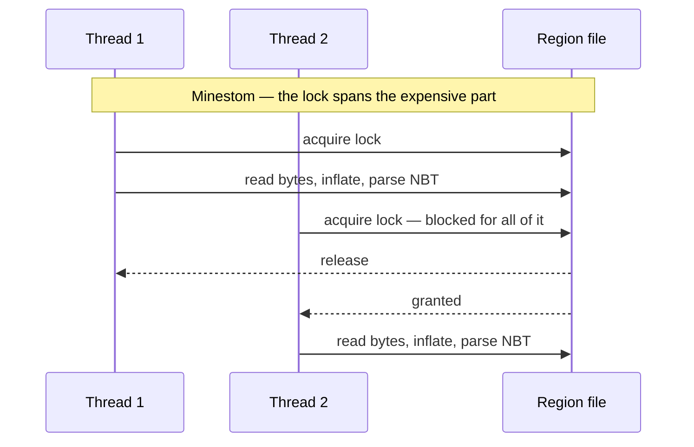
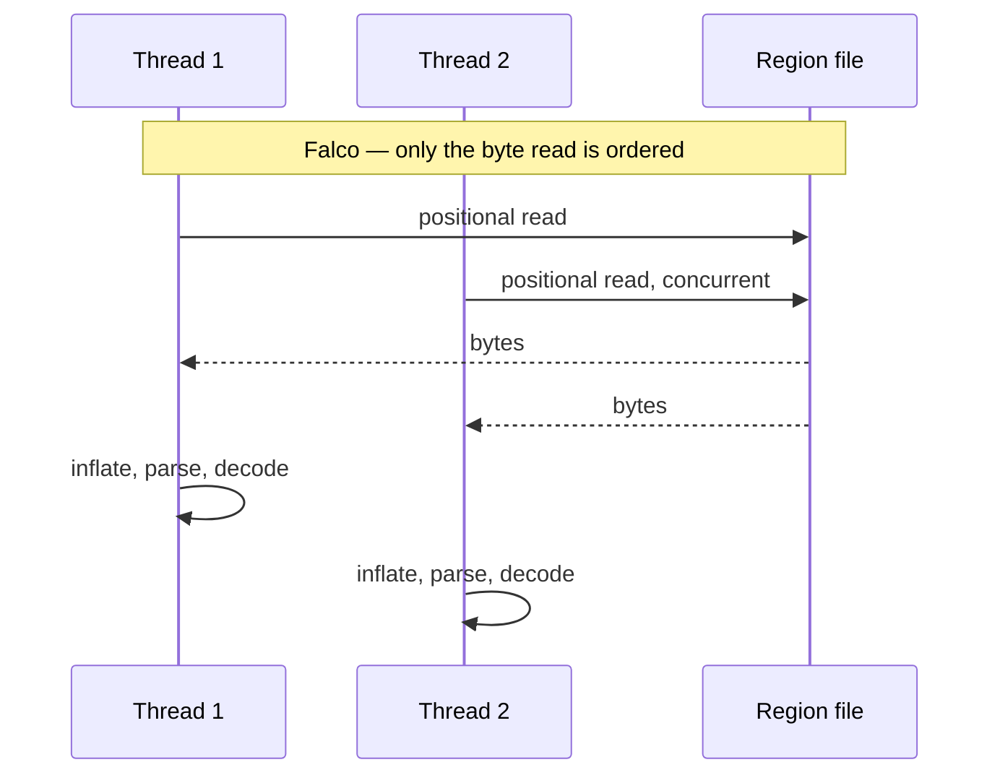
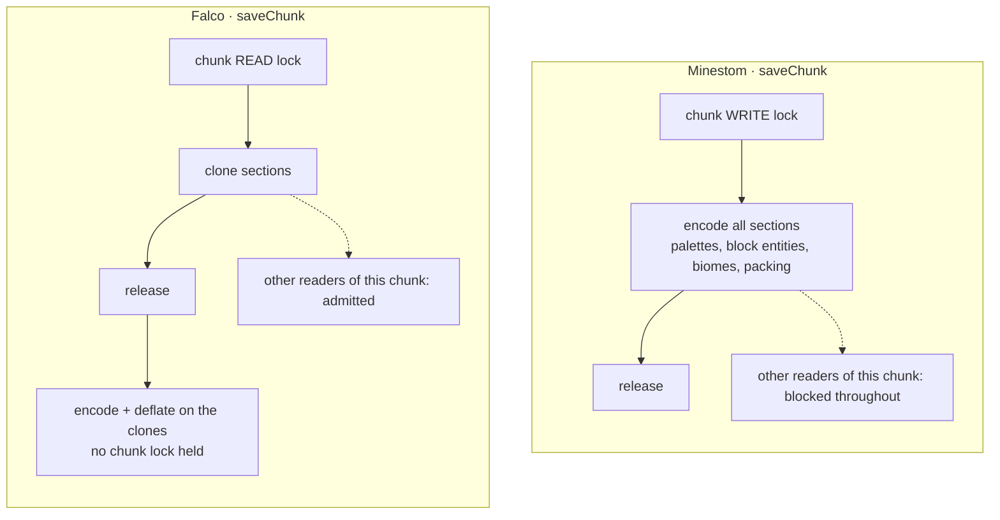
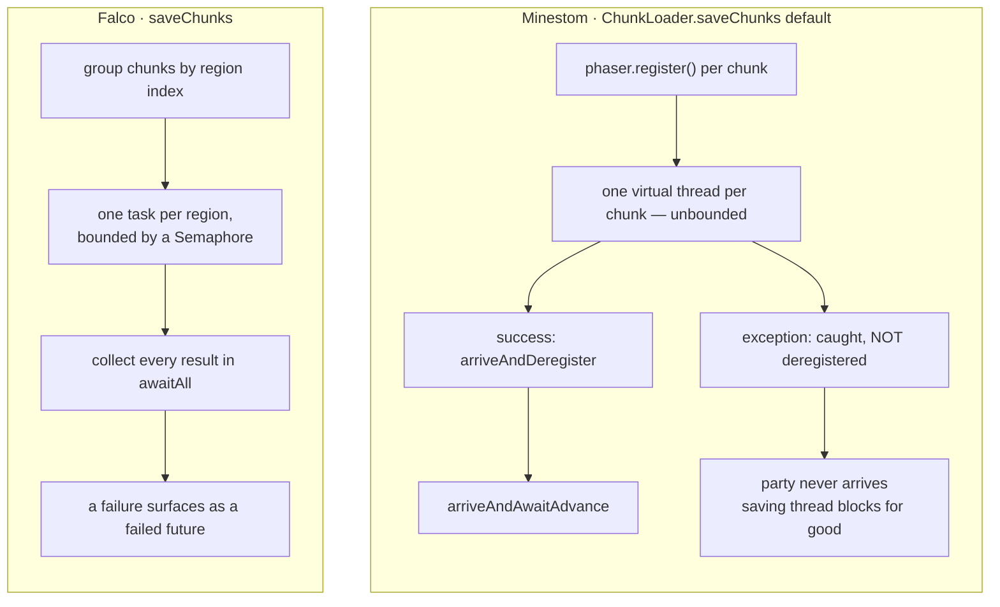

# Choosing between Falco and the built-in loader

`FalcoAnvilLoader` is a drop-in replacement for `net.minestom.server.instance.anvil.AnvilLoader`.
This page is the comparison between the two and, more usefully, which of the differences actually
carry a decision. Not every row below is a reason to switch.

All references point at the sources of the Falco repository and at Minestom
`2026.06.20-26.1.2`.

## Both switches are opt-in

Falco replaces Minestom's chunk loader and hands light computation to a scheduler, and both are opt-in:
nothing in Falco switches itself on. A server keeps its current loader until it constructs a
`FalcoAnvilLoader` and sets it on an instance, and it keeps its current light engine until it sets a
`ChunkLightScheduler` supplier. The two choices are independent of each other, so a server can take one
and not the other.

## Comparison with the built-in AnvilLoader

**How the two sides are referenced.** Minestom references are a path relative to
`net/minestom/server/` plus a line number, at version `2026.06.20-26.1.2`. Falco references name the
member instead — `RegionFile#writeRaw` for a method, `RegionFile.OPTIMISTIC_ATTEMPTS` for a field or
constant, a bare type name for the type itself — and every Falco type lives under
`falco-anvil/src/main/java/net/onelitefeather/falco/anvil/` unless the reference says otherwise.

The asymmetry is deliberate, not an oversight. The Minestom version is pinned, so those files will
never move again and the line number is the most precise pointer available. The Falco sources are the
sources of this branch and change under active work: the concurrency fixes that introduced the
per-entry seqlock and the region handle use count grew `FalcoAnvilLoader` by roughly four hundred
lines in a single week, which silently pointed every line number in this document at a blank line or
a stray `*/`. A member name survives everything short of a rename, and a rename at least breaks
loudly.

| Aspect | Minestom `AnvilLoader` | Falco `FalcoAnvilLoader` | Impact |
| --- | --- | --- | --- |
| **Chunk length field** | Writes `4 + 1 + N`: `CHUNK_HEADER_LENGTH = 4 + 1` (`instance/anvil/RegionFile.java:31`), `chunkLength = CHUNK_HEADER_LENGTH + dataBytes.length` (`:99`), `file.writeInt(chunkLength)` (`:123`). | Writes `1 + N`: `int length = COMPRESSION_FIELD_SIZE + stored.length`, then `buffer.putInt(length)` (`RegionFile#writeRaw`, `RegionConstants.COMPRESSION_FIELD_SIZE`). | The format defines the field as compression byte + payload. Minestom's own reader compensates by reading `length - 1` bytes (`RegionFile.java:84`), so its files are self-consistent, but every chunk it writes declares four bytes more than it holds. A spec-conforming reader over-reads up to four bytes of sector padding, and when the payload ends within four bytes of a sector boundary it reads past the allocation. Falco writes the value the format specifies. |
| **Short reads** | `file.read(data)` — the return value is discarded (`instance/anvil/RegionFile.java:85`). `RandomAccessFile.read` may return fewer bytes than requested. | `readFully` loops until the buffer is full and reports EOF as an `IOException` (`RegionFile#readFully`), used for both the header (`RegionFile#readHeader`) and the payload (`RegionFile#readEntry`). | A short read in Minestom leaves the tail of `data` zero-filled and is then handed to the NBT parser, producing a parse error or a truncated chunk with no indication of the cause. Falco either has the full payload or fails with the byte counts in the message. |
| **Status key casing** | Reads `"status"` (`instance/anvil/AnvilLoader.java:133`) and writes `"status"` (`:396`). The vanilla key is `Status`. | Reads `Status` first and falls back to `status` (`FalcoAnvilLoader.STATUS_KEY`, `FalcoAnvilLoader.LEGACY_STATUS_KEY`, `FalcoAnvilLoader#isFullyGenerated`); writes `Status` (`FalcoAnvilLoader#snapshot`). | For a vanilla world Minestom's `getString("status")` returns the empty default, which the `status.isEmpty()` branch (`AnvilLoader.java:135`) treats as fully generated — so partially generated vanilla chunks are loaded as if complete, and the warning at `:142` never fires for them. Its own output carries a key vanilla ignores. Falco reads both spellings and writes the vanilla one. |
| **Read failure handling** | `catch (Exception e) { handleException(e); return null; }` (`instance/anvil/AnvilLoader.java:117-120`). | Logs with context, reports to the exception manager and rethrows as `AnvilChunkException` (`FalcoAnvilLoader#failedLoad`). | `null` means "chunk absent" to `InstanceContainer`, which then generates a replacement (`instance/InstanceContainer.java:336-343`) that overwrites the unreadable-but-intact data on the next save. Throwing makes `InstanceContainer` complete the load future exceptionally instead (`:367-372`), so the stored bytes are left untouched. |
| **Unknown block** | `Objects.requireNonNull(Block.fromKey(blockName), "Unknown block " + blockName)` (`instance/anvil/AnvilLoader.java:263`). | `BlockPaletteResolver.toId` substitutes `Block.AIR.stateId()` and reports the name once (`BlockPaletteResolver#toId`). | In Minestom one modded or newer-version block name throws an NPE out of `loadSections`, which is swallowed at `:117-120`; the whole chunk is then regenerated and lost on the next save. Falco loses one block state and keeps the chunk. |
| **Unknown biome** | Falls back to `PLAINS_ID` with no report at all (`instance/anvil/AnvilLoader.java:294-296`). | Falls back to plains and reports the name once through the diagnostics (`BiomePaletteResolver#toId`). | Same resulting data, but in Minestom a world referencing biomes the registry does not have is rewritten to plains silently. Falco leaves a log entry and a counter. |
| **Lock granularity while loading** | One `ReentrantLock` per region file (`instance/anvil/RegionFile.java:42`); `readChunkData` holds it across `seek`, the length/compression read, the payload read **and** the decompression plus NBT parse (`:67-92`, parse at `:88`). | `readRaw` holds no lock and uses positional channel reads (`RegionFile#readRaw`); inflate and NBT parse run in the caller (`FalcoAnvilLoader#loadChunk`), palette decoding before the chunk lock (`FalcoAnvilLoader#decodeSections`). | Minestom serialises the expensive part of every load of the same region behind one lock, so `supportsParallelLoading() == true` yields little for chunks in one region file. In Falco only the byte read touches the file, and it needs no mutual exclusion. |
| **Lock granularity while saving** | The chunk **write** lock is held across the entire serialisation loop for all sections: palettes, block entities, biome lookups, packing (`instance/anvil/AnvilLoader.java:420-519`). Compression itself is outside the region lock (`instance/anvil/RegionFile.java:96-98` before `:104`). | The chunk **read** lock is held only to clone the sections and collect block entities (`FalcoAnvilLoader#snapshot`); everything after that works on the clones (`FalcoAnvilLoader#encodeSection`, `FalcoAnvilLoader#saveChunk`). | Taking the write lock blocks readers as well as writers, for the full duration of encoding a chunk. A read lock over an array of `Section.clone()` calls keeps the chunk readable while it is being serialised. |
| **`saveChunks` default** | `AnvilLoader` does not override it, so `ChunkLoader.saveChunks` applies: one virtual thread per chunk, coordinated by a `Phaser` (`instance/ChunkLoader.java:62-82`). The `catch` branch (`:71-73`) skips `phaser.arriveAndDeregister()`. | Overridden: chunks are grouped by region index, one task per region, concurrency bounded by a `Semaphore` of `max(Runtime.availableProcessors(), 2)` permits (`FalcoAnvilLoader#saveChunks`, `FalcoAnvilLoader.saveLimit`), results collected in `awaitAll` (`FalcoAnvilLoader#awaitAll`). | With a `Throwable` escaping `saveChunk` the registered party is never deregistered, so `phaser.arriveAndAwaitAdvance()` at `ChunkLoader.java:76` never advances and the saving thread blocks for good. Independently, one thread per chunk means every chunk of a region contends for that region's lock while all snapshots are alive at once. Grouping by region removes the contention and the semaphore bounds peak memory. |
| **Chunks over 255 sectors** | `Check.stateCondition(sectorCount >= SECTOR_1MB, "Chunk data is too large to fit in a region file")` (`instance/anvil/RegionFile.java:102`, `SECTOR_1MB = 256` at `:29`), which throws `IllegalStateException` (`utils/validate/Check.java:58-62`). | Payload is written to `c.<x>.<z>.mcc` next to the region file, the location entry stores an empty payload and the compression byte carries `EXTERNAL_FLAG = 0x80` (`RegionFile#writeRaw`, `RegionFile#externalPath`, `ChunkCompression.EXTERNAL_FLAG`). Reading follows the flag (`RegionFile#readEntry`). | A chunk larger than ~1 MiB compressed cannot be saved at all by Minestom; the exception propagates out of `saveChunk`'s `IOException`-only catch (`AnvilLoader.java:402`). Falco uses the external-file mechanism the format defines and deletes a stale `.mcc` when a chunk shrinks again, inside the same critical section which rewrites the header entry (`RegionFile#writeRaw`, `RegionFile#removeExternal`). |
| **Block entities in single-value sections** | Block entities are collected only inside the `getAll` callback of the non-uniform branch (`instance/anvil/AnvilLoader.java:456-468`); when `section.blockPalette().singleValue() != -1` that branch is skipped entirely (`:436-441`). | `collectBlockEntities` walks every block position of the chunk independently of the palette shape (`FalcoAnvilLoader#collectBlockEntities`). | A section whose blocks all share one state id but where some carry NBT or a handler — for example a section of air with handler-marked positions — loses all of its block entities on save in Minestom. |
| **Palette bits-per-entry on load** | `Palette.load(palette, values)` derives bits-per-entry from `palette.length` alone and ignores `values.length` (`instance/palette/PaletteImpl.java:127-132`), called at `instance/anvil/AnvilLoader.java:234` and `:248`. | Derived from the palette size, then verified against the actual `long[]` length (`PaletteData#read`, `BitPacker#resolveBitsPerEntry`); if the two disagree the data is unpacked with the resolved width and written entry by entry (`FalcoAnvilLoader#apply`). | The format permits a writer to use a wider bits-per-entry than the palette size requires. Minestom decodes such a section with the wrong stride, producing wrong blocks with no error. Falco detects the mismatch from the array length and decodes with the width that actually fits. |
| **Palette deduplication on save** | Linear search per block: `blockPaletteIndices.indexOf(value)` on an `IntArrayList` (`instance/anvil/AnvilLoader.java:447`); same for biomes with `biomePalette.indexOf(biomeName)` on an `ArrayList<BinaryTag>` (`:484`). | `PaletteData.encode` assigns indices via `HashMap.computeIfAbsent` (`PaletteData#encode`). | Minestom's per-section cost is O(n·m) for n = 4096 blocks and m = distinct states in the section (biomes: O(64·m) with a deep `BinaryTag` equality per probe). Falco is O(n) hash lookups. This is a structural difference in the algorithm, not a measured figure. |
| **Registry access at class initialisation** | Static fields read the biome registry and the block state count during class init: `BIOME_REGISTRY = MinecraftServer.getBiomeRegistry()`, `PLAINS_ID`, `new CompoundBinaryTag[Block.statesCount()]` (`instance/anvil/AnvilLoader.java:46-48`). | The biome registry is resolved lazily on first use behind a `volatile` field, and the supplier is injectable (`BiomePaletteResolver.resolvedRegistry`, `BiomePaletteResolver(AnvilDiagnostics, Supplier)`, `BiomePaletteResolver#registry`). Block lookups go through `Block.fromKey` per palette entry (`BlockPaletteResolver#toId`). | Merely referencing `AnvilLoader` before the server registries exist fails in the static initialiser, so the class cannot be constructed during early startup and unit tests must boot a server. In Falco the loader can be constructed before the registries are populated, and the resolver can be tested with a supplied registry. |
| **Logging and diagnostics** | Unthrottled per-chunk `WARN` for partially generated chunks (`instance/anvil/AnvilLoader.java:142`), per-tag `WARN` for invalid sections (`:203`), block entity tags (`:304`) and non-string block properties (`:273-276`). No counters, no summary. | `AnvilDiagnostics` admits only the first occurrence of a distinct name and caps the tracking sets at `MAX_TRACKED_NAMES = 64` (`AnvilDiagnostics.MAX_TRACKED_NAMES`, `AnvilDiagnostics#track`); a partial chunk reports once per distinct `Status` value under the same cap (`AnvilDiagnostics#reportPartialChunk`) and a section outside the world is logged at `TRACE` (`FalcoAnvilLoader#decodeSections`). A summary line is written on close (`FalcoAnvilLoader#logSummary`). | A world with many partial chunks or one unknown modded block produces one log line per chunk in Minestom, which buries everything else. In Falco the same condition produces one line per distinct value plus a counter, and the cap keeps a corrupt world from growing the tracking sets without bound. |
| **Header write per chunk** | `writeHeader` rewrites the whole 8192-byte header on every dirty save (`instance/anvil/RegionFile.java:182-196`, called at `:131`). | `writeEntry` writes only the 4-byte location and the 4-byte timestamp of the affected index (`RegionFile#writeEntry`). | Minestom rewrites 1024 location and 1024 timestamp entries to change one of each. Beyond the write volume, a crash during that rewrite can damage entries of unrelated chunks; an 8-byte update cannot. |
| **Region header validation** | `readHeader` marks every non-zero location in the bitset, checking only that it stays inside the current sector count (`instance/anvil/RegionFile.java:167-172`, `:234-239`). Overlapping entries are accepted. | Entries pointing into the header or with a zero sector count are dropped (`RegionFile#readHeader`) and `SectorAllocator.reserve` rejects an overlapping range with the conflicting sector in the message (`SectorAllocator#reserve`). | Two location entries claiming the same sectors stay undetected in Minestom until one chunk overwrites the other. Falco fails to open such a file with a message naming the sector. |
| **NBT strictness** | Uses the defaulting getters throughout: `sectionData.getCompound("block_states")` returns an empty compound when absent (`instance/anvil/AnvilLoader.java:239`), and an empty palette list then leaves the section untouched (`:242-249`). | `NbtReads` reports a missing or mistyped key as an `IOException` naming the key, the expected type and the actual type (`NbtReads#longArray`, `NbtReads#missing`); `SectionCodec` rejects empty palettes (`SectionCodec#decode`, `SectionCodec#decodeBiomes`). | In Minestom a truncated or malformed section silently loads as untouched (air) and is written back that way. In Falco the same input fails the load, so the stored bytes survive. |
| **Region file lifecycle** | Opened inside `alreadyLoaded.computeIfAbsent(...)`, i.e. blocking file IO inside a `ConcurrentHashMap` mapping function (`instance/anvil/AnvilLoader.java:179-194`); closed when the last chunk of the region unloads (`:557-584`). | Opened outside the mapping function, published with `putIfAbsent`, and a losing race closes the redundant handle (`FalcoAnvilLoader#acquireRegion`); a file is closed once the last chunk this loader loaded is unloaded, with a hard cap on open files as a backstop (`FalcoAnvilLoader.DEFAULT_OPEN_REGION_LIMIT`); a handle in use is only dropped from the cache and closed by its last user. | `computeIfAbsent` holds the bin lock for the duration of the mapping function; performing file IO there blocks other keys hashing to the same bin. Also, `unloadChunk` is called for chunks the loader never loaded (documented at `instance/ChunkLoader.java:102-108`), which makes a plain reference count unreliable — Falco therefore tracks only the chunks it loaded itself and additionally caps the number of open files. |
| **Instance-level and unknown chunk tags** | `loadInstance`/`saveInstance` read and write `level.dat` (`instance/anvil/AnvilLoader.java:96-107`, `:332-343`). Chunk tags other than `Heightmaps`, `sections` and `block_entities` are kept in the chunk tag handler (`:144-151`) and written back on save (`:390`); heightmaps are restored (`:140`). | Neither method is overridden. `snapshot` builds a fixed set of keys: `DataVersion`, `xPos`, `zPos`, `yPos`, `Status`, `LastUpdate`, `sections`, `block_entities` (`FalcoAnvilLoader#snapshot`). | This one favours Minestom. Saving a vanilla chunk with the Falco loader drops `Heightmaps`, `structures`, `block_ticks`, `fluid_ticks`, `PostProcessing` and any other chunk-level tag, and `level.dat` is not touched at all. See the next section. |

Twenty rows. Every reference above was read in the sources of the stated versions.

## Which of those rows carry the argument

The table is flat by construction — every row gets one line, whether it changes what a server does
or tidies a log message. Sorted by consequence they fall into four groups.

**Silent data loss.** The rows that change what ends up on disk: block entities dropped from uniform
sections, the palette stride derived from the palette length alone, the discarded return value of
`read`, the length field written four bytes too large. None of these announce themselves — the world
loads, the chunk looks fine, and the damage surfaces later or in another tool. These are the reason
the loader exists.

**Failure that destroys the original.** A read error returning `null` means "chunk absent" to
`InstanceContainer`, which generates a replacement and overwrites the intact-but-unreadable bytes on
the next save. This one row turns a recoverable problem into an unrecoverable one.

**Concurrency.** Both loaders report `supportsParallelLoading() == true`. Only one of them means it.
This is the group where the two implementations diverge furthest under measurement — far enough that
on three of the four thread counts Minestom's read carries no usable factor at all and the finding
has to be stated as a loss of predictability rather than as a number. The diagrams below are about
it, and the tables that bound it are further down under
[Performance and memory](how-the-anvil-loader-is-built.md#performance-and-memory).

**Everything else** — logging volume, registry access at class-initialisation time, header write
volume — is real but bounded. A server survives all of it.

### Why parallel loading is nominal in Minestom

Both loaders do the same work per chunk: read bytes, inflate, parse NBT, decode palettes. The
difference is which of those steps happens while the region file's lock is held.

In Minestom all four steps sit inside one `ReentrantLock` held per region file
(`instance/anvil/RegionFile.java:42`, parse at `:88`). In Falco only the first one touches the file,
and it needs no mutual exclusion at all: `FileChannel.read(ByteBuffer, position)` does not move the
channel position, so two readers of different chunks do not interfere. Inflate, parse and palette
decode run in the caller.

The consequence appears as soon as two threads want chunks from the same region — which is exactly
what loading a spawn area does, since a region file holds 32×32 chunks:

Since inflate and NBT parsing dominate the load path, putting them inside the lock means extra
threads mostly queue. That is what "nominal parallelism" means here, and the next section measures it.

### Why the save path blocks readers in Minestom

The same question on the write side, with a different answer. Minestom holds the chunk's **write**
lock across the serialisation of every section — palettes, block entities, biome lookups, packing
(`instance/anvil/AnvilLoader.java:420-519`). A write lock excludes readers as well as writers, so
for the whole duration of encoding, nothing else may look at that chunk.

Falco takes the **read** lock, clones the sections, and releases it. Everything after that works on
copies:

### Why one exception in `saveChunks` hangs the saving thread

`AnvilLoader` does not override `saveChunks`, so the interface default applies: one virtual thread
per chunk, coordinated by a `Phaser` (`instance/ChunkLoader.java:62-82`). Its `catch` branch
(`:71-73`) returns without calling `phaser.arriveAndDeregister()`.

Two independent problems in one row. The `Phaser` branch is a liveness bug: a single `Throwable`
escaping `saveChunk` blocks the saving thread permanently. The unbounded thread-per-chunk is a
memory one: every chunk of a region contends for that region's lock while all snapshots are alive at
once. Grouping by region removes the contention, and the semaphore bounds the peak.

Related: [Explanation Why a second Anvil loader](why-a-second-anvil-loader.md) for the argument in full ·
[Explanation Scope and non-goals](scope-and-non-goals.md) for what neither loader does ·
[How-to Load an Anvil world](../how-to/load-an-anvil-world.md) to act on the decision
