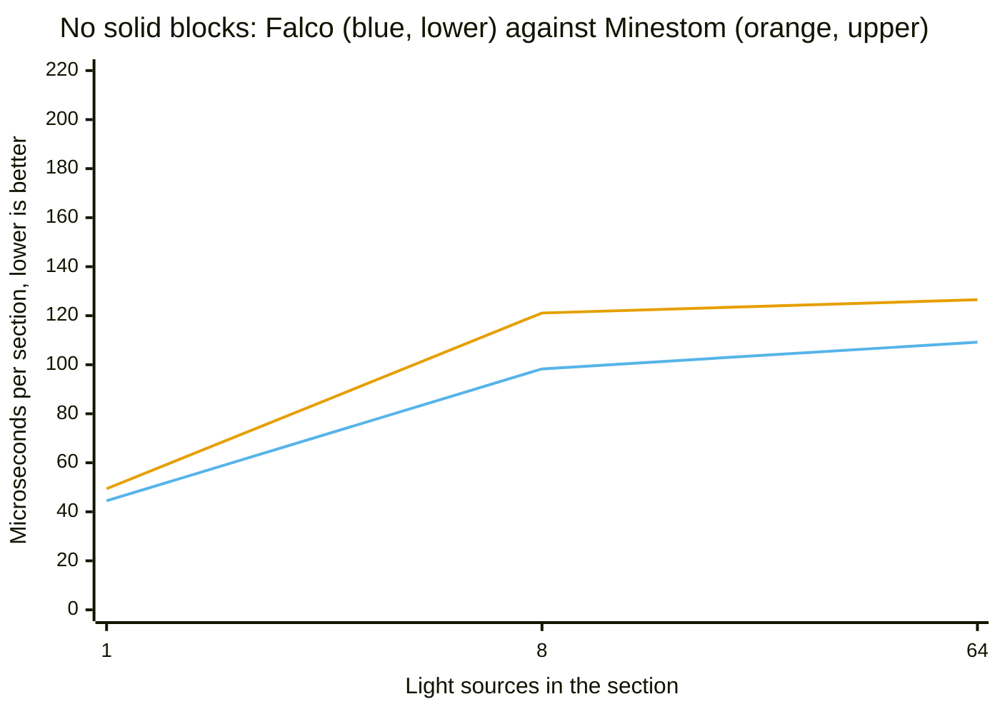
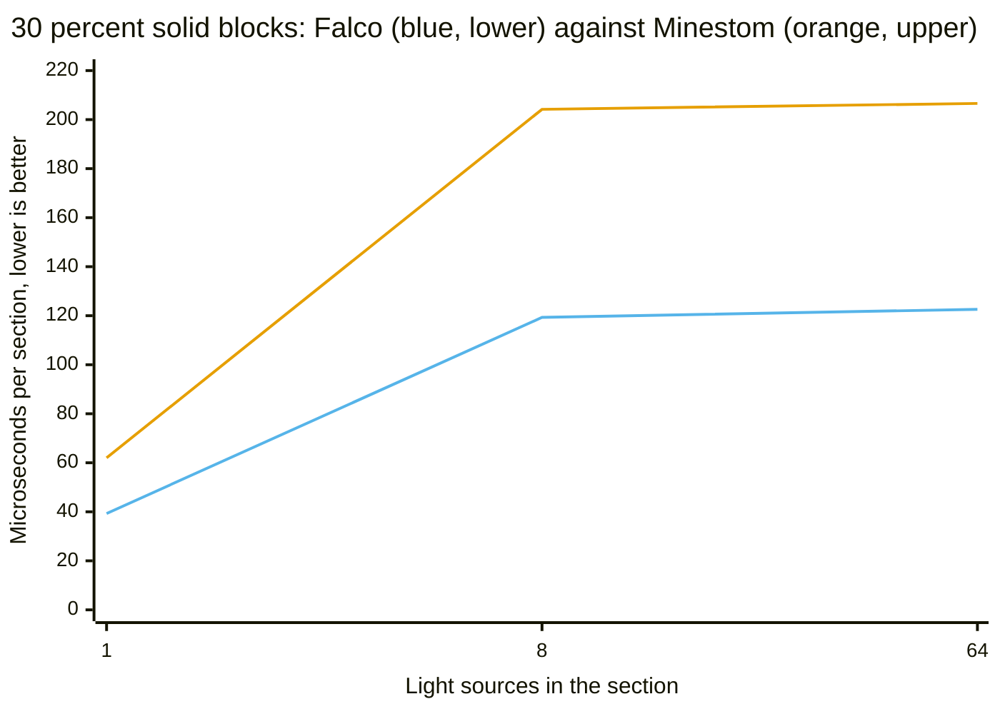
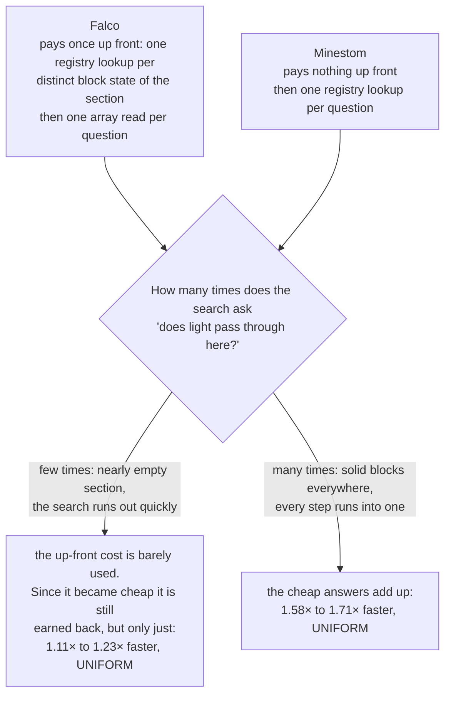
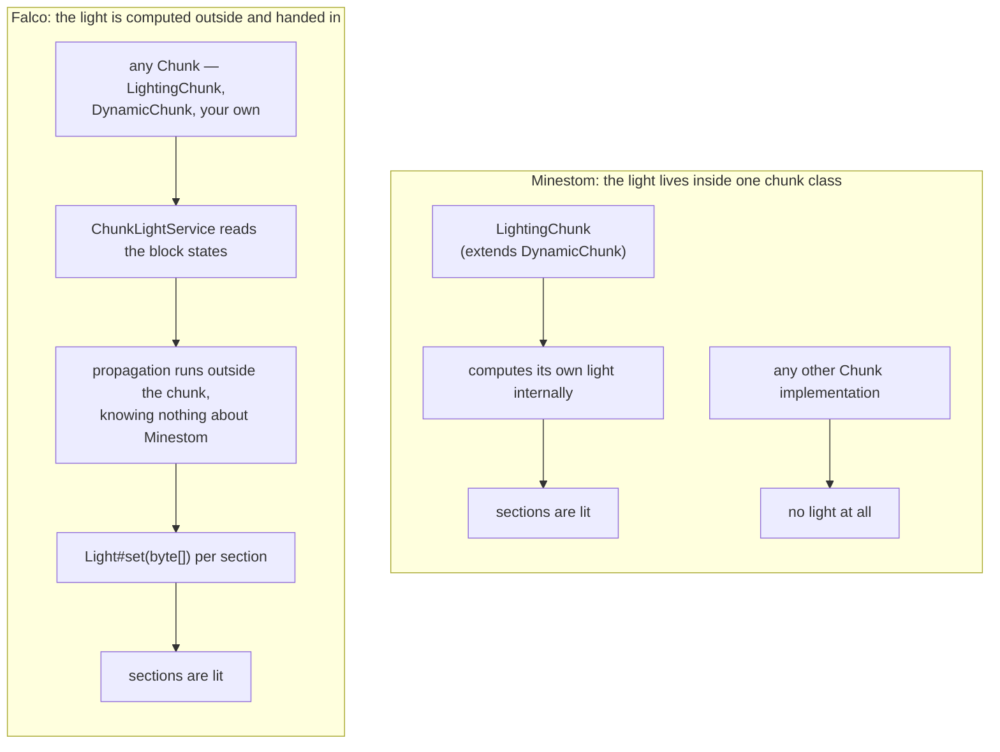

# Comparing the light engine with Minestom's

Where `falco-light` is ahead of the engine Minestom ships with, by how much, where the lead shrinks,
and when the built-in engine is the better choice.

> **Read this before quoting a number.** Every figure here comes from a JMH benchmark run on *one*
> machine, on *one* JVM, under *one* load. The tables live on [Reference Measured results](../reference/measured-results.md); what
> the `±` means is defined once in [Explanation What a measurement here means](what-a-measurement-here-means.md).
>
> **Sky light is never compared.** Every comparison on this page runs against the built-in *block*
> light path. No claim of byte identity with the built-in engine is made for sky light, and none may
> be quoted from here.

**Everything in this section is about block light.** Both the comparison and the equivalence check
call `BlockLight.buildInternalQueue` and `LightCompute.compute`, which are the built-in *block* light
path; no benchmark and no test in this repository puts Falco's sky light next to Minestom's. Sky
light appears further down as a Falco-only feature, and nothing on this page compares it with
anything. That limit is repeated where it belongs, in [Limits](scope-and-non-goals.md#the-light-engine).

`LightEngineComparisonBenchmark` runs both engines over the same section, from a block palette to a
finished light array of 2048 bytes. It lives in `net.minestom.server.instance.light` because the two
methods that make up the built-in path — `BlockLight.buildInternalQueue` and `LightCompute.compute` —
are package-private, which is the only way to measure the original instead of a copy of it. Neither
side gets to skip its preparation: the built-in path builds its seed queue, and the Falco path builds
its opacity table through the real block registry rather than a stand-in.

**The two engines produce the same block light, and that is checked rather than claimed.** This is
the part of the comparison that does not depend on a measurement at all, and it is the part a hostile
reader cannot dismiss, so it comes first.
`LightEngineEquivalenceTest#testBothEnginesLightEverySectionIdentically`
compares them byte for byte over 54 scenarios — nine source counts `{0, 1, 2, 4, 8, 16, 64, 128, 512}`
against six shares of solid blocks `{0, 10, 30, 50, 70, 90}` percent — and runs with `./gradlew test`
like any other test. It also asserts that every scenario holding a source actually carried light, so
a pair of dark sections cannot agree by accident, and a second test pins the fully dark section,
which the two engines represent differently — Minestom as an empty array, Falco without an array at
all — onto the same bytes
(`LightEngineEquivalenceTest#testBothEnginesAgreeOnASectionWithoutAnyLight`). The benchmark repeats
the byte comparison in its `@Setup` (`LightEngineComparisonBenchmark.verifyBothEnginesAgree`) and
aborts the trial when the two disagree, which closes the most common way a benchmark lies — winning
time by computing something else. Until recently this document asserted the byte identity while
nothing in the build verified it; the statement happened to be true, but a change that broke it would
have passed unnoticed. Nothing in this section is a statement about correctness — on block light
correctness is equal, not better, and on sky light it is unmeasured against the built-in engine.
Everything below is about time.

One section per operation, `score ± error`, lower is better. Every source emits level 15; sections
whose sources differ in brightness are measured separately,
[further down](#sources-of-mixed-brightness).

```
java -jar build/libs/falco-*-jmh.jar "LightEngineComparisonBenchmark.(falco|minestom)" \
    -p emissionMix=UNIFORM -f 1 -wi 5 -i 10
```

| Light sources | Solid blocks | Falco | Minestom | Falco is | Conservative bounds |
| ---: | ---: | ---: | ---: | --- | --- |
| 1 | 0 % | 44.5 ± 0.6 µs/op | 49.4 ± 1.3 µs/op | 1.11× faster | 1.07× to 1.16× |
| 8 | 0 % | 98.3 ± 2.4 µs/op | 121.1 ± 5.5 µs/op | 1.23× faster | 1.15× to 1.32× |
| 64 | 0 % | 109.2 ± 1.6 µs/op | 126.5 ± 5.6 µs/op | 1.16× faster | 1.09× to 1.23× |
| 1 | 30 % | 39.3 ± 0.8 µs/op | 62.0 ± 2.0 µs/op | 1.58× faster | 1.50× to 1.66× |
| 8 | 30 % | 119.3 ± 3.5 µs/op | 204.2 ± 3.7 µs/op | **1.71× faster** | 1.63× to 1.80× |
| 64 | 30 % | 122.6 ± 1.3 µs/op | 206.6 ± 4.2 µs/op | 1.68× faster | 1.63× to 1.74× |

<sub>`LightEngineComparisonBenchmark.falco` / `.minestom`, `emissionMix = UNIFORM`,
`lightSources` and `occlusionPercent` as the first two columns, one thread, one fork, 5 warmup and
10 measurement iterations of 1 s — both counts override the class annotation, which specifies 3 and
5 — `-Xms512m -Xmx512m`, JMH 1.37, one 16-core machine recorded as not idle, no `results.json`
committed. The bounds column is `(minestom − error) / (falco + error)` to
`(minestom + error) / (falco − error)`, so it is what the two intervals allow rather than the
quotient of the means. One fork: the `±` covers variance between iterations of one JVM, not between
JVM launches — see [What a measurement here means](what-a-measurement-here-means.md).</sub>

**All six rows resolve a difference in the same direction**, and this is the strongest evidence on
the page. The intervals are disjoint at every point, and the confidence level behind them is
generous — a 99.9 % interval over ten iterations is wide by construction, so two intervals that do
not touch are not a near miss. The finding stands without hedging: on this machine, in this run,
Falco's path is the faster of the two everywhere it was measured, by between 1.07× and 1.80×
depending on the section.

What it does not license: it is a per-section time from one JVM process on one machine that was not
idle, it is not a chunk lighting time and not a tick time, and the single-fork limitation applies in
full. The gap on the three open-sky rows is small enough that a different machine could move it; the
gap on the three 30 % rows is not.

These numbers replace an earlier set in which Falco lost four of the six scenarios. What changed is
not the algorithm but the table it works from: building `SectionOpacity` allocated a throwaway lambda
per block, which is [broken down below](#where-the-gain-came-from). No repeat run of this table
exists. The two genuine cross-run repeats that touch the light engine are the nine-chunk
`AreaVsPerChunkBenchmark` re-run and the earlier `IncrementalVsFullBenchmark` run, both cited at
their own tables in [Measured results](../reference/measured-results.md#measured); neither of them is this benchmark.
They are two of the five the project has; two of the others are repeats of the loader table, and all
five are registered under
[Against the engine Minestom ships with](../reference/measured-results.md#against-the-engine-minestom-ships-with).

**One cell of this table has since been repeated.** A two-fork re-run of the 64 sources / 0 % solid
row on 2026-08-02 puts Falco at 109.88 ± 1.47 against the 109.2 ± 1.6 published here — intervals that
overlap, so the row reproduces. It is the fifth of the project's cross-run repeats and is set out
under
[With sources of mixed brightness](../reference/measured-results.md#with-sources-of-mixed-brightness). **The rest of
the table has still not been repeated**, and the shorter confirmation run this page once implied was
never recorded anywhere.

### A section without solid blocks: the narrow half of the result

This is where the two engines are closest, because it is where Falco has the least to gain: nothing
blocks the light, so the search rarely has to ask whether it may pass.



`xychart-beta` draws no legend, so: the first line, the lower one, is **Falco** (blue); the upper one
is **Minestom** (orange). The scale runs to 220 although nothing here comes close to it, so that this
chart and the next one can be held against each other.

**Why the margin is small here.** Before Falco computes anything, it goes through the section once and
notes down for every block whether light passes through it. That note costs time before a single ray
has moved. In a section with nothing in it, the search hardly ever consults it, so the preparation is
paid for and barely used. This is the shape of the workload on which Falco was behind until the
preparation itself became cheap enough for the remainder to be earned back; 1.11× at one source is
what is left of that, and it is the smallest margin in the table for exactly this reason.

**How firm that is.** The spreads do not overlap at any of the three points — 44.5 ± 0.6 against
49.4 ± 1.3, 98.3 ± 2.4 against 121.1 ± 5.5, 109.2 ± 1.6 against 126.5 ± 5.6. The direction is
established; the size of the gap at one source is small enough that a different machine could move it.

### A section with solid blocks: the wide half

Once 30 % of the blocks are solid, the same mechanism works in the other direction.



Same order and the same colours as before: the first line is **Falco** (blue), the second **Minestom**
(orange). The distance between the lines is several times what the previous chart shows, on the same
scale.

**Why.** Now the note earns its keep. Solid blocks are exactly what a spreading light keeps running
into, and every time it does, the same question comes up again: does light get through here? Falco
reads the answer off the note it wrote at the start — one position in an array. Minestom asks the
registry again each time. The more often the question is asked, the more the one-off cost of writing
the note is worth; and how often it is asked is set by how many light sources are spreading and how
much they run into.

That is the whole shape of the result, and it is what the optimisation moved:



The up-front cost has not disappeared, it has shrunk. The break-even point that used to sit inside
the measured range now sits below its sparsest configuration, which is why the left branch reads as a
small win instead of a loss. A section that is sparser still — no sources at all — is answered
without a search or a table at all, so it never reaches this decision.

**How firm that is.** None of the six spreads overlap. The widest margins, 8 and 64 sources at 30 %
solid, are also the ones with the tightest errors on both sides: 119.3 ± 3.5 against 204.2 ± 3.7 and
122.6 ± 1.3 against 206.6 ± 4.2.

### Where the gain came from

`LightEngineStageBenchmark` splits both engines into their stages, which is what identifies the cost.
For one light source in an open section, in microseconds. This is a genuine before/after across a
single commit — the same benchmark, the same parameters, two builds of Falco:

| | readStates | opacity | propagate | collect | falcoFull (measured) | sum of the four stages |
| --- | ---: | ---: | ---: | ---: | ---: | ---: |
| before `69381af` | 7.70 | **31.33** | 33.85 | 0.24 | 77.1 | 73.12 |
| after `69381af` | 7.23 | **8.07** | 31.41 | 0.23 | 46.3 | 46.94 |

<sub>`LightEngineStageBenchmark.falcoReadStates` / `.falcoOpacity` / `.falcoPropagate` /
`.falcoCollect` / `.falcoFull`, `lightSources = 1`, `occlusionPercent = 0`, one thread, one fork,
3 warmup and 5 measurement iterations of 1 s per the class annotation, `-Xms512m -Xmx512m`, JMH 1.37,
one 16-core machine recorded as not idle, commit `69381af` against its predecessor, no `results.json`
committed, run dates unrecorded. **No
error bars were kept for any cell**, so no rule about interval overlap can be applied to this table
and no ratio drawn from it is defensible to more than one significant figure. The last column is
arithmetic on the four preceding ones, not a measurement.</sub>

<sub>**Both rows describe `69381af`, not the current tree.** `propagate` has moved since: #28 took
it from 31.10 / 31.57 µs to 27.25 / 27.39 µs under these parameters, across two independent
three-fork runs per side. See
[Why a custom light engine](why-a-custom-light-engine.md#where-the-time-actually-went-and-why-that-surprised-us).</sub>

**The table validates itself, which is why the two extra columns are worth having.** `falcoFull` is
measured separately rather than summed, so the residual against the stage sum — `+3.98` before,
`−0.64` after — is what the method exists to expose, and it stays under 6 % on both rows. More
usefully, two stages were not touched by the commit at all: `readStates` moves by 6 % and `collect`
by 4 %. Those two are an internal control. Both moved by under 7 % and both moved in the same
direction, which suggests a small systematic shift between the two runs rather than symmetric noise;
`collect` at 0.23 against 0.24 is one printed digit and constrains little on its own. Even taking the
larger of the two as an upper bound on that shift, `opacity` going from 31.33 to 8.07 — a factor near
4 — is an order of magnitude outside it. That is the argument the table makes, and it does not depend
on error bars nobody recorded.

Building the opacity table was 41 % of `falcoFull` before (31.33 of 77.1) and is 17 % of a much
shorter `falcoFull` after (8.07 of 46.3). The table allocated a throwaway lambda per block; removing
that took the allocation of one call from 74 040 bytes to 8 664, and that allocation figure is the
sturdier half of this claim for the reasons given [above](how-the-light-engine-works.md#memory).

**One number in there corrects the story this document used to tell.** The Falco *search* was already
the faster of the two before the change: 33.9 µs against 53.9 µs for the built-in search. The 53.9 is
**derived**, not measured — Minestom's search consumes the queue it is handed and cannot be run on a
prepared one, so it is `minestomFull − minestomQueue`, which the class javadoc states outright. A
difference of two means carries the sum of both uncertainties, and neither operand was published with
one, so 53.9 has no interval and must not be turned into a factor. What it supports is the direction:
the entire deficit came from the preparation, not from the propagation. The earlier text explained the
losses as a property of the algorithm's shape; they were a property of one allocation.

### Sources of mixed brightness

Every scenario above places glowstone, so every source starts at level 15. Real interiors are lit
with torches, lanterns and magma blocks side by side, and `emissionMix=MIXED` builds exactly that:
the same positions, drawn from the same seed, filled with glowstone 15, lantern 15, torch 14,
redstone torch 7 and magma block 3.

```
java -jar build/libs/falco-*-jmh.jar "LightEngineComparisonBenchmark.(falco|minestom)" \
    -p emissionMix=MIXED -p lightSources=8,64 -f 1 -wi 3 -i 5
```

| Light sources | Solid blocks | Falco | Minestom | Falco is | Conservative bounds |
| ---: | ---: | ---: | ---: | --- | --- |
| 8 | 0 % | 118.97 ± 8.89 µs/op | 126.54 ± 9.55 µs/op | no difference resolvable | — |
| 8 | 30 % | 116.50 ± 7.63 µs/op | 201.46 ± 16.83 µs/op | 1.73× faster | 1.49× to 2.01× |
| 64 | 0 % | 150.42 ± 32.73 µs/op | 162.20 ± 3.11 µs/op | no difference resolvable | — |
| 64 | 30 % | 149.42 ± 12.64 µs/op | 252.26 ± 9.28 µs/op | 1.69× faster | 1.50× to 1.91× |

<sub>`LightEngineComparisonBenchmark.falco` / `.minestom`, `emissionMix = MIXED`,
`lightSources = 8, 64`, `occlusionPercent` as the second column, one thread, one fork, 3 warmup and
5 measurement iterations of 1 s per the class annotation, `-Xms512m -Xmx512m`, JMH 1.37, one 16-core
machine recorded as not idle, no `results.json` committed. **These settings are not the ones the
UNIFORM table above was measured at** (`-wi 5 -i 10` there), so the two tables are two runs and their
rows must not be subtracted from one another. One fork: the `±` covers variance between iterations of
one JVM, not between JVM launches — see [What a measurement here means](what-a-measurement-here-means.md).</sub>

A single source is not measured under `MIXED`: the first block of the set is glowstone, so a lone
source is the identical section `UNIFORM` already covers.

**Two of the four rows resolve nothing, and the two that do are the ones with solid blocks.** At 0 %
solid the intervals overlap in both cases — `[110.08, 127.86]` against `[116.99, 136.09]` at 8
sources, and `[117.69, 183.15]` against `[159.09, 165.31]` at 64. The means put Falco ahead by 6 %
and 8 % respectively, and neither is established; nor is equality. The 64-source row is the loosest
measurement on this page, with a Falco half-width of 22 % of its mean, and that dispersion is itself
the interesting part: mixed brightness makes Falco's time less predictable, not merely larger.

At 30 % solid the intervals are disjoint on both rows and the lead is the same one the uniform table
shows — 1.73× and 1.69× here against 1.71× and 1.68× there. These are not a repeat of each other:
`UNIFORM` and `MIXED` are two different inputs, measured at different iteration counts, so what the
closeness shows is a fact about the mechanism rather than about run-to-run stability. Where solid
blocks are present the cheap opacity answers dominate what the search spends, so the source mixture
barely touches the result. The light engine's two genuine cross-run repeats are elsewhere, and are
two of the five the project has; all five are registered under
[Against the engine Minestom ships with](../reference/measured-results.md#against-the-engine-minestom-ships-with).

**Mixed levels cost Falco more than they cost Minestom**, and the mechanism is in the search: it
assumes the queued positions are ordered by level, which is true only while every source starts at
the same one. With mixed levels a position can be reached again later by a brighter wave, and the
same positions are touched more than once. Comparing the open-sky rows across the two tables shows
the direction — 109.2 µs at 64 sources under `UNIFORM` against 150.42 µs under `MIXED` — but those
are two runs at different iteration counts, so the difference is not a measured quantity and no
percentage is quoted for it here.

Held against the same scenario under `UNIFORM`, Falco's own time at 64 sources in an open section
rises by **41.7 %**, with conservative bounds of 32.3 % to 51.4 %. That comes from a two-fork re-run
of both cells in one run at one setting, under
[With sources of mixed brightness](../reference/measured-results.md#with-sources-of-mixed-brightness); the margin
over Minestom does fall away, but the `MIXED` intervals overlap and no factor may be quoted for it.

<!-- Resolved 2026-08-02. The previous wording read "…rises by about a third, and the margin over
     Minestom falls from roughly 1.3× to the 1.06× above". Neither figure was traceable — the two
     tables came from different runs (-wi 5 -i 10 against -wi 3 -i 5), the published UNIFORM 64 / 0 %
     margin is 1.16× rather than 1.3×, and the 112.7 µs that Measured Results anchored against
     appeared in no table. Both are gone, replaced by the re-run above, which measures both cells
     together and so cannot inherit that defect. -->

If a bucket queue is ever added to the propagator, `emissionMix` is the parameter that will show
whether it was worth it — the two rows where the intervals overlap are exactly where it would be
expected to help — and that is why it is a parameter rather than a constant.

### Which of the two is the steadier

In the UNIFORM run above, Falco has the smaller absolute half-width at every one of the six points:
± 0.6 to ± 3.5 against ± 1.3 to ± 5.6. Measured relative to the score the picture is almost the same,
with one exception — at 8 sources and 30 % solid Minestom is the tighter of the two (1.8 % against
2.9 %). The earlier version of this document reported the opposite across the board, on an earlier
run; the drop in allocation is the likeliest reason the Falco spread fell, since it removes the
garbage collector from the measurement. Likeliest, not established: nothing here isolates the
garbage collector from any other cause.

Two limits on how far that reading goes. The `±` is a confidence interval over the measurement
iterations of one JVM process, so it describes dispersion inside a single run and not how either
engine behaves across JVM launches — a comparison of two such intervals is a comparison of two
within-run dispersions and nothing wider. And under `MIXED` the ordering reverses on the loosest row:
150.42 ± 32.73 against 162.20 ± 3.11, where Falco is the noisier of the two by an order of magnitude.
Whichever engine is the steadier, it is not a property that holds across the parameter space.

The machine that produced every table on this page is recorded as **not idle**, which is a live
candidate explanation for any spread on it and has not been ruled out for any row.

### On concurrency there is nothing to win here

The Anvil comparison in [How the Anvil loader is built](how-the-anvil-loader-is-built.md) turns on a lock that is held across
expensive work. It would be convenient to claim the same thing on the light side, and it is not true.
Minestom's light path is already built for several threads, at `2026.06.20-26.1.2`:
`LightCompute.compute` is `static` and allocates its result buffer per call
(`instance/light/LightCompute.java:115`), `BlockLight` keeps its buffers in instance fields, one
instance per section (`instance/light/BlockLight.java:20-22`), and `LightingChunk` already runs its
work on an `Executors.newWorkStealingPool()` (`instance/LightingChunk.java:38`). Nothing in there
serialises work that could be running in parallel, so there is no contention to remove. This is a
structural reading of the source, not a measurement — no benchmark on this page contends the light
path from several threads, and none should be quoted as if it did.

### How the light reaches the chunk

This is the one argument for this engine that does not depend on a measurement, and it is the
strongest one. Minestom computes light **only** inside `LightingChunk`, which extends `DynamicChunk`
(`instance/LightingChunk.java`). Use any other chunk implementation and no light is computed at all.
Falco computes outside the chunk and hands the finished array over through `Light#set`, which every
chunk accepts.



The same property has a second consequence: because the propagation references no Minestom class at
all, it can be tested against a handful of fake blocks without a running server. Only the adapter
that answers from the real registry needs one.

**Being outside the chunk does not mean giving up the convenience of being inside it.**
`FalcoLightingChunk` offers the same one-line setup as `LightingChunk` while the computation stays in
a service that any chunk type can be handed to — see
[Letting the chunk keep its own light](../how-to/keep-chunk-light-up-to-date-automatically.md). The two are not
alternatives: the chunk is a caller of the service like any other.

### When to use Minestom's engine instead

The reason this section used to give — the built-in engine is faster on sparsely occupied sections —
no longer holds, so it needs restating rather than deleting.

If you already use `LightingChunk`, there is still no obligation to change anything. The built-in
engine is wired into the server, costs no extra code and no extra call site, and on an open section
lit by sources of differing brightness no difference between the two is resolvable at all — both
`MIXED` rows at 0 % solid have overlapping intervals. Swapping a working light path for a margin the
measurement does not establish is not a trade at all.

What does argue for this engine is the case the built-in one does not cover: any chunk that is not a
`LightingChunk`, which includes the chunk type an `InstanceContainer` uses unless it is told
otherwise. That one is structural and needs no benchmark. After it come the workloads where the
margin is both large and resolved — sections carrying a real share of solid blocks, where the tables
above put Falco ahead by 1.58× to 1.71× under `UNIFORM` and 1.69× to 1.73× under `MIXED`, all five
of those rows with disjoint intervals, though across two separate runs whose figures should not be
pooled —
and the control over *when* light is computed that comes from computing it outside the chunk.

The convenience argument has stopped being one either way. `setChunkSupplier(scheduler.supplier())`
is the same amount of setup as `setChunkSupplier(LightingChunk::new)`, so choosing between the two is
now a question about the engine rather than about how much wiring it takes.


Related: [Explanation Why a custom light engine](why-a-custom-light-engine.md) · [Explanation How the light engine works](how-the-light-engine-works.md) ·
[Explanation What the benchmarks establish](what-the-benchmarks-establish.md)
