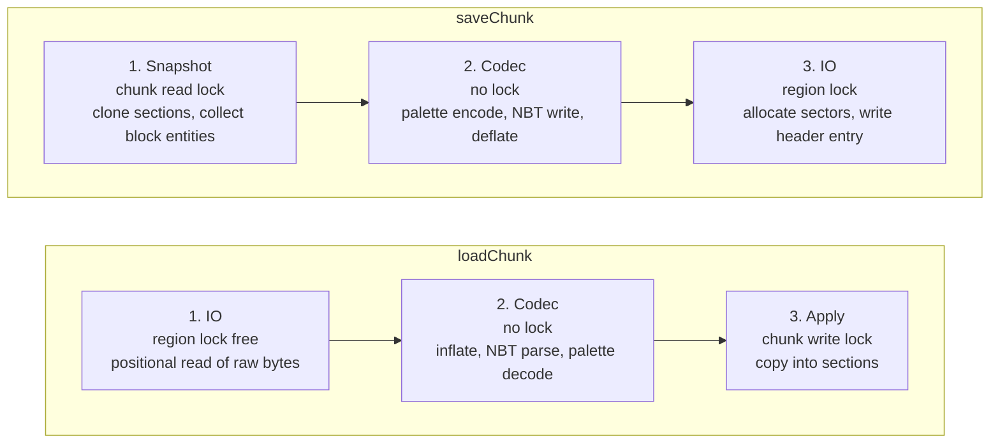
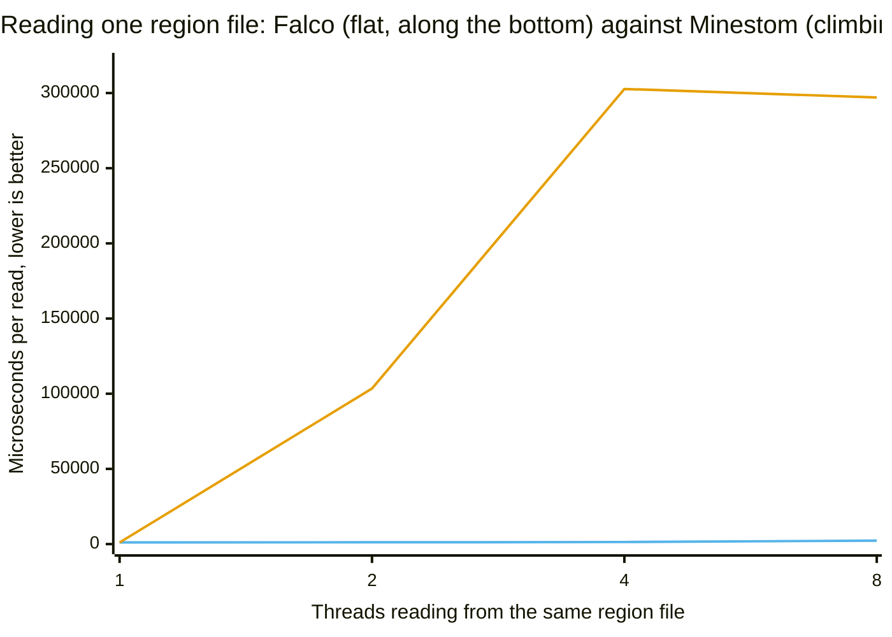
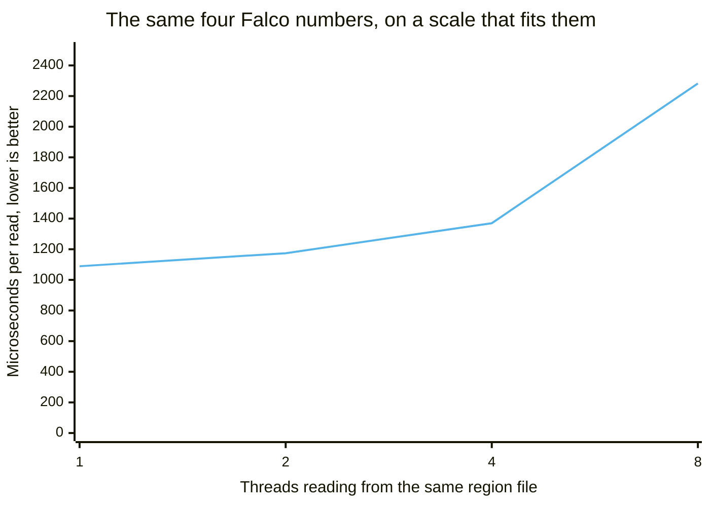
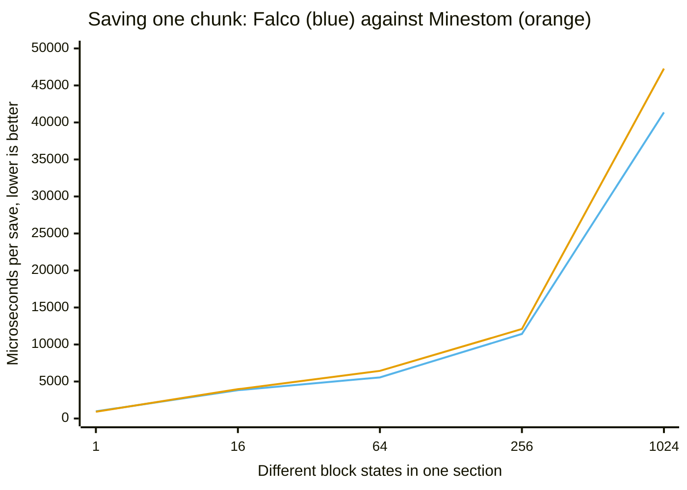

# How the Anvil loader is built

`FalcoAnvilLoader` reads and writes chunks in the Anvil region file format (`r.<x>.<z>.mca`) as a
`net.minestom.server.instance.ChunkLoader`. This page is about its internals: the pipeline a chunk
passes through, which class owns which responsibility, and where the time and the memory actually
go. It is written for someone reviewing the claims made for the loader.

To *use* the loader, see [How-to Load an Anvil world](../how-to/load-an-anvil-world.md). To decide whether to adopt it at all, see
[Explanation Choosing between Falco and the built-in loader](choosing-between-falco-and-the-built-in-loader.md).

> **Read this before quoting a number.** Every figure on this page comes from a JMH benchmark run on
> *one* machine, on *one* JVM, under *one* load, and none of them is an absolute statement about
> chunk loading. How the numbers were produced is in
> [Explanation What the benchmarks establish](what-the-benchmarks-establish.md); why they are believable and what they do not
> license is in [Explanation What a measurement here means](what-a-measurement-here-means.md), which also carries the one definition
> of what the `±` means. The tables themselves live on [Reference Measured results](../reference/measured-results.md).

## Architecture

### The three-stage pipeline

Both loading and saving are split into three stages. The point of the split is that no CPU-bound
work happens while a lock is held. Decompression, NBT parsing, palette conversion and compression
are the expensive parts of chunk IO; if they run inside a per-region lock, adding threads adds
contention and nothing else, because every thread touching the same region file has to wait for
them.



Plain text form:

```
loadChunk:  read raw bytes  ->  inflate + parse + decode  ->  apply to chunk
            (no region lock)      (no lock at all)             (chunk write lock)

saveChunk:  clone sections  ->  encode + write NBT + deflate  ->  write sectors
            (chunk read lock)     (no lock at all)                 (region lock)
```

Concretely:

* **Load stage 1** — `RegionFile.readRaw` returns the still-compressed payload and takes no lock;
  it uses `FileChannel.read(ByteBuffer, long)`, which does not mutate the channel position and is
  therefore safe from several threads
  ([`RegionFile#readRaw`](https://github.com/OneLiteFeatherNET/Falco/blob/main/falco-anvil/src/main/java/net/onelitefeather/falco/anvil/RegionFile.java),
  [`RegionFile#readEntry`](https://github.com/OneLiteFeatherNET/Falco/blob/main/falco-anvil/src/main/java/net/onelitefeather/falco/anvil/RegionFile.java),
  [`RegionFile#readFully`](https://github.com/OneLiteFeatherNET/Falco/blob/main/falco-anvil/src/main/java/net/onelitefeather/falco/anvil/RegionFile.java)).
  Taking no lock does not mean reading whatever is on disk: a chunk which is rewritten releases its
  sector range, and the allocator may hand that range to the next write of any chunk while the reader
  is still inside it. Each of the 1024 entries therefore carries a version counter which a writer
  raises on entry to and on exit from its critical section. The reader takes the counter, rejects an
  odd one, reads the bytes and takes the counter again; anything but an unchanged even counter makes
  it start over, and after four attempts it falls back to the writer lock so a chunk which is
  rewritten in a loop cannot starve it
  ([`RegionFile#readRaw`](https://github.com/OneLiteFeatherNET/Falco/blob/main/falco-anvil/src/main/java/net/onelitefeather/falco/anvil/RegionFile.java),
  the counters in [`RegionFile.versions`](https://github.com/OneLiteFeatherNET/Falco/blob/main/falco-anvil/src/main/java/net/onelitefeather/falco/anvil/RegionFile.java),
  the four in [`RegionFile.OPTIMISTIC_ATTEMPTS`](https://github.com/OneLiteFeatherNET/Falco/blob/main/falco-anvil/src/main/java/net/onelitefeather/falco/anvil/RegionFile.java)).
  Readers are never serialised against each other and never delay a writer.
* **Load stage 2** — decompression and NBT parsing happen in the caller
  ([`FalcoAnvilLoader#loadChunk`](https://github.com/OneLiteFeatherNET/Falco/blob/main/falco-anvil/src/main/java/net/onelitefeather/falco/anvil/FalcoAnvilLoader.java)).
  `decodeSections` then returns a `List<DecodedSection>`
  ([`FalcoAnvilLoader#decodeSections`](https://github.com/OneLiteFeatherNET/Falco/blob/main/falco-anvil/src/main/java/net/onelitefeather/falco/anvil/FalcoAnvilLoader.java)),
  and `loadChunk` calls it **before** it takes the chunk lock.
  Everything costly happens here: resolving every palette entry through the resolvers, deriving the
  bits per entry, validating the packed arrays and reading the light arrays. The result is a list of
  immutable records carrying the section index, the decoded block and biome `PaletteData` and the
  two light arrays
  ([`FalcoAnvilLoader.DecodedSection`](https://github.com/OneLiteFeatherNET/Falco/blob/main/falco-anvil/src/main/java/net/onelitefeather/falco/anvil/FalcoAnvilLoader.java)).
* **Load stage 3** — the chunk write lock is taken, each record is transferred via
  `DecodedSection.applyTo(chunk)`, the block entities are placed, and the lock is released
  ([`FalcoAnvilLoader#loadChunk`](https://github.com/OneLiteFeatherNET/Falco/blob/main/falco-anvil/src/main/java/net/onelitefeather/falco/anvil/FalcoAnvilLoader.java),
  [`FalcoAnvilLoader#applyBlockEntities`](https://github.com/OneLiteFeatherNET/Falco/blob/main/falco-anvil/src/main/java/net/onelitefeather/falco/anvil/FalcoAnvilLoader.java)).
  The guarded region performs no parsing and no palette resolution at all — only writes into
  `Section.skyLight()`, `Section.blockLight()`, `Section.blockPalette()` and `Section.biomePalette()`
  ([`FalcoAnvilLoader.DecodedSection#applyTo`](https://github.com/OneLiteFeatherNET/Falco/blob/main/falco-anvil/src/main/java/net/onelitefeather/falco/anvil/FalcoAnvilLoader.java)).
  This split is the concrete implementation of the pipeline: the record type exists purely to carry
  decoded state across the lock boundary.
* **Save stage 1** — the chunk **read** lock is held only long enough to clone every `Section` and
  collect the block entities
  ([`FalcoAnvilLoader#snapshot`](https://github.com/OneLiteFeatherNET/Falco/blob/main/falco-anvil/src/main/java/net/onelitefeather/falco/anvil/FalcoAnvilLoader.java)).
* **Save stage 2** — encoding, NBT serialisation and deflate run on the clones, outside every lock
  ([`FalcoAnvilLoader#snapshot`](https://github.com/OneLiteFeatherNET/Falco/blob/main/falco-anvil/src/main/java/net/onelitefeather/falco/anvil/FalcoAnvilLoader.java),
  [`FalcoAnvilLoader#encodeSection`](https://github.com/OneLiteFeatherNET/Falco/blob/main/falco-anvil/src/main/java/net/onelitefeather/falco/anvil/FalcoAnvilLoader.java),
  [`FalcoAnvilLoader#saveChunk`](https://github.com/OneLiteFeatherNET/Falco/blob/main/falco-anvil/src/main/java/net/onelitefeather/falco/anvil/FalcoAnvilLoader.java)).
* **Save stage 3** — the region lock covers sector allocation, the payload write, the 8-byte header
  entry update and, for an oversized chunk, the rename which puts its external file in place. The
  header entry decides which of the two storage locations a reader has to follow, so the entry and
  the file have to change together; only the bytes of the external file are written before the lock
  is taken, into a staging file next to the region file
  ([`RegionFile#writeRaw`](https://github.com/OneLiteFeatherNET/Falco/blob/main/falco-anvil/src/main/java/net/onelitefeather/falco/anvil/RegionFile.java),
  [`RegionFile#placeExternal`](https://github.com/OneLiteFeatherNET/Falco/blob/main/falco-anvil/src/main/java/net/onelitefeather/falco/anvil/RegionFile.java),
  [`RegionFile.STAGING_SUFFIX`](https://github.com/OneLiteFeatherNET/Falco/blob/main/falco-anvil/src/main/java/net/onelitefeather/falco/anvil/RegionFile.java)).

`supportsParallelLoading()` and `supportsParallelSaving()` both return `true`
([`FalcoAnvilLoader#supportsParallelLoading`](https://github.com/OneLiteFeatherNET/Falco/blob/main/falco-anvil/src/main/java/net/onelitefeather/falco/anvil/FalcoAnvilLoader.java),
[`FalcoAnvilLoader#supportsParallelSaving`](https://github.com/OneLiteFeatherNET/Falco/blob/main/falco-anvil/src/main/java/net/onelitefeather/falco/anvil/FalcoAnvilLoader.java)),
so `InstanceContainer` dispatches loads onto virtual threads
([Minestom `InstanceContainer.java:362-372`](why-a-second-anvil-loader.md#sources)).

### Classes and their responsibility

Every class in `net.onelitefeather.falco.anvil` has exactly one job, which is what makes
most of the package testable without a running server.

| Class | Single responsibility |
| --- | --- |
| `RegionConstants` | Layout constants of the region format and pure offset/index arithmetic. No state. |
| `SectorAllocator` | Tracks used sectors in a `BitSet`, first-fit allocation, reuse of freed ranges, overlap detection. No file access. |
| `RegionFile` | Byte container for one `.mca` file: header tables, sector placement, raw read/write, `.mcc` overflow. Knows nothing about NBT or Minestom. |
| `ChunkCompression` | The compression scheme byte: id mapping, external flag, compress/decompress. |
| `BitPacker` | Packing and unpacking of palette indices into `long[]`, and derivation of bits-per-entry. Pure functions. |
| `PaletteData` | Immutable palette + packed indices pair; construction from disk, construction from raw values, unpacking. |
| `PaletteEntryResolver` | Interface between named format entries and numeric server ids. |
| `BlockPaletteResolver` | Block name/properties ↔ Minestom block state id, with air fallback. |
| `BiomePaletteResolver` | Biome name ↔ registry id, with plains fallback and lazily resolved registry. |
| `NbtReads` | Strict accessors for Adventure NBT: a missing or mistyped key is an error, not a default. |
| `SectionCodec` | Palette container (`palette` + `data`) ↔ `PaletteData`, for blocks and biomes. |
| `AnvilDiagnostics` | Throttling of repeated warnings and the counters reported on close. Thread safe. |
| `AnvilChunkException` | The unchecked failure signalling that an existing chunk could not be read. |
| `FalcoAnvilLoader` | Orchestration: region file cache, the three stages, block entities, logging, `saveChunks` scheduling. |

`NbtReads` exists because `CompoundBinaryTag` getters return defaults for missing or mistyped keys.
For chunk data that default is dangerous: a malformed region file would decode into an empty chunk
which then overwrites the real data on the next save
([`NbtReads`](https://github.com/OneLiteFeatherNET/Falco/blob/main/falco-anvil/src/main/java/net/onelitefeather/falco/anvil/NbtReads.java)).
It also avoids the array-tag iterators of Adventure 5.1.1, which stop one entry early
([`NbtReads#longArray`](https://github.com/OneLiteFeatherNET/Falco/blob/main/falco-anvil/src/main/java/net/onelitefeather/falco/anvil/NbtReads.java),
[`NbtReads#intArray`](https://github.com/OneLiteFeatherNET/Falco/blob/main/falco-anvil/src/main/java/net/onelitefeather/falco/anvil/NbtReads.java)).

### Lazy registry resolution

`BiomePaletteResolver` does **not** read the biome registry in its constructor. It stores a
`Supplier<DynamicRegistry<Biome>>` and resolves it on first use, behind double-checked locking on a
`volatile` field that holds the registry itself, not a wrapping record
([`BiomePaletteResolver.registrySupplier`](https://github.com/OneLiteFeatherNET/Falco/blob/main/falco-anvil/src/main/java/net/onelitefeather/falco/anvil/BiomePaletteResolver.java),
[`BiomePaletteResolver.resolvedRegistry`](https://github.com/OneLiteFeatherNET/Falco/blob/main/falco-anvil/src/main/java/net/onelitefeather/falco/anvil/BiomePaletteResolver.java),
[`BiomePaletteResolver#registry`](https://github.com/OneLiteFeatherNET/Falco/blob/main/falco-anvil/src/main/java/net/onelitefeather/falco/anvil/BiomePaletteResolver.java)).
There is no fallback id to pair it with any more: an unknown biome is now handed to an
`UnknownEntryPolicy` (see [Replaceable policies](../reference/replaceable-policies.md)) rather than falling back to
a hardcoded plains id stored next to the registry, so the single volatile write publishes only the
`DynamicRegistry<Biome>` itself.

The reason is a hard ordering constraint. `MinecraftServer.getBiomeRegistry()` dereferences the
static `serverProcess` field (Minestom `MinecraftServer.java:280`), which stays `null` until
`MinecraftServer.init(..)` assigns it through `updateProcess` (`MinecraftServer.java:85-88`,
`:95-99`). Calling it earlier throws. Resolving the registry in the constructor would therefore make
a loader impossible to construct before `MinecraftServer.init(..)` has run — which is exactly when
worlds and map providers are normally set up. Deferring the lookup to the first decoded biome
palette means the loader can be constructed at any point during startup, and the registry is read
only once a chunk is actually being loaded.

The same constraint is what makes the Minestom `AnvilLoader` hard to use early and hard to unit
test: it reads the registry in a static initialiser (`instance/anvil/AnvilLoader.java:46-48`), so
merely referencing the class before `init` fails. The two-argument constructor of
`BiomePaletteResolver` exists so a test can inject a registry without a server
([`BiomePaletteResolver(AnvilDiagnostics, Supplier)`](https://github.com/OneLiteFeatherNET/Falco/blob/main/falco-anvil/src/main/java/net/onelitefeather/falco/anvil/BiomePaletteResolver.java)).

`BlockPaletteResolver` needs no such treatment: `Block.fromKey` and `Block.fromStateId` are static
registry lookups performed per palette entry, not cached at class initialisation
([`BlockPaletteResolver#toId`](https://github.com/OneLiteFeatherNET/Falco/blob/main/falco-anvil/src/main/java/net/onelitefeather/falco/anvil/BlockPaletteResolver.java),
[`BlockPaletteResolver#toEntry`](https://github.com/OneLiteFeatherNET/Falco/blob/main/falco-anvil/src/main/java/net/onelitefeather/falco/anvil/BlockPaletteResolver.java)).

## Performance and memory

Two kinds of statement appear below. The **structural** differences are visible in the source of both
implementations and are marked as such; they need no benchmark and cannot be argued away as noise.
The **measured** ones come from the JMH benchmarks in `falco-benchmarks/src/jmh` — how to re-run them
is in [What the benchmarks establish](what-the-benchmarks-establish.md) — and each table carries the configuration it was produced under.
Where a cost is called dominant without a benchmark name attached, it comes from a one-off
micro-measurement taken while designing the loader and no run record was kept; treat those as orders
of magnitude and nothing finer.

Every measured figure below comes from a class annotated `@Fork(1)`, and every table below was
measured at that setting, so the `±` after a mean describes the spread between the measurement
iterations of a single JVM process and says nothing about how the number would move across JVM
launches. There is exactly one exception on this page, and it is called out where it appears: the
four-thread control run under
[Measured: concurrent readers of one region file](#measured-concurrent-readers-of-one-region-file)
was run with `-f 2`, so its `±` does cover the difference between two JVM launches. The one
definition of that quantity, and what it does and does not bound, is in
[What a measurement here means](what-a-measurement-here-means.md); it is stated there once rather than repeated here.

Two facts shaped every decision below. In the load path, zlib inflate plus NBT parsing dominate —
palette handling is a small fraction of the total. In the save path, deflate dominates everything
else. Both come from the design-time micro-measurements described above rather than from a published
table, so they are the reason for a decision and not evidence for a factor. Optimising the palette
would therefore have been pointless; keeping compression and parsing **out of the locks** is where
the time actually is.

### Measured: concurrent readers of one region file

`RegionFileComparisonBenchmark` measures the region file of Falco against the one Minestom ships with,
on the same stored bytes, through the same Adventure writer at the same compression level, from a
stored chunk to a parsed compound. It lives in `net.minestom.server.instance.anvil` because
Minestom's `RegionFile` is package-private — the same reason the light comparison lives in Minestom's
light package. Minestom's `AnvilLoader` itself cannot be reached from a benchmark fork at all: its
static fields read the biome registry and the block state count, so the class initialiser fails
before any measurement starts. The region file reads no registry and is measurable directly.

```
java -jar build/libs/falco-*-jmh.jar "RegionFileComparisonBenchmark.(falco|minestom)Read" \
     -f 1 -wi 3 -i 5 -t <threads> -p distinctStates=200
```

| Threads | Falco | Minestom | What the row supports |
| ---: | ---: | ---: | --- |
| 1 | 1 089 ± 48 µs/op | 1 045 ± 112 µs/op | Intervals overlap over `[1 041, 1 137]` against `[933, 1 157]`. No difference is resolvable at this precision, in either direction. |
| 2 | 1 174 ± 71 µs/op | 103 437 ± 856 306 µs/op | Minestom's half-width is 8.3× its mean. No factor may be quoted. What is established is that its read time stops being predictable. |
| 4 | 1 370 ± 200 µs/op | 302 704 ± 674 429 µs/op | Half-width 2.2× the mean. Same reading as the row above, no factor. |
| 8 | 2 282 ± 248 µs/op | 297 075 ± 593 563 µs/op | Half-width 2.0× the mean. Same reading, no factor. |

<sub>`RegionFileComparisonBenchmark.falcoRead` / `.minestomRead`, `distinctStates = 200`, one thread
count per row via `-t` (JMH takes one `-t` per run, so the four rows are four separate runs), one
fork, 3 warmup and 5 measurement iterations of 1 s as the class annotates them, `-Xms1g -Xmx1g`, JMH
1.37, one 16-core machine recorded as not idle, no `results.json` committed. One fork: the `±`
covers variance between iterations of one JVM, not between JVM launches — see
[What a measurement here means](what-a-measurement-here-means.md).</sub>

**`RegionFileComparisonBenchmark` was run twice in this form, and the table above is the second of
the two runs.** The first is the four-row table
[Measured results](../reference/measured-results.md#the-region-file-against-the-one-minestom-ships-with) owns and
[What the benchmarks establish](what-the-benchmarks-establish.md) reproduces; **that first run is the canonical one**, it is where a
correction is made, and the table above is an independent second run published only on this page.
Neither supersedes the other and neither is an erratum for the other — they are two measurements of
the same thing on two different days.

The two agree on Falco at every thread count and disagree wildly on Minestom: at one thread
1 060 ± 55 there against 1 045 ± 112 µs/op here, at two 2 200 ± 445 against 103 437 ± 856 306, at
four 11 021 ± 16 470 against 302 704 ± 674 429 — and at eight the run that measured the higher of
the two swaps over, 530 905 ± 1 928 261 there against 297 075 ± 593 563 here. That last clause is
about which *run* came out higher, not about which *loader*: Minestom's mean is above Falco's at
two, four and eight threads in both runs. Neither run's date was recorded and the two provenance
lines describe the same configuration, so nothing distinguishes them but the state of the machine on
the day.

That disagreement is itself the result. No row of one table may be held against a row of the other,
and **the magnitude of Minestom's collapse is not a quantity this project has measured.** Two things
do reproduce across both runs, and they are what the design rests on. The direction: at two, four and
eight threads Minestom's mean is the higher of the two in both runs, and at one thread it is the
lower in both. And the loss of predictability: at four and at eight threads Minestom's half-width
exceeds its own mean in both runs, while Falco's stays inside 15 % of its own at every point of
both.

**The row that carries the argument is a separate, two-fork run**, because it is the only one here
that does not rest on a single JVM. Repeated at four threads with two forks and ten iterations, which
tightens the spread considerably: Falco **1 325.6 ± 21.1 µs/op** against Minestom
**359 690.8 ± 97 498.3 µs/op**. Both intervals — `[1 304.5, 1 346.7]` and `[262 192.5, 457 189.1]` —
are disjoint, and separated by more than two orders of magnitude, so the direction is not in
question. Minestom's half-width is 27 % of its mean, which is what bounds how precisely the gap may
be stated: the two intervals put
it between roughly 190× and 350×, and no more precisely than that. That bound is a property of this
one session and of nothing else: the two single-fork runs measured the same four-thread Minestom read
at 11 021 ± 16 470 and at 302 704 ± 674 429 µs/op, so the magnitude moves by more than an order of
magnitude between sessions. The point estimate is not the finding, and neither is the bound; the
finding is that the read time stops being predictable.

<sub>`RegionFileComparisonBenchmark.falcoRead` / `.minestomRead`, `distinctStates = 200`, `-t 4`, two
forks, ten measurement iterations, warmup unrecorded, `-Xms1g -Xmx1g`, JMH 1.37, one 16-core machine
recorded as not idle, no `results.json` committed. Two forks: the `±` here does cover the difference
between two JVM launches, which no other table on this page does.</sub>

Four things this measurement says, including the ones that do not flatter Falco:

- **On one thread there is no advantage, and none is claimed.** The two means differ by 4 % and the
  intervals overlap; that is not evidence that Falco is slower, and it is not evidence that the two
  are equal either. It is a row on which the measurement resolves nothing. The design pays off under
  contention and nowhere else.
- **Falco degrades gently.** From one to eight threads its mean grows by roughly a factor of 2, from
  1 089 to 2 282 µs/op, which is what sharing a disk looks like. That comparison is between two
  separate JMH sessions — JMH takes one `-t` per run — so the two intervals do not compose into a
  bound and none is quoted; what the four rows support is the shape, not a factor between them.
  Minestom does not degrade in this run; its time stops being predictable at all.
- **Minestom's three contended rows cannot carry a factor and none is printed.** A half-width larger
  than the mean means the measurement does not constrain the value: the lower end of every one of
  those three intervals is negative. Loss of predictability under contention is the finding, and it
  is a stronger one than a number would be, because it is what an operator actually experiences.
- **The size of the collapse is not explained.** Pure serialisation of a 1 045 µs operation across
  four threads predicts roughly 4 200 µs, not 360 000 — and that comparison itself mixes two runs, so
  it is an order-of-magnitude observation and not a derived quantity. The direction reproduces across
  the single-fork and the two-fork run; the mechanism behind the magnitude has not been investigated,
  and lock convoying, scheduler interaction and background load on a machine recorded as not idle are
  all still open. Do not quote the factor as if it were understood.

The same measurement as a picture. On one thread the two loaders sit on top of each other; from two
threads onwards one of them stays roughly where it was and the other leaves the chart.



`xychart-beta` cannot draw a legend, so it has to be said instead: the line running along the bottom
is **Falco** (blue in every chart of this document), the one climbing away from it is **Minestom**
(orange). Falco is not actually flat there. It only looks flat because the scale has to reach 300 000
to fit the other line at all. Its own shape is the next chart, and it is the same four numbers.



**Why the first chart looks like that.** Picture a shop with a single till. Minestom's region file
has one lock per file, and it holds that lock not only while it fetches the bytes from disk, but also
while it unpacks them and reads the structure inside them — and the unpacking and the reading are
nearly all of the work. So one customer occupies the till for the entire purchase, and everybody else
stands in the queue. Adding threads adds people to the queue; it does not add tills. Falco holds the
lock only for fetching the bytes and does the unpacking and reading outside it, so several threads
are served at the same time. That is also why the second chart still rises rather than staying level:
those threads do share one disk, and going from one to eight of them costs roughly a factor of 2 — but they
spend that time working, not waiting.

Two things the charts are not allowed to imply. First, a drawn line is a mean without its spread, and
at two threads the Minestom measurement is 103 437 ± 856 306 µs/op — an uncertainty eight times the
value itself. That point says "sometimes catastrophic", not "this is what it costs"; the four-thread
control run with two forks is the trustworthy one. Second, standing in a queue does not explain how
high the line goes, as the third bullet above says.

### Measured: saving a chunk

`ChunkSaveComparisonBenchmark` runs the whole save path of both loaders over the same chunk, varying
how many distinct block states a section holds — the axis on which the palette deduplication differs
(linear scan per block against a hash lookup). Both loaders are measured **as they ship**, and that
includes a compression level they do not share: Minestom writes at zlib level 6, Falco at
`ChunkCompression.DEFAULT_LEVEL`, which is 2
([`ChunkCompression.DEFAULT_LEVEL`](https://github.com/OneLiteFeatherNET/Falco/blob/main/falco-anvil/src/main/java/net/onelitefeather/falco/anvil/ChunkCompression.java),
`ChunkSaveComparisonBenchmark.MINESTOM_LEVEL`). Not equalising it is deliberate — the level is part
of what a user of the loader actually gets — but it means **the difference below is not attributable
to the palette algorithm alone**. The class ships `compressFalcoLevel` and `compressMinestomLevel`
for exactly that reason: they measure the level's own contribution so it can be subtracted.

**The table below is the only published output of `ChunkSaveComparisonBenchmark`, and it is half of
the class.** Four methods over five `distinctStates` levels make twenty configurations. The ten
belonging to `falcoSave` and `minestomSave` are below, drawn as five rows because each row is one
Falco figure against its Minestom counterpart — [What the benchmarks establish](what-the-benchmarks-establish.md) and
[Measured results](../reference/measured-results.md) count those same measurements as the five published rows, which
is the same half of the class described two ways. The ten configurations belonging to
`compressFalcoLevel` and `compressMinestomLevel` have never been run into a published figure, which
is why the subtraction above has not been performed on any row here. Where the rest of this
documentation calls part of this class unpublished, that is the part it means.

```
java -jar build/libs/falco-*-jmh.jar "ChunkSaveComparisonBenchmark.(falco|minestom)Save" -f 1 -wi 3 -i 6
```

| Distinct states | Falco | Minestom | What the row supports |
| ---: | ---: | ---: | --- |
| 1 | 968 ± 52 µs/op | 918 ± 39 µs/op | `[916, 1 020]` against `[879, 957]` — overlap. No difference resolvable. |
| 16 | 3 826 ± 279 µs/op | 3 959 ± 227 µs/op | `[3 547, 4 105]` against `[3 732, 4 186]` — overlap. No difference resolvable. |
| 64 | 5 555 ± 305 µs/op | 6 435 ± 421 µs/op | `[5 250, 5 860]` against `[6 014, 6 856]` — **disjoint**. Falco faster, conservatively 1.03× to 1.31×. |
| 256 | 11 427 ± 980 µs/op | 12 095 ± 1 326 µs/op | `[10 447, 12 407]` against `[10 769, 13 421]` — overlap. No difference resolvable. |
| 1 024 | 41 361 ± 4 082 µs/op | 47 273 ± 3 964 µs/op | `[37 279, 45 443]` against `[43 309, 51 237]` — overlap. No difference resolvable. |

<sub>`ChunkSaveComparisonBenchmark.falcoSave` / `.minestomSave`, `distinctStates` as the first column,
one thread (there is no `-t`, and thread count is a CLI-only axis in this harness), one fork, 3
warmup and 6 measurement iterations of 2 s — the measurement count overrides the class annotation,
which specifies 5 — `-Xms2g -Xmx2g`, JMH 1.37, one 16-core machine recorded as not idle, no
`results.json` committed. Compression levels differ between the two sides by design, see above. One
fork: the `±` covers variance between iterations of one JVM, not between JVM launches — see
[What a measurement here means](what-a-measurement-here-means.md).</sub>

Here the two lines lie almost on top of each other — and that, rather than a gap, is the finding.



No legend again: at the right-hand end the lower of the two lines is Falco (blue) and the upper one is
Minestom (orange). Towards the left they are hard to tell apart, and at the very first point Minestom
is the lower of the two.

**Why so little happens here.** Saving a chunk is mostly one single job: squeezing the data small
before it is written. Both loaders hand that job to the same library, so most of the time is the same
work on both sides. What differs is how each of them writes down the list of block types a section
contains. Minestom searches the list it has built so far once for every single block; Falco keeps a
lookup table and asks it directly — the difference between paging through a book for a word and going
to its index. That is a real structural difference, verifiable in the source of both without any
benchmark: `IntArrayList.indexOf` per block at `instance/anvil/AnvilLoader.java:447` against
`HashMap.computeIfAbsent` in `PaletteData#encode`. The more different block types a section holds,
the more often it matters. But it is a small part of a large job, and no arrangement of it changes
what the squeezing costs.

**What the chart must not be read as saying.** Its lines are means, and every point also carries a
spread that a line chart cannot draw. At four of the five points that spread is wider than the gap
you can see, so the chart draws a difference the measurement does not establish.

This is a far smaller effect than the read path and it has to be read conservatively. **Exactly one
of the five rows resolves a difference**: at 64 distinct states the intervals are disjoint and Falco
is between 1.03× and 1.31× faster. The other four overlap, including the one at 1 024 states where
the means are 14 % apart — `[37 279, 45 443]` and `[43 309, 51 237]` share the range 43 309 to
45 443, so that row establishes nothing, in either direction. At one distinct state the means put
Minestom ahead and the intervals overlap, so that row establishes nothing either.

Two consequences follow, and neither is comfortable. The O(n·m) against O(n) difference in the
palette is real as a property of the two algorithms, but at these palette sizes **this table does not
resolve it** — five points, one of which separates. And the one row that does separate is confounded:
Falco compresses at level 2 and Minestom at level 6 in the same measurement, and the level's
contribution has not been subtracted. Closing this gap costs one run of `compressFalcoLevel` and
`compressMinestomLevel`, which the class already ships.

The compression **level** is a configuration choice available to either loader rather than a property
of this one, and the benchmark ships the pair of methods that isolate it — `compressFalcoLevel`
against `compressMinestomLevel`. **Both have now been run**, at two forks across all five
`distinctStates` levels; the table is in
[Compression level 2 against level 6](../reference/measured-results.md#compression-level-2-against-level-6).

The 2.4× at 256 distinct states and the 3.1× at 1 024 that this section carried **survive the
measurement**: each falls inside the bounds its own parameter value produces, 2.07×–2.53× and
2.74×–3.20×. They were readings that had lost their conditions rather than wrong readings. The
**1.83×** quoted elsewhere with no `distinctStates` attached falls inside no row's bounds and has
been dropped.

The "roughly 3 % more stored bytes" does not survive in any form. Level 2 costs 1.64 % more at 16
distinct states, 4.56 % at 64 and **40.66 % at 1 024** — and that cost climbs in step with the time
advantage, so the cheap size and the flattering factor are never the same measurement. At one
distinct state the two levels are not separable in time at all.

### Time

| Property | Minestom | Falco | Why it matters |
|---|---|---|---|
| Work inside the region lock (read) | `readChunkData` holds one `ReentrantLock` across seek, read, decompression and NBT parsing (`instance/anvil/RegionFile.java:42`, `:57-89`) | The read takes no lock at all; only a read that keeps racing a writer falls back to it. Decompression, NBT parsing and palette conversion run in the caller (`RegionFile#readRaw`, `FalcoAnvilLoader#loadChunk`) | This is the whole reason `supportsParallelLoading()` is worth reporting. With the dominant cost inside the lock, extra threads queue instead of working. |
| Concurrent readers of one region | Serialised by the single lock, plus `RandomAccessFile.seek` makes shared use unsafe | `FileChannel.read(ByteBuffer, position)` does not touch the channel position, so readers of different chunks proceed in parallel (`RegionFile#readFully`) | Loading a spawn area touches many chunks of the same region file at once. |
| Chunk lock held while saving | Write lock over the entire serialisation of all sections (`instance/anvil/AnvilLoader.java:420-519`) | Read lock only while cloning sections into a snapshot; serialisation and compression happen after it is released (`FalcoAnvilLoader#snapshot`) | A write lock blocks readers of that chunk; on `saveChunksToStorage` this stalls the tick thread for the duration of the serialisation. |
| Header write per chunk save | Rewrites the full 8192-byte header whenever it is dirty (`RegionFile.java:182-196`) | Patches the 4-byte location entry and the 4-byte timestamp entry only (`RegionFile#writeEntry`) | 8192 bytes versus 8 bytes per save. It also narrows the window in which a crash can damage unrelated entries. |
| Palette deduplication on save | `IntArrayList.indexOf(value)` per block, i.e. a linear scan for each of the 4096 blocks of a section (`instance/anvil/AnvilLoader.java:447`), and the same for biomes (`:484`) | Hash-based index assignment, one lookup per block (`PaletteData#encode`) | Quadratic versus linear in the palette size. Sections with large palettes are the worst case. |
| Re-packing on load | `Palette#load` derives bits per entry from the palette length alone (`instance/palette/PaletteImpl.java:128-129`) | The stored `long[]` is validated and handed over unchanged when its bit width matches; only a mismatching file is unpacked and re-applied (`FalcoAnvilLoader#apply`) | The common case avoids an unpack/repack round trip entirely. The uncommon case is decoded correctly instead of silently misread. |

### Memory

| Property | Minestom | Falco | Why it matters |
|---|---|---|---|
| Concurrency of `saveChunks` | Interface default starts one virtual thread **per chunk** (`instance/ChunkLoader.java:62-82`) | Chunks are grouped per region, one task per group, bounded by a `Semaphore` of `max(Runtime.availableProcessors(), 2)` permits (`FalcoAnvilLoader#saveChunks`, `FalcoAnvilLoader.saveLimit`) | The number of chunk snapshots and compressed byte arrays alive at once is bounded by the permit count instead of by the number of chunks being saved. |
| Uniform sections | Written as a full palette container | Collapsed to a single palette entry with no data array (`PaletteData#single`) | A section of pure air or pure stone stores one entry instead of a 4096-entry index array. |
| Repeated array reads | — | `NbtReads` copies each array tag once and never calls `value()` twice | `value()` on an array tag copies on every call; a 4096-entry `long[]` is 32 KiB per copy. |
| Open file handles | Closed when the last chunk of a region unloads, using a reference count that the interface documents as unreliable (`instance/ChunkLoader.java:102-108`) | Closed when the last chunk **this loader loaded** is unloaded, plus a hard cap on open files as a backstop (`FalcoAnvilLoader.DEFAULT_OPEN_REGION_LIMIT`); never closed under a thread that is still reading or writing, and never opened again after `close()` | Unload calls arrive for foreign chunks, so a count alone either leaks handles or closes files still in use. The cap bounds the worst case regardless. |
| Block state cache | `static CompoundBinaryTag[]` sized by `Block.statesCount()`, populated without synchronisation (`instance/anvil/AnvilLoader.java:48`, `:526-531`) | No global cache; palette entries are built per section (`BlockPaletteResolver#toEntry`) | Trades a small amount of repeated work for no shared mutable state and no class-loading-time allocation proportional to the block registry. |

### What is not faster

Being explicit about this, because the table above is one-sided by construction:

- **On a single thread nothing here is faster, and nothing is measurably slower either.** Measured on
  the region file, Minestom's mean comes out marginally ahead — 1 045 ± 112 against 1 089 ± 48 µs/op
  — but the intervals overlap, so the row resolves no ordering at all. Everything the design buys is
  bought under contention. A single-threaded workload that reads one chunk at a time gains nothing
  here and pays for the version counter, the stricter NBT reads and the length validation; how much
  it pays is not resolved by any measurement on this page.
- **On the save path, four of five measured points resolve nothing** and the fifth is confounded by
  the compression level, as the save table above says. A save-heavy single-threaded server has no
  measured reason to switch.
- Falco does **not** parse NBT faster — both use adventure-nbt 5.1.1, and parsing is the largest single
  cost in the load path.
- Falco does **not** compress faster — both use `java.util.zip`. Falco's default level is lower
  (`ChunkCompression.DEFAULT_LEVEL` is 2 against Minestom's 6), which is a setting and not an
  algorithm; either loader could use either level.
- Falco writes **more** data per chunk in one respect: block entities are collected for uniform
  sections too, which Minestom skips (see the comparison table). That is a correctness fix, not a
  saving.
- The palette representation is a value record, so a section snapshot allocates. Minestom mutates a
  palette in place. Falco trades that allocation for the ability to build sections without holding
  the chunk lock.

## Testing

Thirteen test classes cover the anvil package. The **declared** column counts `@Test` and
`@ParameterizedTest` methods in the sources at commit `ca79507` and is checkable by reading them;
the **executed** column is what JUnit actually ran, and a `@ParameterizedTest` expands into one
executed test per argument set, which is why the two differ.

<!-- TODO(maintainer): the executed column and any suite-wide total come from a
     build/test-results/test/TEST-*.xml that is not committed and predates ca79507 — three declared
     counts have since moved (AnvilDiagnosticsTest 10 -> 18, FalcoAnvilLoaderIntegrationTest 19 ->
     25, AnvilDiagnosticsConcurrencyTest 5 -> 6), so the executed numbers below no longer describe
     this commit. Re-run ./gradlew test and refresh the column, or drop it. The declared column has
     been re-derived from the sources and is current. The former "575 tests" suite total and the
     "plus 3 for the factory" row have been removed: the factory test class does not exist. -->

| Test class | Declared methods | Executed tests | Needs a Minestom server |
| --- | --- | --- | --- |
| `BitPackerTest` | 12 (8 + 4 parameterized) | 34 | no |
| `PaletteDataTest` | 17 (16 + 1 parameterized) | 22 | no |
| `ChunkCompressionTest` | 14 (11 + 3 parameterized) | 21 | no |
| `FalcoAnvilLoaderIntegrationTest` | 25 | unrecorded | **yes** |
| `AnvilDiagnosticsTest` | 18 | unrecorded | no |
| `NbtReadsTest` | 15 | 15 | no |
| `RegionFileTest` | 14 | 14 | no |
| `SectionCodecTest` | 13 | 13 | no |
| `SectorAllocatorTest` | 9 (8 + 1 parameterized) | 10 | no |
| `RegionFileConcurrencyTest` | 6 | 6 | no |
| `AnvilDiagnosticsConcurrencyTest` | 6 | unrecorded | no |
| `FalcoAnvilLoaderLifecycleTest` | 5 | 5 | **yes** |
| `FalcoAnvilLoaderConcurrencyTest` | 4 | 4 | **yes** |
| **Total (anvil package)** | **158** | — | |

The total is the sum of the column above it and nothing else. `FileTestBase`, the fourteenth file in
`falco-anvil/src/test`, declares no test method of its own and therefore contributes none.

**Layers that need no server.** Ten of the thirteen classes import nothing from `net.minestom`. That
is a direct consequence of the class split: `RegionConstants`, `SectorAllocator`, `RegionFile`,
`ChunkCompression`, `BitPacker`, `PaletteData`, `SectionCodec`, `NbtReads` and `AnvilDiagnostics`
have no dependency on the server or its registries. `SectionCodecTest` exercises the codec through a
stub `PaletteEntryResolver`, so palette encoding and decoding are verified without touching the block
or biome registry. `RegionFileTest` works on real files in a `@TempDir`.

`RegionFileConcurrencyTest` and `AnvilDiagnosticsConcurrencyTest` hammer the same file and the same
diagnostics from several threads and stay server-free for the same reason.

**The layer that does.** Three classes need one: `FalcoAnvilLoaderIntegrationTest`,
`FalcoAnvilLoaderLifecycleTest` and `FalcoAnvilLoaderConcurrencyTest`. The first is annotated
`@ExtendWith(MicrotusExtension.class)` (Cyano) and receives an `Env` parameter, from which it builds
instances with `env.createEmptyInstance(loader)`
([`FalcoAnvilLoaderIntegrationTest`](https://github.com/OneLiteFeatherNET/Falco/blob/main/falco-anvil/src/test/java/net/onelitefeather/falco/anvil/FalcoAnvilLoaderIntegrationTest.java)).
It needs a real server because the loader touches `Chunk`, `Section`, `Palette`, the block registry
and the biome registry. It covers the chunk round trip through a real region file: absent chunks,
block round trip, region file placement in the dimension directory, NBT on blocks, block properties,
parallel saving and parallel loading. The other two use the same extension: the lifecycle test covers
what a closed loader does with further loads and saves, the concurrency test the loader under several
threads at once, including the open-region limit and the eviction of a region file that is being read.

`UnknownEntryPolicyTest` is the dedicated, server-free unit test for `BlockPaletteResolver` and
`BiomePaletteResolver`
([`UnknownEntryPolicyTest`](https://github.com/OneLiteFeatherNET/Falco/blob/main/falco-anvil/src/test/java/net/onelitefeather/falco/anvil/UnknownEntryPolicyTest.java)),
on top of the indirect coverage the integration test still gives both through a real chunk load. It
exercises the two resolvers directly against an `UnknownEntryPolicy` — the default, a refusing one and
one whose substitute is itself unresolvable — and pins the counting into `AnvilDiagnostics` that has to
keep happening regardless of what the policy does with an unknown entry. The biome cases use
`Biome.createDefaultRegistry()` rather than the biome registry of a running server
([`BiomePaletteResolver(AnvilDiagnostics, UnknownEntryPolicy, Supplier)`](https://github.com/OneLiteFeatherNET/Falco/blob/main/falco-anvil/src/main/java/net/onelitefeather/falco/anvil/BiomePaletteResolver.java)),
the package-private three-argument constructor that exists for exactly this: injecting both a policy
and a registry supplier without starting a server.

Run everything with:

```bash
./gradlew test
```


## Error handling and world consistency

The governing rule: **a chunk that exists on disk but cannot be read must not be reported as
absent.**

`ChunkLoader.loadChunk` uses `null` for "this loader has no data for that chunk". `InstanceContainer`
reacts by generating a replacement chunk, caching it and firing the load event
(`InstanceContainer.java:336-343`). That replacement is a normal, dirty chunk, so the next
`saveChunk` writes it over the bytes that failed to read. A transient IO error, a temporarily
unavailable mount or a parser bug therefore does not merely fail a load in Minestom — it destroys
the data it failed to read, without an error visible to the operator beyond one handled exception.

`FalcoAnvilLoader.loadChunk` returns `null` only for the two genuinely-absent cases: no region file
([`FalcoAnvilLoader#acquireRegion`](https://github.com/OneLiteFeatherNET/Falco/blob/main/falco-anvil/src/main/java/net/onelitefeather/falco/anvil/FalcoAnvilLoader.java)
returns `null` without `create`) and no location entry for the chunk
([`RegionFile#readEntry`](https://github.com/OneLiteFeatherNET/Falco/blob/main/falco-anvil/src/main/java/net/onelitefeather/falco/anvil/RegionFile.java)
returns `null`, handled in
[`FalcoAnvilLoader#loadChunk`](https://github.com/OneLiteFeatherNET/Falco/blob/main/falco-anvil/src/main/java/net/onelitefeather/falco/anvil/FalcoAnvilLoader.java)).
A chunk that is present but not fully generated also returns `null` after a throttled warning
([`FalcoAnvilLoader#isFullyGenerated`](https://github.com/OneLiteFeatherNET/Falco/blob/main/falco-anvil/src/main/java/net/onelitefeather/falco/anvil/FalcoAnvilLoader.java)),
which matches the intent of the format. Every other failure — malformed header, short read,
unsupported compression, broken NBT, palette index out of range — is logged with context, handed to
the exception manager and rethrown as `AnvilChunkException`
([`FalcoAnvilLoader#failedLoad`](https://github.com/OneLiteFeatherNET/Falco/blob/main/falco-anvil/src/main/java/net/onelitefeather/falco/anvil/FalcoAnvilLoader.java)).
`InstanceContainer` then completes the load future exceptionally instead of generating
(`InstanceContainer.java:367-372`), the chunk stays unloaded, and nothing overwrites it.

`AnvilChunkException` is an unchecked exception so it can cross the `ChunkLoader` interface, which
declares no checked exceptions
([`AnvilChunkException`](https://github.com/OneLiteFeatherNET/Falco/blob/main/falco-anvil/src/main/java/net/onelitefeather/falco/anvil/AnvilChunkException.java)).

`saveChunk` deliberately does **not** throw. It logs at error level, increments the error counter
and reports to the exception manager
([`FalcoAnvilLoader#saveChunk`](https://github.com/OneLiteFeatherNET/Falco/blob/main/falco-anvil/src/main/java/net/onelitefeather/falco/anvil/FalcoAnvilLoader.java)).
A failed save has already lost the in-memory state either way; propagating would additionally abort
the surrounding save of every other chunk. The one exception is a save on a **closed** loader: that
is a lifecycle error of the caller rather than a broken chunk, so it propagates as an
`IllegalStateException` and is not counted as a failed chunk. In `saveChunks` a task that fails is reported per group
in `awaitAll` ([`FalcoAnvilLoader#awaitAll`](https://github.com/OneLiteFeatherNET/Falco/blob/main/falco-anvil/src/main/java/net/onelitefeather/falco/anvil/FalcoAnvilLoader.java)),
and the error count surfaces again in the summary written by `close()`.


## The loader's lifecycle

`FalcoAnvilLoader(Path worldRoot, Key dimension)` takes the **world root**, not the region
directory. It resolves `worldRoot/dimensions/<namespace>/<value>/region` and falls back to
`worldRoot/region` when only the pre-26.1 layout exists
([`FalcoAnvilLoader#resolveRegionDirectory`](https://github.com/OneLiteFeatherNET/Falco/blob/main/falco-anvil/src/main/java/net/onelitefeather/falco/anvil/FalcoAnvilLoader.java)).

The loader implements `AutoCloseable`. `close()` flushes and closes every open region file and
writes the summary line
([`FalcoAnvilLoader#close`](https://github.com/OneLiteFeatherNET/Falco/blob/main/falco-anvil/src/main/java/net/onelitefeather/falco/anvil/FalcoAnvilLoader.java),
[`FalcoAnvilLoader#logSummary`](https://github.com/OneLiteFeatherNET/Falco/blob/main/falco-anvil/src/main/java/net/onelitefeather/falco/anvil/FalcoAnvilLoader.java)).
Call it on server shutdown. During operation a region file is closed on its own once the last chunk
this loader read from it has been unloaded, and the number of region files held in the cache is
capped by `DEFAULT_OPEN_REGION_LIMIT` (64, configurable through the three-argument constructor).

A region file is never closed while a thread is reading from or writing to it. Every access
registers itself on the cached handle first; an unload, an eviction or `close()` only drops the
handle from the cache, and the thread that leaves it last performs the actual close. That is why a
chunk load cannot fail because another thread unloaded a chunk of the same region, and why a save
needs no retry when the open-file limit evicts its file mid-write. The cap therefore bounds the
number of *cached* files exactly; the number of open descriptors can exceed it for the duration of
a single access.

After `close()` the loader refuses further work with an `IllegalStateException` instead of ignoring
it: `loadChunk`, `saveChunk` and `saveChunks` all throw. Returning `null` from a closed loader would
report the chunk as absent and make the server generate a replacement over the stored data, and
ignoring a save would drop chunk data during the very shutdown it belongs to. A task that is already
past that check and reaches the region cache during the close either finds its handle still valid
and finishes normally, or is refused the same way — it can never publish a handle that nothing
closes again.


## Why the policies are services

The guard above and the unknown-block/unknown-biome substitution described under
[Comparison with the built-in AnvilLoader](choosing-between-falco-and-the-built-in-loader.md) are not fixed
behaviour. Both are policies — plain interfaces the loader consults — discoverable through the
platform `ServiceLoader` or settable directly on the builder:

* [`ChunkVersionPolicy`](https://github.com/OneLiteFeatherNET/Falco/blob/main/falco-anvil/src/main/java/net/onelitefeather/falco/anvil/ChunkVersionPolicy.java)
  decides whether a chunk is readable at all:
  `void check(CompoundBinaryTag data, int minimumDataVersion) throws ChunkDataException`. The shipped
  [`DefaultChunkVersionPolicy`](https://github.com/OneLiteFeatherNET/Falco/blob/main/falco-anvil/src/main/java/net/onelitefeather/falco/anvil/DefaultChunkVersionPolicy.java)
  is the layout-then-version check described above, moved into this type rather than rewritten. A
  policy only decides and throws; it does not count or log — `FalcoAnvilLoader#checkVersion` still
  does both, so every diagnostic of a load stays in one place regardless of which policy ran.
* [`UnknownEntryPolicy`](https://github.com/OneLiteFeatherNET/Falco/blob/main/falco-anvil/src/main/java/net/onelitefeather/falco/anvil/UnknownEntryPolicy.java)
  decides what an unknown palette entry becomes: `String onUnknownBlock(String name,
  @Nullable CompoundBinaryTag properties)` and `String onUnknownBiome(String name)`, each returning a
  replacement *name* (not an id — the resolver that consults the policy already owns the registry
  lookup that turns a name into one) or throwing `AnvilChunkException` if the chunk should fail
  instead of carrying a substitute. `BlockPaletteResolver#toId` and `BiomePaletteResolver#toId`
  consult it exactly where they used to hard-code the substitution, and keep reporting the name to
  `AnvilDiagnostics` and the log regardless of what the policy does with it. The policy is not asked
  twice: if the name it returns is itself unknown, the resolver throws `IllegalStateException` rather
  than risk a loop. The shipped
  [`DefaultUnknownEntryPolicy`](https://github.com/OneLiteFeatherNET/Falco/blob/main/falco-anvil/src/main/java/net/onelitefeather/falco/anvil/DefaultUnknownEntryPolicy.java)
  always returns `"minecraft:air"` and `"minecraft:plains"` — byte-for-byte the values
  `BlockPaletteResolver` and `BiomePaletteResolver` hard-coded before this policy existed.

Each policy has two builder slots on `FalcoAnvilLoader.Builder`: an explicit instance
(`versionPolicy(ChunkVersionPolicy)`, `unknownEntryPolicy(UnknownEntryPolicy)`) or classpath discovery
(`discoverVersionPolicy()`, `discoverUnknownEntryPolicy()`). `FalcoAnvilLoader.builder()` defaults to
discovery for both, which is what keeps a loader built through the two-argument constructor behaving
the way it always did. `versionPolicy(null)` is the one way to leave the version policy unset — see
below; `unknownEntryPolicy(null)` is not the equivalent for the other policy, because a resolver
always needs an id to keep decoding, so it falls back to `DefaultUnknownEntryPolicy` instead.

Resolution — implemented in
[`ServiceResolution`](https://github.com/OneLiteFeatherNET/Falco/blob/main/falco-anvil/src/main/java/net/onelitefeather/falco/anvil/ServiceResolution.java)
and shared by both policies — follows three rules:

1. **The shipped default steps aside for a single foreign provider.** `falco-anvil` registers its own
   `DefaultChunkVersionPolicy` and `DefaultUnknownEntryPolicy` in its own `META-INF/services`, so a
   third party registering one provider of its own would otherwise always find two candidates and
   always hit the next rule. **Two *foreign* providers throw**, naming both classes, so a caller
   cannot end up with a policy nobody explicitly chose.
2. **The builder slot and discovery are mutually exclusive.** Setting both throws
   `IllegalStateException`. Calling `versionPolicy(...)`/`unknownEntryPolicy(...)` always turns
   discovery off for that policy, whatever value is passed — including `null` — so an explicit
   decision always wins over the classpath when only it is used.
3. **Discovery loads with the service's own classloader, not the thread context classloader.** Under
   CloudNet, extension or plugin classloaders the context loader may not see the `falco-anvil` jar at
   all; discovery would then find nothing and silently put the pre-`21w43a` air chunk back — the exact
   failure mode this guard exists to end.

Resolution happens once, when the loader is built, not per chunk.

There is a third service of the same shape,
[`ChunkMigrator`](https://github.com/OneLiteFeatherNET/Falco/blob/main/falco-anvil/src/main/java/net/onelitefeather/falco/anvil/ChunkMigrator.java),
which *translates* a chunk an older version wrote rather than deciding what to do about it. It
differs from these two in one respect: it is not consulted at all unless a caller selects a
`ChunkMigrationMode`, and selecting one turns discovery on by itself instead of requiring a second
call — a caller who has chosen a mode has already said that chunks are to be migrated. A loader told
to migrate with no engine on the classpath fails to build rather than migrating nothing. See
[How world migration works](how-world-migration-works.md) for the three modes, the backup that cannot be switched off, and
the engine behind them.

**The guard is fully optional, and losing it has a cost.** `falco-anvil` ships
`DefaultChunkVersionPolicy` as its own registered provider, so a normal dependency on the module has
the guard by default — losing it takes an exclusion somebody writes, not a classpath that happens to
be empty. But nothing stops a caller from removing it, either through that exclusion or through
`versionPolicy(null)`, and the consequence is exactly what it was before this guard existed: **a
loader with no guard provider reads a pre-`21w43a` world as air again, with no error and no log
line.** The opening log line of the loader (see [Logging](#why-only-three-classes-log)) reports which version policy was
resolved, or the word `none`, for exactly this reason — without it, losing the guard would be as
invisible as the world it stops reading correctly.


## Why only three classes log

Only three classes own a logger:

| Class | Logger | Why |
| --- | --- | --- |
| `FalcoAnvilLoader` | yes ([`FalcoAnvilLoader.LOGGER`](https://github.com/OneLiteFeatherNET/Falco/blob/main/falco-anvil/src/main/java/net/onelitefeather/falco/anvil/FalcoAnvilLoader.java)) | It is the only layer that knows chunk coordinates, region directory and dimension. |
| `BlockPaletteResolver` | yes ([`BlockPaletteResolver.LOGGER`](https://github.com/OneLiteFeatherNET/Falco/blob/main/falco-anvil/src/main/java/net/onelitefeather/falco/anvil/BlockPaletteResolver.java)) | Reports a substituted block name once; the loader never sees the substitution. |
| `BiomePaletteResolver` | yes ([`BiomePaletteResolver.LOGGER`](https://github.com/OneLiteFeatherNET/Falco/blob/main/falco-anvil/src/main/java/net/onelitefeather/falco/anvil/BiomePaletteResolver.java)) | Same, for biomes. |

`RegionFile`, `SectorAllocator`, `BitPacker`, `ChunkCompression`, `NbtReads`, `PaletteData`,
`SectionCodec`, `RegionConstants` and `AnvilDiagnostics` deliberately have none. They are leaf
classes that do not know which chunk, region or dimension they are working on, so any line they
logged would be context-free. Instead they throw with the facts they do have — the offending key
and its actual type ([`NbtReads#missing`](https://github.com/OneLiteFeatherNET/Falco/blob/main/falco-anvil/src/main/java/net/onelitefeather/falco/anvil/NbtReads.java)),
the declared length against the sector allocation
([`RegionFile#readEntry`](https://github.com/OneLiteFeatherNET/Falco/blob/main/falco-anvil/src/main/java/net/onelitefeather/falco/anvil/RegionFile.java)),
the long count against the entry count
([`PaletteData#read`](https://github.com/OneLiteFeatherNET/Falco/blob/main/falco-anvil/src/main/java/net/onelitefeather/falco/anvil/PaletteData.java)),
the conflicting sector ([`SectorAllocator#reserve`](https://github.com/OneLiteFeatherNET/Falco/blob/main/falco-anvil/src/main/java/net/onelitefeather/falco/anvil/SectorAllocator.java)).
The loader catches these and adds the context.

**Message schema.** Every loader message that concerns a chunk ends with the same trailer, so logs
can be grepped and parsed uniformly:

```
... chunk=[{},{}] region={} dim={}
```

for example
`Failed to load the chunk chunk=[{},{}] region={} dim={}`
([`FalcoAnvilLoader#failedLoad`](https://github.com/OneLiteFeatherNET/Falco/blob/main/falco-anvil/src/main/java/net/onelitefeather/falco/anvil/FalcoAnvilLoader.java)).
Messages that concern a whole region omit the `chunk=` part and keep `region={} dim={}`
([`FalcoAnvilLoader(Path, Key, int)`](https://github.com/OneLiteFeatherNET/Falco/blob/main/falco-anvil/src/main/java/net/onelitefeather/falco/anvil/FalcoAnvilLoader.java),
[`FalcoAnvilLoader#closeQuietly`](https://github.com/OneLiteFeatherNET/Falco/blob/main/falco-anvil/src/main/java/net/onelitefeather/falco/anvil/FalcoAnvilLoader.java),
[`FalcoAnvilLoader#close`](https://github.com/OneLiteFeatherNET/Falco/blob/main/falco-anvil/src/main/java/net/onelitefeather/falco/anvil/FalcoAnvilLoader.java),
[`FalcoAnvilLoader#acquireRegion`](https://github.com/OneLiteFeatherNET/Falco/blob/main/falco-anvil/src/main/java/net/onelitefeather/falco/anvil/FalcoAnvilLoader.java),
[`FalcoAnvilLoader#awaitAll`](https://github.com/OneLiteFeatherNET/Falco/blob/main/falco-anvil/src/main/java/net/onelitefeather/falco/anvil/FalcoAnvilLoader.java)).

**Throttling.** `AnvilDiagnostics` decides whether a report is emitted. `reportUnknownBlock` and
`reportUnknownBiome` return `true` only for the first occurrence of a distinct name, and only while
fewer than `MAX_TRACKED_NAMES = 64` names are tracked in that category
([`AnvilDiagnostics.MAX_TRACKED_NAMES`](https://github.com/OneLiteFeatherNET/Falco/blob/main/falco-anvil/src/main/java/net/onelitefeather/falco/anvil/AnvilDiagnostics.java),
[`AnvilDiagnostics#track`](https://github.com/OneLiteFeatherNET/Falco/blob/main/falco-anvil/src/main/java/net/onelitefeather/falco/anvil/AnvilDiagnostics.java)).
The cap matters because a broken or heavily modded world can contain an unbounded number of distinct
unknown names, which would otherwise grow the tracking sets indefinitely.

`reportPartialChunk(String)` throttles the same way but on a different key: it counts partial chunks
in a `ConcurrentHashMap<String, LongAdder>` keyed by the `Status` value the chunk carried and returns
`true` only for the first chunk of each distinct status, again while fewer than `MAX_TRACKED_NAMES`
statuses are tracked
([`AnvilDiagnostics#reportPartialChunk`](https://github.com/OneLiteFeatherNET/Falco/blob/main/falco-anvil/src/main/java/net/onelitefeather/falco/anvil/AnvilDiagnostics.java)).
A world holding several generation stages therefore names each of them once rather than once in
total, and the counts survive even for a status past the cap. The no-argument overload counts under
`AnvilDiagnostics.UNKNOWN_STATUS` for a caller that could not read the value
([`AnvilDiagnostics.UNKNOWN_STATUS`](https://github.com/OneLiteFeatherNET/Falco/blob/main/falco-anvil/src/main/java/net/onelitefeather/falco/anvil/AnvilDiagnostics.java)).

Three reports are once-per-loader, each behind its own `AtomicBoolean`: `reportMissingRegionFile`,
`reportMissingChunkEntry` and `reportSectionOutOfRange`
([`AnvilDiagnostics#reportMissingRegionFile`](https://github.com/OneLiteFeatherNET/Falco/blob/main/falco-anvil/src/main/java/net/onelitefeather/falco/anvil/AnvilDiagnostics.java),
[`AnvilDiagnostics#reportMissingChunkEntry`](https://github.com/OneLiteFeatherNET/Falco/blob/main/falco-anvil/src/main/java/net/onelitefeather/falco/anvil/AnvilDiagnostics.java),
[`AnvilDiagnostics#reportSectionOutOfRange`](https://github.com/OneLiteFeatherNET/Falco/blob/main/falco-anvil/src/main/java/net/onelitefeather/falco/anvil/AnvilDiagnostics.java)).
The loader calls the first two
([`FalcoAnvilLoader#loadChunk`](https://github.com/OneLiteFeatherNET/Falco/blob/main/falco-anvil/src/main/java/net/onelitefeather/falco/anvil/FalcoAnvilLoader.java))
and not the third; a section outside the world is logged at `TRACE` without going through the
diagnostics
([`FalcoAnvilLoader#decodeSections`](https://github.com/OneLiteFeatherNET/Falco/blob/main/falco-anvil/src/main/java/net/onelitefeather/falco/anvil/FalcoAnvilLoader.java)).
The name sets are `ConcurrentHashMap.newKeySet()`, the status map is a `ConcurrentHashMap` and the
counters are `LongAdder`, so reporting from many loader threads is safe
([`AnvilDiagnostics()`](https://github.com/OneLiteFeatherNET/Falco/blob/main/falco-anvil/src/main/java/net/onelitefeather/falco/anvil/AnvilDiagnostics.java)).

Consequence to be aware of: once 64 distinct unknown block names have been seen, further distinct
names are substituted silently. The counters still rise, and `unknownBlockCount()` saturates at 64.

**Close summary.** `close()` writes one line with loaded chunks, **skipped** chunks, saved chunks,
errors, distinct unknown blocks and distinct unknown biomes, plus the region/dimension trailer. It
is logged at `WARN` when the error count is greater than zero and at `INFO` otherwise, so a shutdown
that lost chunks does not read like a clean one
([`FalcoAnvilLoader#logSummary`](https://github.com/OneLiteFeatherNET/Falco/blob/main/falco-anvil/src/main/java/net/onelitefeather/falco/anvil/FalcoAnvilLoader.java)).

A **second** line follows it, and only on a run that skipped something: the breakdown of the skipped
chunks into the three reasons — no region file, no entry in the region file, not fully generated —
with the `Status` values of the partial chunks and their counts spelled out
([`FalcoAnvilLoader#logSkipSummary`](https://github.com/OneLiteFeatherNET/Falco/blob/main/falco-anvil/src/main/java/net/onelitefeather/falco/anvil/FalcoAnvilLoader.java),
[`FalcoAnvilLoader#describeStatuses`](https://github.com/OneLiteFeatherNET/Falco/blob/main/falco-anvil/src/main/java/net/onelitefeather/falco/anvil/FalcoAnvilLoader.java)).
It is separate rather than more fields on the line above because the three reasons only matter once
one of them fired, and it is logged at `WARN`. The distinction is the point of the pair: a loader
that returned nothing has to say which of the three reasons it returned nothing for, and "no region
file at all" and "the file exists and the chunk was never written into it" are two different faults
with two different remedies.

Levels in use, read off the call sites in
[`FalcoAnvilLoader`](https://github.com/OneLiteFeatherNET/Falco/blob/main/falco-anvil/src/main/java/net/onelitefeather/falco/anvil/FalcoAnvilLoader.java)
and the two resolvers: `INFO` for the loader opening and for a clean close; `WARN` for a throttled
data problem, for a close with errors and for the skip breakdown; `ERROR` for a failed chunk load,
a failed chunk save, a failed group of chunks in `saveChunks` and a region file that could not be
closed; `DEBUG` for a region file being opened or closed and for the first chunk found without a
region file or without an entry in one; `TRACE` for chunk unloads and skipped out-of-world sections.
The two absent-chunk reports sit at `DEBUG` rather than `WARN` on purpose — a chunk that was never
written is the normal state of an unexplored world, not a fault.


## Sources

Minestom sources cited here, at version `2026.06.20-26.1.2`:

* `net/minestom/server/instance/anvil/AnvilLoader.java`
* `net/minestom/server/instance/anvil/RegionFile.java`
* `net/minestom/server/instance/ChunkLoader.java`
* `net/minestom/server/instance/InstanceContainer.java`
* `net/minestom/server/instance/palette/PaletteImpl.java`
* `net/minestom/server/instance/palette/Palette.java`
* `net/minestom/server/utils/validate/Check.java`
* `net/minestom/server/instance/DynamicChunk.java`

Format reference: [Region file format](https://minecraft.wiki/w/Region_file_format),
[Chunk format](https://minecraft.wiki/w/Chunk_format).
Related: [Explanation How the concurrency design works](how-the-concurrency-design-works.md) ·
[Explanation Why a second Anvil loader](why-a-second-anvil-loader.md) · [Reference Measured results](../reference/measured-results.md)
