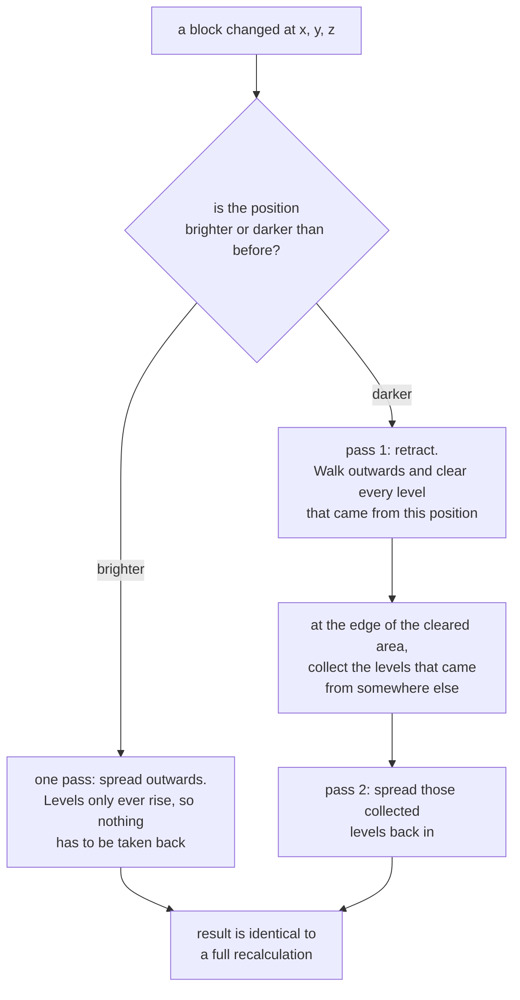

# How the light engine works

The propagation model `falco-light` uses, where its time and memory go, and the correctness details
that are worth knowing before trusting its output.

To *use* the engine, see [How-to Compute light for a loaded world](../how-to/compute-light-for-a-loaded-world.md). Whether it runs on your
workload at all is [Explanation When light computation actually runs](when-light-computation-actually-runs.md).

> **Experimental.** Every public type of `net.onelitefeather.falco.light` is annotated
> `@ApiStatus.Experimental`. The API may still change.

## Design

Eight types compute the light, each with one responsibility. Only the two on the right know Minestom
exists. A further five, listed in [Reference API surface and stability](../reference/api-surface-and-stability.md#light-engine-types),
decide *when* it is computed and never how.

```
                      ┌─ engine, no Minestom ─────────────┐   ┌─ adapter ──────────────┐
                      │                                   │   │                        │
  Chunk ──────────────┼──► int[] stateIds                 │   │  ChunkLightService     │
                      │         │                         │   │        │               │
                      │         ▼                         │   │        │ uses          │
                      │   SectionOpacity ◄── BlockLightSource ◄── MinestomBlockLight-  │
                      │         │            (one lookup   │   │        Source          │
                      │         ▼             per state)   │   │                        │
                      │   ChunkLightPropagator             │   │  writes back through   │
                      │         │  (crosses section        │   │  Light#set(byte[])     │
                      │         ▼   borders)               │   │                        │
                      │   List<LightNibbles> ──────────────┼───┼──►  Chunk sections     │
                      └───────────────────────────────────┘   └────────────────────────┘
```

| Type | Responsibility |
| --- | --- |
| `LightNibbles` | Storage. Two levels per byte, uniform sections without an array. |
| `BlockLightSource` | Abstraction over "how bright is this block and which faces does it block". |
| `SectionOpacity` | Precomputed table of those properties for one section. |
| `LightPropagator` | The breadth-first propagation, with reusable buffers. |
| `ChunkLightPropagator` | The same search across all sections of a chunk, so light crosses their borders. |
| `MinestomBlockLightSource` | Answers `BlockLightSource` from the block registry. |
| `ChunkLightState` | Keeps a calculated result and updates it incrementally, including the retraction pass and the sky heightmap. |
| `ChunkLightService` | Reads a chunk, runs the propagation, settles the borders against the neighbours, writes the result back. |

`BlockLightSource` exists for the same reason `PaletteEntryResolver` does in the Anvil package: it
keeps the registry out of the algorithm, so the propagation is verified with a handful of fake
blocks and no server at all.

## Where the resources are saved

### Time

The dominant cost of a naive propagation is not the search but the block lookups. A breadth-first
search reaches a block from up to six directions, and resolving palette → block → registry →
occlusion shape on each of those visits repeats the same work.

`SectionOpacity` resolves every **distinct state id** of a section exactly once when the table is
built and answers from two flat `byte[]` afterwards — an array index instead of a registry walk.
A section of 4096 stone blocks costs one lookup, which
`SectionOpacityTest#testEveryDistinctStateIsResolvedOnlyOnce` pins down.

Two further short cuts:

- A section without any emitting block returns immediately with a uniform dark result. No buffer is
  touched, no queue is built.
- Because a level drops by exactly one per block and the search is breadth-first, every position is
  reached with its final level on the first visit. No position is ever revisited or re-queued.

### Memory

- **Uniform sections carry no array.** `LightNibbles` keeps a single level and allocates the
  2048-byte array only when a level actually differs. Most sections of a world are either fully dark
  or fully lit, so this is the common case rather than an edge case. `fill` releases the array again.
- **A fully dark section reports an empty array** (`toArray().length == 0`), which is how the file
  format stores "no light" — nothing is written for it.
- **The propagator reuses its buffers.** The level buffer and the queue are allocated once per
  instance and cleared per run, so repeated propagation allocates nothing beyond the result. An
  instance is therefore reusable but thread confined — use one per worker rather than sharing one.
- **The queue is an `int[]`, not a collection.** No boxing, no growth: a section has 4096 positions
  and each is queued at most once, so the array is sized exactly once.
- **Building the table allocates nothing per block.** The lookup is a linear probing table over the
  raw state id, so no key is boxed and no value object is created; a resolved state is packed into a
  short that carries the occluded faces and the emission together. A run of one repeated state is
  answered from the previous block instead of the table, because the blocks of a world come in runs.
  This is what took the build of one section from 74 040 to 8 664 bytes per call, and it is the
  single largest reason for the times
  [further down](comparing-the-light-engine-with-minestoms.md).

  **That pair of numbers is the most robust quantitative claim on this page**, and worth more than
  any timing here. Allocation per invocation is essentially deterministic: it does not move with the
  fork count, the machine load, the JIT plan or the garbage collector, which is exactly what every
  timing on this page is vulnerable to. A reader who trusts nothing else can reproduce it with
  `-prof gc` and read `gc.alloc.rate.norm`.
  <!-- TODO(maintainer): the -prof gc output backing 74 040 and 8 664 is not committed anywhere.
       Attach the two lines from the profiler, with the benchmark method and the commit, and this
       becomes the one number on the page nobody can argue with. -->
  <sub>`SectionOpacity.of` over one section, before and after the change that removed the per-block
  lambda; from a `-prof gc` run whose output is not committed — parameter values, iteration counts
  and machine unrecorded.</sub>

## Correctness details worth knowing

**Occlusion is per face, not per block.** A great many block types of the game occlude some faces and
not others — slabs, stairs, snow, farmland, dirt paths, lecterns, stonecutters. A design storing one
flag per block answers those wrongly. `SectionOpacity` stores a six-bit mask per block;
`MinestomBlockLightSourceTest#testABottomSlabBlocksItsBottomFaceOnly` and
`#testATopSlabBlocksItsTopFaceOnly` pin the behaviour down on real block data, which is what makes
this a checked property rather than an assertion.
<!-- TODO(maintainer): the previous wording said "roughly one in seven block types". Nothing in the
     repository counts them, so the figure is not reproducible and has been replaced by the
     unquantified statement plus the test that actually pins the behaviour. Restore a number only
     with the query over the block registry that produces it. The same unsourced figure is still in
     the repository: the javadoc of BlockLightSource#blocksFace says "Roughly one in seven block
     types of the game occludes some of its faces and not others". Whatever is decided here has to
     be applied there too, or a reader will cite the javadoc back at this page. -->
Whether that is one block type in seven or one in three does not change the design, because a
single wrongly answered slab is a visible patch of wrong brightness.

**Only the entered face is tested.** Light passing from A to B is blocked by the face of **B** it
enters, not by the face of A it leaves. Testing both would leave every emitting block that is opaque
itself dark — and glowstone is exactly that. This is checked end to end against the real registry.

**Unknown block states are transparent, not fatal.** `Block.fromStateId` indexes an array without a
bounds check and throws for an id outside the known range. The adapter turns that into an absent
block, because a propagation must not lose a whole section over one unknown state.

**The face mapping is pinned by a test.** The adapter maps its faces onto the server's by ordinal.
`testTheFaceOrderMatchesTheOneOfTheServer` fails if Minestom ever reorders its enum, which would
otherwise silently shift every occlusion answer to the wrong face.


## Tests

Everything that tests the algorithm itself runs without a Minestom server. Nine classes need one and
use Cyano's `MicrotusExtension` for it, each because a server is what the test is about:

| Class | Why it needs a server |
| --- | --- |
| `MinestomBlockLightSourceTest` | The directional occlusion of a slab is only meaningful against real block data. |
| `LightEngineEquivalenceTest` | Compares the two engines byte for byte over 54 scenarios; an equivalence claim is only worth something if both sides see the same registry. |
| `ChunkLightServiceIntegrationTest` | The service reads real chunks and writes through `Light#set`. |
| `ChunkLightServiceConcurrencyTest` | The same, from several threads at once. |
| `ChunkLightAreaTest` | Light crossing a real chunk border, and the ring keeping its own light. |
| `ChunkLightSchedulerTest` | The tick cycle against a real instance, made deterministic with a direct executor. |
| `ChunkLightSchedulerConcurrencyTest` | The same cycle under threads, where back pressure and the staleness rule are what is being tested. |
| `IncrementalLightUpdateTest` | The incremental path has to agree with a full pass over real chunks, not over fake blocks, or the claim it rests on is worth nothing. |
| `FalcoLightingChunkTest` | The chunk only means anything inside an instance that supplies and ticks it. |

`ChunkArea` is the deliberate exception on the other side: area forming is coordinate arithmetic with
no Minestom type in it, so `ChunkAreaTest` runs without a server even though the rule it checks is
about chunks.

`LightEngineEquivalenceTest` reaches `BlockLight.buildInternalQueue` and `LightCompute.compute`
through reflection rather than by placing a test inside a Minestom package, so no package of the
server is split across two artifacts and the queue type of the built-in path stays off the test
classpath.


## Why the result is written through `Light#set`


- `Light#set(byte[])` is not marked internal, unlike `calculateInternal` / `calculateExternal`. The
  service therefore does not implement the `Light` interface and cannot break when the signatures of
  those internal methods change.
- `set` clears the update flag of the section, so the server does not recompute what was just
  written. A wrong result is therefore never corrected on its own, which is why every write path is
  covered by a test.

**One service is enough for a whole server.** Unlike `LightPropagator` above, `ChunkLightService`
holds exactly one field, the `BlockLightSource` it was constructed with, and every working buffer
lives in a `ChunkLightPropagator` built inside the call
([`ChunkLightService#calculate`](https://github.com/OneLiteFeatherNET/Falco/blob/main/falco-light/src/main/java/net/onelitefeather/falco/light/ChunkLightService.java),
[`#calculateSky`](https://github.com/OneLiteFeatherNET/Falco/blob/main/falco-light/src/main/java/net/onelitefeather/falco/light/ChunkLightService.java)).
A single instance may therefore be used by as many threads as one likes, and that is a property of
the class layout rather than of a benchmark.
`ChunkLightServiceConcurrencyTest#testOneServiceCalculatesTheSameBlockLightFromManyThreads` and its
sky-light sibling `#testOneServiceCalculatesTheSameSkyLightFromManyThreads` hold it in
place. That shape is not a coincidence but the fix to a defect: the service once kept a propagator in
a field, and two threads sharing one service then shared its scratch buffers, which produced wrong
light in the large majority of concurrent calls.
<!-- TODO(maintainer): the previous wording put that at "about 99 % of concurrent calls". No test,
     run record or issue in the repository establishes the figure, so it has been replaced by the
     qualitative statement the test does support. Restore a number with the reproduction that
     produced it. -->

Locking follows the same three-stage split the Anvil loader uses: the block states are read under the
chunk's read lock (`ChunkLightService#readStates`), the propagation runs with **no** lock held, and
only the transfer of the result takes the write lock
([`ChunkLightService#applyLight`](https://github.com/OneLiteFeatherNET/Falco/blob/main/falco-light/src/main/java/net/onelitefeather/falco/light/ChunkLightService.java),
which brackets its loop with `chunk.lockWriteLock()` and `chunk.unlockWriteLock()`).


## Light across chunk borders

### Sky light

Sky light enters from above and falls straight down **without losing a level** until something stops
it — which is why an open field is fully lit at every height while a cave is dark. Only after the
fall is interrupted does it spread like any other light, losing one level per block.

### Why a chunk alone is not enough

Lighting a chunk on its own ends its light at the border, which shows up as a straight dark line
every sixteen blocks. `ChunkLightService#calculateWithNeighbours` exchanges the border levels with every
already loaded neighbour in both directions, and **writes only the chunk in the middle**. Neighbours that
are not loaded are skipped rather than forced to load.

One round of that exchange is not enough. A source in the corner of a chunk sends light through two
borders, and the light that entered a neighbour has to leave it again on another side to arrive in
the chunk diagonally behind it. The exchange therefore repeats over the whole area — the chunk and
the eight positions around it — until no chunk of it raises a level any more:

| Property | How it is reached |
| --- | --- |
| Terminates | An injection only ever raises a level, and a level is capped at fifteen, so the repetition walks towards a fixed point. |
| Same result every time | The area is a fixed-size array walked in a fixed order, not a map. Since every step only raises levels, the fixed point does not depend on the order either. |
| Reads a chunk once | The opacity tables of every participating chunk are built once, before the first round, and reused by all of them. |
| Cannot loop forever | The amount of rounds is capped at sixteen, which is one more than the highest level that can exist. Hitting the cap is reported through `LOGGER.warn` instead of being accepted silently. |

A radius of one chunk is enough because a level of fifteen cannot survive sixteen blocks of travel,
so nothing the middle chunk emits can reach a second ring.

**The eight chunks around the middle are read and never written, and that is not a shortcut.** They
only exchanged light inside the 3×3, so whatever they legitimately receive from outside it is missing
from their result; writing that back would replace their correct light with a darker one. The middle
chunk does not have the problem, and provably so: a source outside the 3×3 is at least seventeen
blocks away from it and no path can be shorter than the direct distance, so not even a level of
fifteen survives the trip. Writing one chunk instead of nine is therefore cheaper *and* correct. The
method used to write all nine, which is the defect this replaces.

**What this method still has over a one-chunk area.** The 3×3 includes the four **diagonal** chunks;
the ring of a [`ChunkLightArea`](../reference/api-surface-and-stability.md#light-engine-types) is built from face neighbours
only. A source in a diagonal chunk reaches the middle chunk through the chunk between them, and the
neighbourhood carries that — an area of a single chunk never reads it. For one chunk this is
therefore the more accurate of the two calls; for several connected chunks the area is the cheaper
one, because it reads every chunk once instead of once per neighbourhood. That an area misses its own
diagonals is a gap of its own, and it is recorded in [Project Status](../project-record/project-status.md) rather than
glossed over here.

## Incremental updates and what they keep

### A change marks the 3×3, not just the chunk it happened in

A lamp on the eastern edge of a chunk belongs in the light of the chunk east of it, and that chunk would
otherwise never be told. The ring around an area is the mirror image of the same rule: it is read so the
edge of the area is right, and never written, because a ring chunk has not seen what lies on its own far
side.

### A changed block costs a changed block, not nine chunks

`setBlock` reports the *position* that changed, not merely that its chunk is dirty. The area keeps the
light of every chunk it has computed and replays the reported positions on it, so a placed torch costs one
incremental update rather than nine full chunk searches. The eight neighbours are still marked, because
light crosses borders, but nothing of theirs is discarded: their own blocks did not move, and what arrives
across the border is derived again by every pass anyway. A change that cannot be placed — a chunk that was
generated, loaded, or written past `setBlock` — is reported as being of unknown extent, and that chunk is
searched again. What this is worth is measured by `IncrementalVsFullBenchmark`; the measured figures and the
reading of their intervals are in
[Measured results](../reference/measured-results.md#a-replayed-block-change-against-lighting-the-chunks-again)
and [What a measurement here means](what-a-measurement-here-means.md).

### What is kept

Incremental light updates keep the light of a chunk *alone*, before any border exchange, and that is what
makes the hard direction tractable. Taking light back is the case an incremental engine gets wrong, because
a retraction has to run until light from somewhere else legitimately takes over — and a retraction that had
to leave the chunk to find that point would need the neighbours retracted with it. It never has to here: the
kept light contains nothing from any neighbour, so every level in it originates inside the chunk and the
retraction is complete at the border by construction. The light that crosses borders is not stored at all;
it is derived again on every pass, from a *copy* of the kept light, and an exchange only ever raises levels
and so cannot carry a stale glow forward.

The kept light is bounded: at most 128 chunks by default (`ChunkLightArea.DEFAULT_MAX_CACHED_CHUNKS`), least
recently used first. Dropping an entry costs a full propagation and nothing else. The result is the same bytes
a full recalculation produces, and a chunk that cannot be followed incrementally is simply propagated again.

### When the scheduler computes

**Areas are formed once per tick and capped.** `Chunk#tick(long)` runs per chunk, but a pass has to
see every change of the tick before it groups anything, so the scheduler runs its pass for the first
chunk reporting a timestamp it has not seen. Connected dirty chunks are lit together, and the group
is closed at `maxAreaSize` chunks, 16 by default, with the remainder starting the next area. The cap
is there because every chunk of an area and of its ring is read and turned into opacity tables inside
one tick. The seam between two parts settles on the following tick, because each part reads the other
as its ring. The constants and what is not measured about them are in
[Scope and non-goals](scope-and-non-goals.md#the-light-engine).

**Nothing ever blocks on a computation.** A chunk hands out whatever its sections hold right now,
which is the previous result while a new one is in flight. A chunk whose area is still running stays
marked but is not submitted again, and a chunk that changed while its area ran has its result
discarded and stays dirty rather than being written from block states that are already gone.

### Batches

`AbsoluteBlockBatch#apply` ends by calling `sendLighting()` on every touched chunk that is a `LightingChunk`
and skips every other type, so a `FalcoLightingChunk` would never be resent by it. It does not have to be: a
batch writes through `setBlock`, which marks the chunk here, so the next tick lights the whole touched region
and sends it. The result arrives one tick later than Minestom's would, and it arrives for the ring around the
batch as well, which Minestom's path does not manage.

### Retracting light

Adding brightness is straightforward — it only spreads. **Removing** it is the hard case and the
reason this class exists: when a light source disappears, the brightness it had spread is still
stored in every block around it, and spreading again would keep that glow forever. The update
therefore runs two passes. The first retracts every level that originated from the changed position
and collects the still valid levels it meets at the edge of the retracted area; the second spreads
those back in.

Which way an update goes, drawn out:



The second pass is not a correction of the first. The light of every *other* source in the
neighbourhood is legitimate and was cleared along with the rest simply because it stood in the way;
collecting it at the edge and letting it back in is what puts it back. Skipping the retraction
instead and only spreading again would leave the removed source's glow in place for good.

`ChunkLightStateTest#testTheIncrementalResultMatchesAFullRecalculation` asserts that the incremental
result is identical to a full recalculation, block for block.

### Sky light updates

Sky light has an origin no block holds: it falls in from above. An update can therefore not tell
from the levels alone which positions lost their origin and which gained one, and a state that holds
sky light keeps a heightmap for that reason — the highest position that stops the sky, per column.

A block change moves exactly one column of that heightmap, and the difference between the old and
the new height names the positions whose origin changed:

| Change | Effect on the column |
| --- | --- |
| A block is placed above the current height | Everything between the old and the new height falls out of the open sky and gives its level back. What is left is refilled from the sides, which is why a single pillar leaves a level of fourteen below it rather than darkness. |
| The highest blocking block is removed | The column opens down to the next block below, and every position in between receives the full level again and spreads it. |
| The change is below the height | The height stays where it is. The changed position is retracted and refilled from its neighbours, exactly as a block light update works. |

Only the changed column is walked again, so an update no longer re-seeds all two hundred and fifty
six columns of the chunk.

`SkyLightUpdateTest` asserts the result against a full recalculation block for block, for both
directions, for a change that is not in the highest blocking position, and for a seeded sequence of
random changes that verifies the equality after every single one of them.

## Sources

Falco sources are cited by member name throughout, and every type of the engine lives under
[`falco-light/src/main/java/net/onelitefeather/falco/light/`](https://github.com/OneLiteFeatherNET/Falco/tree/main/falco-light/src/main/java/net/onelitefeather/falco/light).
The tests are under
[`falco-light/src/test/java/net/onelitefeather/falco/light/`](https://github.com/OneLiteFeatherNET/Falco/tree/main/falco-light/src/test/java/net/onelitefeather/falco/light),
and the two benchmark classes quoted here are
[`LightEngineComparisonBenchmark`](https://github.com/OneLiteFeatherNET/Falco/blob/main/falco-benchmarks/src/jmh/java/net/minestom/server/instance/light/LightEngineComparisonBenchmark.java),
[`LightEngineStageBenchmark`](https://github.com/OneLiteFeatherNET/Falco/blob/main/falco-benchmarks/src/jmh/java/net/minestom/server/instance/light/LightEngineStageBenchmark.java)
and
[`IncrementalVsFullBenchmark`](https://github.com/OneLiteFeatherNET/Falco/blob/main/falco-benchmarks/src/jmh/java/net/onelitefeather/falco/benchmark/light/IncrementalVsFullBenchmark.java).

Minestom sources cited here, at version `2026.06.20-26.1.2`:

* `net/minestom/server/instance/light/Light.java`
* `net/minestom/server/instance/light/BlockLight.java`
* `net/minestom/server/instance/light/LightCompute.java`
* `net/minestom/server/instance/LightingChunk.java`
* `net/minestom/server/instance/DynamicChunk.java`
* `net/minestom/server/instance/Section.java`
* `net/minestom/server/instance/batch/AbsoluteBlockBatch.java`
* `net/minestom/server/instance/block/Block.java`

The methodology behind every number above is in [What the benchmarks establish](what-the-benchmarks-establish.md) for how to re-run it
and in [What a measurement here means](what-a-measurement-here-means.md) for why it is believable and what it does not
license. The design argument that sits behind the engine is in
[Why a custom light engine](why-a-custom-light-engine.md); the loader that produces the chunks it lights, and which
shares its three-stage locking shape, is in [How the Anvil loader is built](how-the-anvil-loader-is-built.md).
Related: [Explanation Why a custom light engine](why-a-custom-light-engine.md) ·
[Explanation Comparing the light engine with Minestoms](comparing-the-light-engine-with-minestoms.md) · [Reference Measured results](../reference/measured-results.md) ·
[Explanation Scope and non-goals](scope-and-non-goals.md) for the engine's limits
