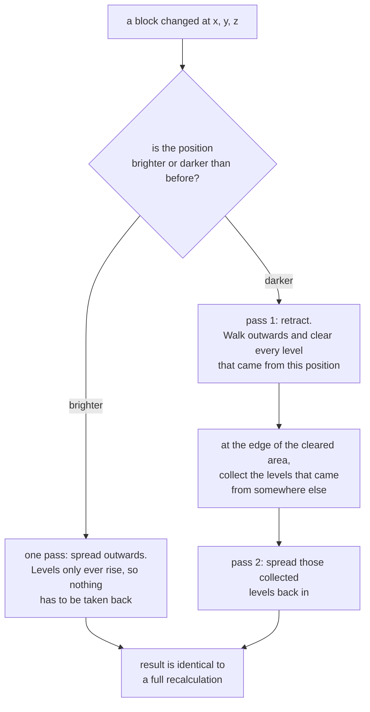

# Keep chunk light up to date automatically

Have chunks relight themselves when blocks change, instead of noticing the change and calling the
engine yourself. This is the same entry point Minestom offers with
`setChunkSupplier(LightingChunk::new)`.

**Before you start:** `falco-light` on the classpath, and an `Instance` whose chunk supplier you can
set.

## Set the scheduler's chunk supplier

Every call in [How-to Compute light for a loaded world](compute-light-for-a-loaded-world.md) is one you make yourself: you have to
notice that a chunk changed and decide when to recompute it. `FalcoLightingChunk` removes that step,
and it is the same entry point Minestom sets with `setChunkSupplier(LightingChunk::new)`:

```java
import net.onelitefeather.falco.light.ChunkLightScheduler;
import net.onelitefeather.falco.light.ChunkLightService;

ChunkLightScheduler scheduler = new ChunkLightScheduler(new ChunkLightService());
instance.setChunkSupplier(scheduler.supplier());
```

That is the whole setup. Keep one scheduler per instance — a second instance handed to the same one
is refused with an `IllegalStateException`, because the dirty set is keyed by chunk coordinates alone
and every instance of a server ticks with the same timestamp.

Five types, and only one of them holds any behaviour:

| Type | Responsibility |
| --- | --- |
| `FalcoLightingChunk` | The drop-in, a `DynamicChunk` subclass. Five overrides and no computation: `setBlock` reports the changed position, `onLoad` reports a change of unknown extent, `tick` triggers the pass, `invalidate` drops the cached light packet, and `onLightUpdated` — its half of `LightUpdateAware` — resends it. |
| `ChunkLightScheduler` | Everything else — the dirty set, the once-per-tick trigger, area forming, the executor, back pressure and the staleness rule — so a reader looking for the behaviour finds it in one place. |
| `ChunkArea` | A chunk coordinate pair, and the flood fill that cuts a dirty set into capped connected groups. Pure arithmetic, no Minestom. |
| `ChunkLightArea` | Computes one group in a single pass: reads its chunks plus one ring, exchanges borders until settled, writes back the group and never the ring. Keeps the light of each chunk it has computed, so the next pass replays the reported changes on it. |
| `LightUpdateAware` | The hook Minestom does not have, so a computed result can be delivered without knowing which chunk type it belongs to. |


**A change marks the 3×3, not just the chunk it happened in.** A lamp on the eastern edge of a chunk
belongs in the light of the chunk east of it, and that chunk would otherwise never be told. The ring
around an area is the mirror image of the same rule: it is read so the edge of the area is right, and
never written, because a ring chunk has not seen what lies on its own far side.

**A changed block costs a changed block, not nine chunks.** `setBlock` reports the *position* that
changed, not merely that its chunk is dirty. The area keeps the light of every chunk it has computed
and replays the reported positions on it, so a placed torch costs one incremental update rather than
nine full chunk searches. The eight neighbours are still marked, because light crosses borders, but
nothing of theirs is discarded: their own blocks did not move, and what arrives across the border is
derived again by every pass anyway. A change that cannot be placed — a chunk that was generated,
loaded, or written past `setBlock` — is reported as being of unknown extent, and that chunk is
searched again. What this is worth is measured by `IncrementalVsFullBenchmark` and the full table is
in [Measured results](../reference/measured-results.md) under *Measured*: replaying one changed block against
relighting the 3×3 from block states is **2.07× cheaper on block light** (incremental 7 747 ± 402
against full 16 028 ± 778 µs/op, conservative bounds 1.87× to 2.29×) and **5.60× cheaper on sky
light** (incremental 7 065 ± 438 against full 39 585 ± 1 512 µs/op, bounds 5.07× to 6.20×). Both
pairs of intervals are disjoint, so both are established for that run. The third figure often quoted
alongside them — a tick that pays for both kinds — is **derived**: it is the sum of the two rows
above, not a measurement of its own, and summing assumes such a tick shares no work between the two
kinds, which is an assumption about the implementation rather than a measured fact. Propagating the
errors gives 55 613 ± 2 290 against 14 812 ± 840, so about **3.7×**, bounds 3.41× to 4.14×.

<sub>`IncrementalVsFullBenchmark.full` / `.incremental`, `sky = false` and `sky = true`, one thread,
one fork, 5 warmup and 10 measurement iterations — an override of the class annotation, which
specifies 3 and 5 — **no heap flags**, which is the one class in the harness that pins neither `-Xms`
nor `-Xmx` while building a real Minestom chunk world, JMH 1.37, one 16-core machine recorded as not
idle, no `results.json` committed. One fork: the `±` covers variance between iterations of one JVM,
not between JVM launches — see [What a measurement here means](../explanation/what-a-measurement-here-means.md).</sub>

<sub>**The incremental figures predate `ec35f61`, which keeps the opacity tables of a chunk between
passes**, and the `full` figures do not — that path keeps nothing by contract. The factors above
therefore understate what the incremental path now buys, and the third one, a tick paying for both
kinds, is no longer a sum of independent halves: the sky pass reuses the tables the block pass
built.
See [Measured results](../reference/measured-results.md#measured).</sub>

An independent earlier run of the same benchmark gave 1.96× / 6.40× / 3.95×. That is the most useful
sentence available about any number on this page: **the ratios reproduce and the third digits do
not.** Two runs, two JVMs, same direction, same order of magnitude, different last digit — which is
exactly what a single-fork measurement should be expected to deliver, and exactly the reason no third
digit anywhere here is load-bearing.

**What is kept is the light of a chunk *alone*, before any border exchange**, and that is what makes
the hard direction tractable. Taking light back is the case an incremental engine gets wrong, because
a retraction has to run until light from somewhere else legitimately takes over — and a retraction
that had to leave the chunk to find that point would need the neighbours retracted with it. It never
has to here: the kept light contains nothing from any neighbour, so every level in it originates
inside the chunk and the retraction is complete at the border by construction. The light that crosses
borders is not stored at all; it is derived again on every pass, from a *copy* of the kept light, and
an exchange only ever raises levels and so cannot carry a stale glow forward.

The kept light is bounded — roughly 100 KB per chunk and kind of light, for at most 128 chunks by
default (`ChunkLightArea.DEFAULT_MAX_CACHED_CHUNKS`), least recently used first — and dropping an
entry costs a full propagation and nothing else. The result is the same bytes a full recalculation
produces, and a chunk that cannot be followed incrementally is simply propagated again.

<!-- TODO(maintainer): the "roughly 100 KB per chunk and kind of light" figure has no committed
     source — no -prof gc output, no heap dump, no test that asserts it. The 128-chunk cap is a
     constant and is checkable; the per-entry size is not. Either attach the measurement or derive
     the number from the field layout of ChunkLightState in the javadoc and cite that. It is quoted
     twice on this page and both places inherit whatever is decided. -->


**Areas are formed once per tick and capped.** `Chunk#tick(long)` runs per chunk, but a pass has to
see every change of the tick before it groups anything, so the scheduler runs its pass for the first
chunk reporting a timestamp it has not seen. Connected dirty chunks are lit together, and the group
is closed at `maxAreaSize` chunks, 16 by default, with the remainder starting the next area. The cap
is there because every chunk of an area and of its ring is read and turned into opacity tables inside
one tick; a `ChunkLightState` of roughly 100 KB per chunk is the smaller half of that bill. The seam
between two parts settles on the following tick, because each part reads the other as its ring.

**Nothing ever blocks on a computation.** A chunk hands out whatever its sections hold right now,
which is the previous result while a new one is in flight. A chunk whose area is still running stays
marked but is not submitted again, and a chunk that changed while its area ran has its result
discarded and stays dirty rather than being written from block states that are already gone.

## The scheduler's executor is injectable, and a test should inject one

```java
// Deterministic: the task runs on the calling thread, so a tick is finished when onTick returns.
ChunkLightScheduler scheduler = new ChunkLightScheduler(new ChunkLightService(), Runnable::run, 16);
```

The default gives every area its own virtual thread and bounds them with a semaphore at the processor
count, the same shape `FalcoAnvilLoader` uses for its saves. The bound sits inside the task rather
than around the submission on purpose: acquiring it before starting the thread would block whichever
chunk happened to trigger the pass, and that chunk is being ticked by the server.

A direct executor turns the whole cycle synchronous, which is what makes the tests of this path
deterministic rather than timing-dependent — place a block, call `tick`, assert the light. A server
that already has a pool can hand that one over instead.

**A batch is covered by this too.** `AbsoluteBlockBatch#apply` ends by calling `sendLighting()` on
every touched chunk that is a `LightingChunk` and skips every other type, so a `FalcoLightingChunk`
would never be resent by it. It does not have to be: a batch writes through `setBlock`, which marks
the chunk here, so the next tick lights the whole touched region and sends it. The result arrives one
tick later than Minestom's would, and it arrives for the ring around the batch as well, which
Minestom's path does not manage.

## Incremental updates

`ChunkLightService#calculate` always recomputes the whole chunk. For a single block change that is
wasteful, and `ChunkLightState` exists for that case. It is what `ChunkLightScheduler` runs on:
`FalcoLightingChunk#setBlock` reports the position, `ChunkLightArea` keeps the light of the chunk and
replays the position on it. Use the type directly only if you drive the engine yourself.

```java
ChunkLightState state = ChunkLightState.blockLight(opacityTables);

// after a block changed at that position
state.update(updatedOpacityTables, x, y, z);
List<LightNibbles> light = state.toSections();
```

Adding brightness is straightforward — it only spreads. **Removing** it is the hard case and the
reason this class exists: when a light source disappears, the brightness it had spread is still
stored in every block around it, and spreading again would keep that glow forever. The update
therefore runs two passes. The first retracts every level that originated from the changed position
and collects the still valid levels it meets at the edge of the retracted area; the second spreads
those back in.

Which way an update goes, drawn out:



The second pass is not a correction of the first. The light of every *other* source in the
neighbourhood is legitimate and was cleared along with the rest simply because it stood in the way;
collecting it at the edge and letting it back in is what puts it back. Skipping the retraction
instead and only spreading again would leave the removed source's glow in place for good.

`ChunkLightStateTest#testTheIncrementalResultMatchesAFullRecalculation` asserts that the incremental
result is identical to a full recalculation, block for block.

## Incremental sky light updates

Sky light has an origin no block holds: it falls in from above. An update can therefore not tell
from the levels alone which positions lost their origin and which gained one, and a state that holds
sky light keeps a heightmap for that reason — the highest position that stops the sky, per column.

A block change moves exactly one column of that heightmap, and the difference between the old and
the new height names the positions whose origin changed:

| Change | Effect on the column |
| --- | --- |
| A block is placed above the current height | Everything between the old and the new height falls out of the open sky and gives its level back. What is left is refilled from the sides, which is why a single pillar leaves a level of fourteen below it rather than darkness. |
| The highest blocking block is removed | The column opens down to the next block below, and every position in between receives the full level again and spreads it. |
| The change is below the height | The height stays where it is. The changed position is retracted and refilled from its neighbours, exactly as a block light update works. |

Only the changed column is walked again, so an update no longer re-seeds all two hundred and fifty
six columns of the chunk.

`SkyLightUpdateTest` asserts the result against a full recalculation block for block, for both
directions, for a change that is not in the highest blocking position, and for a seeded sequence of
random changes that verifies the equality after every single one of them.


## Check it worked

Place a block, let one tick pass, and the surrounding light is correct without any call of your own.
With a direct executor (`Runnable::run`) the pass is finished when `onTick` returns, which is what
makes a test of this path deterministic rather than timing-dependent.

## If it does not work

An `IllegalStateException` when handing a second instance to the same scheduler is by design: the
dirty set is keyed by chunk coordinates alone. A server with many worlds needs one scheduler per
world.

See also: [How-to Compute light for a loaded world](compute-light-for-a-loaded-world.md) for the manual calls ·
[Explanation How the light engine works](../explanation/how-the-light-engine-works.md) · [Explanation Scope and non-goals](../explanation/scope-and-non-goals.md) for the cap on
kept light and the seam an area split leaves
