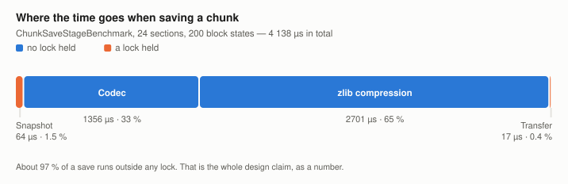
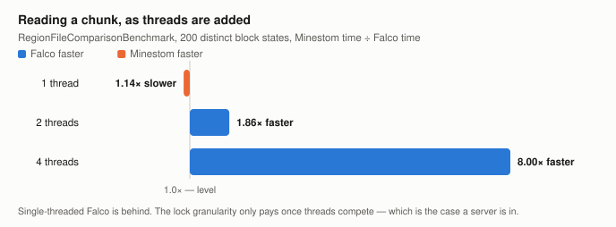
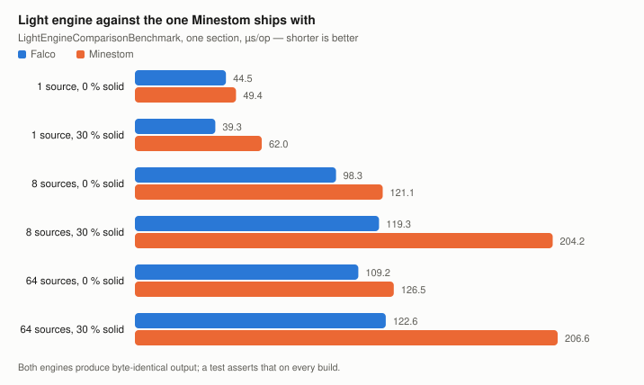
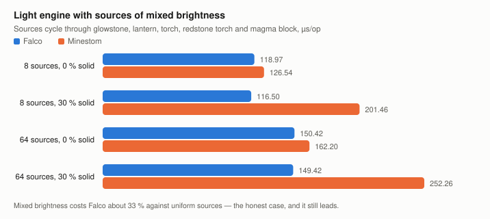

# Measured results

Every measured table this project publishes, each with the benchmark class and methods its rows came
from, the parameter values and run configuration behind them, and what the `±` does and does not
cover. It deliberately explains nothing — how the loader and the engine work is
[How the Anvil loader is built](../explanation/how-the-anvil-loader-is-built.md) and [How the light engine works](../explanation/how-the-light-engine-works.md), and how to re-perform any
of these runs is [What the benchmarks establish](../explanation/what-the-benchmarks-establish.md) — and it is written for someone auditing a number
rather than for someone using the library.

**Where a measured table appears on more than one page, the copy below is the one that is right**,
and a correction is made here first and propagated outwards. Not every table in the documentation is here:
[How the Anvil loader is built](../explanation/how-the-anvil-loader-is-built.md) publishes an independent second run of the loader table
that appears nowhere else, and the two-fork four-thread control beside it — the only published run
whose `±` covers more than one JVM launch. A page carrying a run of its own says so where the table
stands. The rest of the working record — the structural facts, the decisions these runs fed, the
defects found and fixed, and what is still open — is [Project Status](../project-record/project-status.md).

> **Read this before quoting a number.** Every *timing* here comes from *one* machine, on *one*
> JVM, under *one* load, and none of it is an absolute statement about either implementation. What
> the `±` covers is defined once in [What a measurement here means](../explanation/what-a-measurement-here-means.md); how to re-run
> any of it is in [What the benchmarks establish](../explanation/what-the-benchmarks-establish.md).
>
> **The Minestom version is part of every timing, and it is not recorded for any of them.** The rows
> that quote a factor compare Falco with the loader and engine Minestom ships, so the Minestom under test
> is part of the measurement. The run commit is not recorded either, so it cannot be recovered later.
> Every figure on this page was taken before this repository moved to Minestom `2026.08.28-26.2`, and none
> has been re-run against it. Read the comparison rows as unverified on 26.2 until a baseline is taken
> there. The object counts in [Counted](#counted) are not affected, because they count objects on a heap.
>
> [Counted](#counted) is the exception and is separated for it: object and byte counts are
> deterministic, carry no `±`, and are unaffected by what else the machine was doing. They are the
> only figures on this page that survive being taken on a busy machine.

## Contents

- [Measured](#measured) — the measurement environment, then every published timing with its provenance
- [Counted](#counted) — object and byte counts, which have no spread and are kept apart for that reason
- [The uniform-section fast paths](#the-uniform-section-fast-paths) — a design-time measurement, not from this suite
- [References](#references)

The eight measured sections under [Measured](#measured), in order, with the environment they were
taken in first and the decisions they produced last. Seven of the eight carry a table; *scaling by
world height* publishes three claims and no table, and says so at the point where the table would
be:

[the measurement environment](#measurement-environment)

[save stages](#where-the-time-goes-when-saving-a-chunk) ·
[region file against Minestom](#the-region-file-against-the-one-minestom-ships-with) ·
[light engine against Minestom](#against-the-engine-minestom-ships-with) ·
[mixed brightness](#with-sources-of-mixed-brightness) ·
[scaling by world height](#scaling-by-world-height) ·
[area against per-chunk](#lighting-an-area-against-one-neighbourhood-per-chunk) ·
[replayed change against full](#a-replayed-block-change-against-lighting-the-chunks-again) ·
[stages of the light path](#where-the-time-goes-in-the-light-path)

[optimisations these numbers produced](#optimisations-these-numbers-produced)

Under [Counted](#counted), one section that is not a timing:
[a chunk that allocates what it uses](#a-chunk-that-allocates-what-it-uses)

---

## Measured

Every table in this section carries a provenance line naming the benchmark class and methods, the
parameter values, the run configuration and what the `±` covers. Reproduce any of them with
`./gradlew :falco-benchmarks:jmhJar` and the class name — except for the parts of *Where the time
goes in the light path* that are marked as coming from a standalone rebuild, which is not JMH and
cannot be re-run from this repository.

### Measurement environment

<!-- TODO(maintainer): fill from the machine the published numbers came from. Leave a field as TBD
     rather than guessing — a wrong value is worse than a missing one. -->

| | |
| --- | --- |
| CPU | **TBD** — model, physical cores, SMT on or off. Recorded only as "a 16 core machine", which does not say whether that is 16 physical cores or 8 with SMT |
| Frequency policy | **TBD** — turbo on or off, governor |
| RAM | **TBD** |
| Storage and file system | **TBD** — the loader tables all touch it |
| OS and kernel | **TBD** |
| JVM | **TBD** — vendor, full version string, garbage collector. The toolchain is Java 25; the JVM that ran the benchmarks is not recorded anywhere |
| Machine state | **not idle** |
| Git commit per table | **TBD** for five of the eight. Recorded only for the two light comparison tables and the light stage table: `69381af` and its predecessor for the `UNIFORM` and stage tables, `0e8fbb5` onwards for `MIXED` |
| Run date per table | **TBD** — recorded for none of the eight |
| Raw `results.json` | **not committed** for any published table |

**What follows from the empty rows.** Absolute microseconds below are a property of that unrecorded
machine and nothing else. Ratios between two methods measured in the same run are the durable part,
which is why the tables are read as ratios and why the two cross-run repeats that reproduce a ratio —
the nine-chunk re-run under
[Lighting an area against one neighbourhood per chunk](#lighting-an-area-against-one-neighbourhood-per-chunk)
and the earlier run under
[A replayed block change against lighting the chunks again](#a-replayed-block-change-against-lighting-the-chunks-again)
— are the most useful evidence on this page for reading the tables that way: **ratios reproduce,
third digits do not.** Those are two of the five cross-run repeats this project has; the other two
are on the loader table and establish an asymmetry rather than a ratio, and all five are counted under
[Against the engine Minestom ships with](#against-the-engine-minestom-ships-with). Background
load on a machine that was not idle is also a live candidate explanation for the widest error bars
here, which are all in
[the loader contention table](#the-region-file-against-the-one-minestom-ships-with).

**One heap gap worth naming.** Every benchmark class with a `@Fork` annotation pins `-Xms` equal to `-Xmx` in `jvmArgsAppend`
except `AreaVsPerChunkBenchmark` and `IncrementalVsFullBenchmark`, which set no heap flags at all, and
`ChunkLookupBenchmark`, which has no `@Fork` annotation. The first two are also the ones that build a world of real Minestom chunks, so they have the largest live
set and the most garbage-collector sensitivity in the suite. Their numbers rest on a default,
unrecorded heap configuration.

### Where the time goes when saving a chunk

<picture>
  <source media="(prefers-color-scheme: dark)" srcset="../charts/save-stages-dark.svg">
  
</picture>

| Stage | Time | Lock held | Kind |
| --- | ---: | --- | --- |
| Snapshot | 64 µs | chunk read lock | measured (`snapshot`) |
| Codec, without compression | 1 356 µs | none | measured (`codecWithoutCompression`) |
| NBT serialisation and zlib compression | 2 701 µs | none | **derived** — `codec` − `codecWithoutCompression` |
| Transfer | 17 µs | region lock | measured (`transfer`) |

`ChunkSaveStageBenchmark.snapshot` / `.codec` / `.codecWithoutCompression` / `.transfer`,
`distinctStates = 200`, 24 sections (`BenchmarkConstants.OVERWORLD_SECTIONS`), one thread, one fork,
5 warmup and 5 measurement iterations of 1 s **per the class annotations — no command line was
recorded for this run**, `-Xms1g -Xmx1g`, JMH 1.37, one 16-core machine recorded as not idle, run
commit and run date not recorded, no `results.json` committed. **The run printed no `±` for these
rows and none was recorded**, so no significance test can be applied to them and no ratio between
them is defensible. One fork: an interval, had one been recorded, would cover variance between
iterations of one JVM and not between JVM launches — see
[What a measurement here means](../explanation/what-a-measurement-here-means.md).

**Half the class is unpublished here too.** `ChunkSaveStageBenchmark` declares
`@Param({"8", "200"})` and five methods, which is ten configurations; the four rows above are the
`200` level of four of them. The `8` level is not published, and neither is `full()` — the fifth
method, which exists so the sum of the stages can be checked against a whole save.

**The third row is a difference of two benchmarks, and it does not measure what its old label said.**
`codec()` is `compress(serialize(encode(…)))` while `codecWithoutCompression()` is `encode(…)` alone
— it returns a `CompoundBinaryTag` and never serialises it. The difference therefore contains the NBT
serialisation *and* the zlib pass, not zlib alone. The value 2 701 µs is correct for what it actually
measures; only the label was wrong.

**The structural claim is the strong one here, and it needs no benchmark at all.** `FalcoAnvilLoader`
holds the chunk read lock only across the `Section.clone()` loop and the block-entity collection
(`FalcoAnvilLoader#snapshot`), releases it, and encodes and compresses on the clones; the region lock
is taken by `RegionFile#writeRaw` for the transfer alone. Anyone can verify that by reading the file.
The table's job is to say how much of the work sits in the lock-free part, and on these four rows
that is 1 356 + 2 701 against 64 + 17.

<!-- Resolved 2026-08-02. The question was whether `full` was the denominator that produced the
     withdrawn 97 % and 63 %. It was not, and it cannot have been: a single denominator cannot yield
     both, needing 4 182 for one and 4 287 for the other. A CI run of the class at two forks settles
     the other half — full comes out 1.3 % to 1.5 % above the sum of its stages, so the decomposition
     is complete and there is no unaccounted time for a different denominator to hide in. The shares
     that follow from the published rows are 98.0 % and 65.3 %; the withdrawn figures remain
     withdrawn because no arithmetic reproduces them. -->

**Two percentages that used to stand here have been withdrawn pending their arithmetic**, and
`ChunkSaveStageBenchmark.full` — the method that exists to check the stages against the whole save —
has never been published. Publishing it would let a reader verify the decomposition instead of taking
it. Until then, what this table supports is an ordering rather than a share: the two lock-free stages
are the large ones and the two locked stages are the small ones — 1 356 and 2 701 µs against 64 and
17 — and compression-plus-serialisation is the larger of the two lock-free stages. No ratio between
these rows is quoted, because none of them carries an interval. That ordering is what made
compression the optimisation target.

### The region file against the one Minestom ships with

<picture>
  <source media="(prefers-color-scheme: dark)" srcset="../charts/loader-contention-dark.svg">
  
</picture>

Reading and writing one chunk, µs/op. The read column carries a verdict rather than a factor,
because two of its four rows do not support one.

| Threads | Falco read | Minestom read | Read verdict | Falco write | Minestom write |
| ---: | ---: | ---: | --- | ---: | ---: |
| 1 | 1 203 ± 123 | 1 060 ± 55 | intervals overlap | 2 659 ± 212 | 2 601 ± 100 |
| 2 | 1 181 ± 31 | 2 200 ± 445 | **1.9× faster** in this run — not reproduced | 2 637 ± 204 | 2 643 ± 153 |
| 4 | 1 378 ± 84 | 11 021 ± 16 470 | no factor admissible | 2 672 ± 43 | 2 678 ± 115 |
| 8 | 2 438 ± 252 | 530 905 ± 1 928 261 | no factor admissible | 3 098 ± 658 | 3 102 ± 245 |

`RegionFileComparisonBenchmark.falcoRead` / `.minestomRead` / `.falcoWrite` / `.minestomWrite`,
`distinctStates = 200`, one thread count per row passed as `-t` (JMH takes one per run, so this is
four runs, not one), one fork, 3 warmup and 5 measurement iterations, `-Xms1g -Xmx1g`,
`@State(Scope.Benchmark)` with a nested per-thread slot, JMH 1.37, one 16-core machine recorded as
not idle, run commit and run date not recorded, no `results.json` committed. **Iteration time: the
class annotates `time = 1` for both
warmup and measurement. Earlier documentation of this table said 2 s, and no `-r` appears on the
command line that was recorded, so the run's actual iteration time is unrecorded; the annotation says
1 s. `ChunkSaveComparisonBenchmark` is the class that really uses 2 s iterations.** One fork: the ±
covers variance between iterations of one JVM, not between JVM launches — see
[What a measurement here means](../explanation/what-a-measurement-here-means.md).

Read the four read rows against their intervals rather than against their means:

- **One thread: no difference is resolvable.** Falco's interval is `[1 080, 1 326]` and Minestom's is
  `[1 005, 1 115]`; they overlap between 1 080 and 1 115. The means put Falco 14 % behind, but at this
  precision that gap is not resolved, and the row must not be quoted as "Falco is 1.14× slower" —
  nor as a tie. **This is the row where Falco looks worse, and it gets the same treatment as the rows
  where it looks better.** What the row does support is that no advantage is visible without
  contention, which is exactly what the design predicts: the claim was always about lock granularity,
  and with one thread there is no lock to contend for.
  **The eight-state level has since been measured, and there the difference does resolve.** A
  full-suite run of 2026-08-02 puts Falco at 566.87 ± 12.61 against Minestom 538.70 ± 4.51 at
  `distinctStates = 8` on one thread — disjoint intervals, so **Falco is 5.2 % slower** there, with
  conservative bounds of 2.0 % to 8.5 %. The "20 % at 8" this bullet once carried falls well outside
  that range and stays withdrawn. The 200-state row of the same run overlaps, as the published row
  above does, so what fewer distinct states change is that the single-thread disadvantage becomes
  resolvable — not that it grows.
  Full-suite run of 2026-08-02, `RegionFileComparisonBenchmark.falcoRead` / `.minestomRead`,
  forks and iterations per the class annotation, JMH 1.37, one 4-core `ubuntu-latest` runner,
  `results.json` attached to the workflow run. **A shared runner, so these are not the microseconds
  of the table above** — both sides of the ratio came from one process, which is what makes the
  5.2 % quotable and the absolute figures not.
- **Two threads: Falco is faster in this run, and this row does not reproduce.** `[1 150, 1 212]`
  against `[1 755, 2 645]` are disjoint, so the difference holds at this precision. Conservative
  bounds on the ratio are 1.45× to 2.30×; the wider of the two relative half-widths is 20 %, which
  permits one decimal, hence **1.9× faster** rather than the 1.86× the means give. **The second run
  of this table does not reproduce it.** An independent run of the identical configuration,
  published in [How the Anvil loader is built](../explanation/how-the-anvil-loader-is-built.md), measured Minestom at
  103 437 ± 856 306 µs/op at two threads — 47 times the mean printed above, and a half-width 8.3
  times its own mean, which under the rules used here carries no factor at all. Falco's two-thread
  figure did reproduce, at 1 174 ± 71. The 1.9× is a property of this run and of nothing else; what
  survives both runs is the direction and the loss of predictability. The whole of what the two runs
  agree and disagree on is set out under the write rows below.
- **Four threads: the direction holds, no factor does.** Minestom's half-width is 16 470 on a mean of
  11 021 — 149 % of the mean, putting the lower end of its interval at −5 449. A measurement whose
  interval contains negative time does not constrain a ratio at any precision. This is the same test
  that disqualifies the eight-thread row, applied to the row above it.
- **Eight threads: the same, more so.** The half-width is 363 % of the mean.

**The four- and eight-thread rows are not a null result; they are the interesting one.** What they
show is that Minestom's read time stops being *predictable* under contention — it scatters over three
orders of magnitude at eight threads — while Falco's half-width stays at or below a tenth of its own
mean at every thread count in this table, 10.3 % at its widest. For a server, an unpredictable read
is the worse failure of the
two, and dispersion is a claim these rows genuinely support where a factor is not.

**Writing shows no resolvable difference at any thread count.** All four write pairs overlap, which
is not the same as the two being equal and is not evidence that they are. The mechanism is what
makes a tie the expected outcome: both implementations take a lock to allocate sectors and update
the header, so the write path has no lock granularity to win on. Claiming otherwise would be easy
and wrong.

**This table was run a second time, and the two runs part company on Minestom's side only.** The
repeat is published in [How the Anvil loader is built](../explanation/how-the-anvil-loader-is-built.md) at the same settings — same class,
same methods, `distinctStates = 200`, one `-t` per row, one fork. Falco reproduces at every thread
count: 1 089 ± 48, 1 174 ± 71, 1 370 ± 200 and 2 282 ± 248 against the four figures above, every
pair of intervals overlapping. Minestom reproduces at one thread only, 1 045 ± 112 against
1 060 ± 55. Above it, the repeat gives 103 437 ± 856 306, 302 704 ± 674 429 and 297 075 ± 593 563
where this table has 2 200 ± 445, 11 021 ± 16 470 and 530 905 ± 1 928 261 — a mean 47 times the
published one at two threads, and on every one of the three a half-width larger than its own mean.
**That asymmetry is the more durable result, and it is worth more than the factor it costs us.**
Falco's read time is reproducible across JVM launches and Minestom's is not, above one reader —
which is the same statement the half-widths make within either run, now made across two of them.
What neither run establishes is a magnitude.

**A third run of the four-thread row exists at two forks, and it is the only published Falco number
whose `±` covers more than one JVM launch.** Recorded in
[How the Anvil loader is built](../explanation/how-the-anvil-loader-is-built.md): at four threads, two forks and ten measurement iterations,
Falco **1 325.6 ± 21.1 µs/op** against Minestom **359 690.8 ± 97 498.3 µs/op**. It belongs next to
the four-thread row above, and it says three things about it. Falco's figure reproduces —
`[1 304.5, 1 346.7]` against this table's `[1 294, 1 462]`, overlapping — across a configuration that
samples JVM launches rather than only iterations, which is the objection every other table on this
page is exposed to. Minestom's does not: 359 690.8 against 11 021 is a factor of 33 on disjoint
intervals, from the same class at the same thread count. And the two-fork run is the one row in the
project where Minestom's read is bounded well enough to divide by at all — its half-width is 27 % of
its mean rather than 149 % — which puts the two sides conservatively **between roughly 190 and 350
times apart in that run**, the bound [How the Anvil loader is built](../explanation/how-the-anvil-loader-is-built.md) states for it and no
more precisely than that. That is a statement about one pair of JVM processes at one thread count and
not a property of either implementation, because the operand it rests on moved by a factor of 33
between two runs of the same configuration. It is quoted here because it is the strongest single
piece of evidence for the direction, not because it fixes a magnitude.

Two-fork control: `RegionFileComparisonBenchmark.falcoRead` / `.minestomRead`,
`distinctStates = 200`, four threads (`-t 4`), **two forks**, ten measurement iterations — an
override of the class annotations, which are one fork, 3 warmup and 5 measurement iterations of 1 s.
**The warmup count and iteration time of this run are not recorded**, and neither is a full command
line. `-Xms1g -Xmx1g`, JMH 1.37, same 16-core machine recorded as not idle, run commit and run date
not recorded, no `results.json` committed. At two forks and ten iterations the `±` pools iterations
across **both** JVM launches, so unlike every other interval on this page it samples run-to-run JVM
variance — see [What a measurement here means](../explanation/what-a-measurement-here-means.md). The conservative ratio bounds are
`(b − eb) / (a + ea)` to `(b + eb) / (a − ea)`.

**The comparison is fair by construction, not by assertion.** `RegionFileComparisonBenchmark#setUp`
produces the payload once with the Adventure writer both implementations use and hands the same bytes
to both region files, so no part of this result is a compression level in disguise. That is a fact
about the setup method, checkable without running it.

**Only one of the two `distinctStates` levels is published.** The class declares
`@Param({"8", "200"})`, so a full run produces a second set of four read rows and four write rows at
8 states — the cheaper payload, and therefore the case in which the byte transfer weighs more against
the inflate and the parse. Those eight rows are not in this document.

**Scaling of the series, which no single row shows:** from one thread to eight, Falco's read mean
grows from 1 203 to 2 438 µs and Minestom's from 1 060 to 530 905 µs. Both are read across four
separate runs, so the comparison between thread counts is between runs rather than within one, and
the growth ratios inherit that.

### Against the engine Minestom ships with

<picture>
  <source media="(prefers-color-scheme: dark)" srcset="../charts/light-engine-dark.svg">
  
</picture>

**Before any timing is quoted: both engines produce the same bytes, and that is enforced twice.**
`LightEngineEquivalenceTest` runs the full cross product of `LIGHT_SOURCES = {0, 1, 2, 4, 8, 16, 64,
128, 512}` and `OCCLUSION_PERCENTS = {0, 10, 30, 50, 70, 90}` — 9 × 6 = **54 scenarios** — on every
build and asserts the 2048 bytes of each side are equal, plus a check that a section holding sources
did not simply stay dark, which would make the comparison vacuous.
`LightEngineComparisonBenchmark.verifyBothEnginesAgree` repeats the comparison in `@Setup` for every
trial and every parameter combination and throws before a single measurement is taken if the arrays
differ. Both are facts about the code, not measurements, and both are checkable by opening the two
files. They close the most common way a benchmark lies — winning time by computing something else.

The measured side of the comparison is `LightPropagator` against the real
`BlockLight.buildInternalQueue` and `LightCompute.compute`, reached by placing the benchmark class in
`net.minestom.server.instance.light` because those two methods are package-private there. It is not a
reimplementation of Minestom's engine.

Measured before and after `69381af` in one session on the same machine, with a Minestom column as the
control. **The *After* column is the load-bearing one; the *Before* ratios do not divide out of the
two columns beside them, which is worked through below the table.** µs/op:

| Sources | Solid | Falco before | Falco after | Minestom | After |
| ---: | ---: | ---: | ---: | ---: | --- |
| 1 | 0 % | 74.2 ± 1.9 | 44.5 ± 0.6 | 49.4 ± 1.3 | 1.11× faster |
| 1 | 30 % | 61.8 ± 1.6 | 39.3 ± 0.8 | 62.0 ± 2.0 | 1.58× faster |
| 8 | 0 % | 137.7 ± 7.4 | 98.3 ± 2.4 | 121.1 ± 5.5 | 1.23× faster |
| 8 | 30 % | 144.7 ± 1.8 | 119.3 ± 3.5 | 204.2 ± 3.7 | **1.71× faster** |
| 64 | 0 % | 135.9 ± 2.8 | 109.2 ± 1.6 | 126.5 ± 5.6 | 1.16× faster |
| 64 | 30 % | 152.7 ± 1.8 | 122.6 ± 1.3 | 206.6 ± 4.2 | 1.68× faster |

`LightEngineComparisonBenchmark.falco` / `.minestom`, one section, `emissionMix = UNIFORM`
(every source a glowstone block), `lightSources` and `occlusionPercent` as in the first two columns,
one thread, run as `-f 1 -wi 5 -i 10` — an override of the class annotations, which are 3 warmup and
5 measurement iterations of 1 s — `-Xms512m -Xmx512m`, JMH 1.37, one 16-core machine recorded as not
idle, commits `69381af` and its predecessor, run date not recorded, no `results.json` committed. Ten
measurement iterations put the *t* multiplier at 4.78 rather than the 8.61 of a five-iteration run,
so these intervals are the tightest on this page for a given dispersion. One fork: the ± covers
variance between iterations of one JVM, not between JVM launches — see
[What a measurement here means](../explanation/what-a-measurement-here-means.md).

**All six *After* rows are supported, and they should be read without hedging.** Each Falco interval
is disjoint from the corresponding Minestom interval — the closest pair is 1 source at 0 % solid,
`[43.9, 45.1]` against `[48.1, 50.7]`, which still do not touch. Taking the conservative bounds
`(b − eb) / (a + ea)` to `(b + eb) / (a − ea)` on each row gives 1.07×–1.16×, 1.50×–1.66×,
1.15×–1.32×, 1.63×–1.80×, 1.09×–1.23× and 1.63×–1.74×. **The headline "1.11× to 1.71× faster" is
inside those bounds on every row.** Every one of the six is inside the two-decimal band the rule in
[What a measurement here means](../explanation/what-a-measurement-here-means.md) allows — the wider relative half-width of every one
of the six pairs is under 5 %, and the rule permits two decimals up to 10 % — so the printed factors
stand as they are. The bounds are still the better form of each, and they are why the bounds column
exists.

**A *Before* ratio column stood here and has been removed.** Not one of its six cells could be
recovered from the columns printed beside it: 74.2 / 49.4 is 1.50 where the cell said 1.42;
137.7 / 121.1 is 1.14 against 1.18; 204.2 / 144.7 is 1.41 against 1.37; 206.6 / 152.7 is 1.35 against
1.37; 135.9 / 126.5 is 1.07 against 1.08; and at 1 source and 30 % solid, 61.8 against 62.0 puts
Falco marginally ahead where the cell said 1.03× behind — so even that *direction* did not follow.
Five of the six missed by more than a rounding step.

The *After* column reproduces exactly on all six rows, which is what identifies the published
Minestom column as the one the *After* run was measured against. The likeliest reading is that the
*Before* ratios were taken against a Minestom measurement from the earlier run that was never
published. **A ratio computed against an unpublished operand cannot be repaired by dividing the
published ones**, and the run that would settle it is not recoverable: the pair compares two Falco
versions on one machine, so re-measuring would require both commits in one process on that same
machine. The column is therefore gone rather than corrected.

**The two Falco columns and the Minestom column are measurements and remain**, and they carry what
the pair was published to show: Falco's own time falls on every row between the two commits, from
74.2 to 44.5 at one source in open sky and from 152.7 to 122.6 at 64 sources at 30 % solid. That
comparison needs no Minestom column at all. What is gone is only the arithmetic nobody could check.

<!-- Resolved 2026-08-02 by deletion, which was the second of the two options this marker gave. The
     first — publishing the Minestom column of the pre-69381af run — is not available: that run was
     never recorded, and it cannot be re-created, because the pair compares two Falco versions on one
     machine and would need both commits measured in one process on that same machine. Two CI runs
     land on different CPUs and would not answer it. The measured columns are untouched. -->

**Minestom is the natural control for this pair of runs, because its code did not change across
`69381af`** — that is what makes a before-and-after comparable at all. What is published is one
Minestom column, and the *After* ratios were computed against it. A reader should in any case treat
the *Before* and *After* Falco columns as two runs rather than one: they are separated by a rebuild,
which means a fresh JVM, a fresh JIT plan and a fresh set of ergonomic decisions on each side.

Falco is ahead in all six scenarios after the change, against two before it — counting the *Before*
rows whose intervals are disjoint from Minestom's in Falco's favour, which is the two 30 % solid
rows, and not counting 1 source at 30 % where the two overlap. The lead on solid blocks grew rather
than being traded for the empty rows. This is a result under the conditions in the provenance line
— one section, one machine that was not idle, sources of equal brightness, one JVM launch — and not a
general statement about either engine.

<!-- TODO(maintainer): this paragraph previously ended "An independent re-run confirms direction and
     order of magnitude, not the third digit." No such re-run of LightEngineComparisonBenchmark is
     recorded anywhere — the five repeats this project has are listed in the paragraph below, and
     none of them is of this table. Either name the light re-run and publish its numbers, or leave
     the sentence out. It has been removed rather than reattributed. Light-Engine.md still carries a
     version of it ("A shorter run on a loaded machine reproduces the same ordering...") whose own
     figures were never written down; that page has to be brought level with this one. -->

**This page is the register of the cross-run repeats, and there are five.** The nine-chunk
`AreaVsPerChunkBenchmark` re-run at
[Lighting an area against one neighbourhood per chunk](#lighting-an-area-against-one-neighbourhood-per-chunk),
the earlier `IncrementalVsFullBenchmark` run at
[A replayed block change against lighting the chunks again](#a-replayed-block-change-against-lighting-the-chunks-again),
the second single-fork run of the whole loader table, the two-fork four-thread
`RegionFileComparisonBenchmark` control — the last two both recorded in
[How the Anvil loader is built](../explanation/how-the-anvil-loader-is-built.md) and discussed at
[The region file against the one Minestom ships with](#the-region-file-against-the-one-minestom-ships-with)
— and, since 2026-08-02, the two-fork re-run of the 64 / 0 % cell of this table and of its `MIXED`
counterpart, set out under
[With sources of mixed brightness](#with-sources-of-mixed-brightness). **Only the last is a repeat of
*this* table**, and it is a repeat of one cell of it rather than of the whole: it puts Falco at
109.88 ± 1.47 where the row below says 109.2 ± 1.6, intervals that overlap, so the row reproduces.
The single-fork run published beside it is the same control at weaker settings and is not counted
separately; what it establishes is that it should not have been trusted on its own.

The `Before`/`After` pair above is a repeat of a *different* kind — the same benchmark across a code
change, with Minestom as the control — which tests whether the change did what it claims and not
whether the numbers are stable across JVM launches. Where another page counts these differently,
this section is the one that is right.

**The occlusion axis is a benchmark parameter, not a survey of real worlds.** The lead grows with
`occlusionPercent`: at one source it goes from 1.11× at 0 % solid to 1.58× at 30 %. The reason for
measuring at 30 % is that a solid block ends a search early, so an entirely open section is the upper
bound of the work rather than the typical case. Nothing here establishes what share of solid blocks a
real chunk holds.

The earlier reading of the pattern was wrong and is worth recording. It said an empty section favours
Minestom because our opacity table is built unconditionally, and a section with solid blocks favours
us because the table is then read many times. The table is still built unconditionally; it now costs
a quarter. The stage breakdown below also shows that **Falco's search was already the faster of the
two before the change** — 33.85 µs against a figure for Minestom's search of 53.9 µs which is
*derived*, not measured directly, because Minestom's search consumes the queue it is handed and
cannot be run on a prepared one. The entire deficit came from the preparation, never from the
algorithm.

### With sources of mixed brightness

<picture>
  <source media="(prefers-color-scheme: dark)" srcset="../charts/light-engine-mixed-dark.svg">
  
</picture>

This is the honest case, and it is here because it is the one where Falco's lead shrinks.

`LightEngineComparisonBenchmark` gained an `emissionMix` parameter in `0e8fbb5`. `MIXED` cycles the
sources through glowstone, lantern, torch, redstone torch and magma block, which the registry gives
15, 15, 14, 7 and 3; positions are drawn identically to `UNIFORM`, so the levels are the only
difference. µs/op:

| Sources | Solid | Falco | Minestom | Verdict |
| ---: | ---: | ---: | ---: | --- |
| 8 | 0 % | 118.97 ± 8.89 | 126.54 ± 9.55 | intervals overlap |
| 8 | 30 % | 116.50 ± 7.63 | 201.46 ± 16.83 | **1.7× faster**, bounds 1.49×–2.01× |
| 64 | 0 % | 150.42 ± 32.73 | 162.20 ± 3.11 | intervals overlap |
| 64 | 30 % | 149.42 ± 12.64 | 252.26 ± 9.28 | **1.7× faster**, bounds 1.50×–1.91× |

`LightEngineComparisonBenchmark.falco` / `.minestom`, one section, `emissionMix = MIXED`,
`lightSources` and `occlusionPercent` as in the first two columns, one thread, one fork,
`-Xms512m -Xmx512m`, JMH 1.37, one 16-core machine recorded as not idle, from `0e8fbb5` onwards, run
date not recorded, no `results.json` committed. **No command line was recorded for this run.** The
class annotates 3 warmup and 5 measurement iterations of 1 s, and its javadoc recommends
`-p emissionMix=MIXED -p lightSources=8,64 -f 1 -wi 3 -i 5` for exactly these rows — which is five
measurement iterations rather than the ten the `UNIFORM` table above was run at, and would put the
*t* multiplier at 8.61 instead of 4.78. The half-widths here are wider than the `UNIFORM` ones on
every comparable row, which is consistent with that but does not establish it. **The `lightSources = 1`
level of this parameter combination is not published**, although the class declares it — the class
javadoc recommends running `MIXED` with `-p lightSources=8,64`, which is what these four rows are.
One fork: the ± covers variance between iterations of one JVM, not between JVM launches — see
[What a measurement here means](../explanation/what-a-measurement-here-means.md).

**Two further runs of this row, and the second overturns the first.** Re-run on 2026-08-02 at one
fork, the configuration gave Falco **107.59 ± 1.61** against Minestom **124.51 ± 5.88** under
`UNIFORM`, and **142.84 ± 5.44** against **164.84 ± 12.46** under `MIXED` — both pairs disjoint, at
1.16× and 1.15× faster. Repeated at **two forks** with ten measurement iterations, the `MIXED` pair
stops ordering anything at all: Falco **155.73 ± 8.44** against Minestom **161.77 ± 1.60**, intervals
that overlap, with conservative bounds of **0.98× to 1.11×** — a range that includes Falco being the
slower of the two. `UNIFORM` holds: **109.88 ± 1.47** against **124.16 ± 2.61**, **1.13× faster**,
bounds 1.09× to 1.17×.

Both runs: `LightEngineComparisonBenchmark.falco` / `.minestom`, one section,
`emissionMix = UNIFORM` and `MIXED`, `lightSources = 64`, `occlusionPercent = 0`, one thread,
`-Xms512m -Xmx512m`, JMH 1.37, JVM 25.0.3+9-LTS, commit `ed83cad`, one 16-core machine recorded as
**not idle** — a load average of 1.66 for the first run and 2.46 for the second. The first ran at
one fork, 3 warmup and 5 measurement iterations of 1 s; the second at **two forks**, 5 warmup and
10 measurement iterations of 1 s, as
`-p emissionMix=UNIFORM,MIXED -p lightSources=64 -p occlusionPercent=0 -f 2 -wi 5 -i 10`.
`results.json` produced for both, neither committed. Load average and commit are assurances of the
runner: JMH records neither. **The two-fork `±` covers variance between two JVM launches**, which is
what makes it the one to believe here — see [What a measurement here means](../explanation/what-a-measurement-here-means.md).

**The two-fork run is the one to believe, and it says the lead does fall.** It agrees with the
published row above, which also finds the `MIXED` pair unresolvable, and it contradicts the
single-fork run, which appeared to resolve it at 1.15×. That is not a curiosity — it is this table's
own thesis happening to it: at one fork the interval describes dispersion inside a single JVM and is
narrower than the true uncertainty, so a pair can look ordered when it is not. **No factor may be
quoted for `MIXED` at 64 sources and 0 % solid.** The direction the withdrawn sentence claimed —
a lead that falls away as brightness mixes — survives; the 1.30× and the 1.06× do not, and 1.06×
could not have been restored in any case, having been drawn from overlapping intervals.

Falco's own cost rises **41.7 %** from `UNIFORM` to `MIXED` at two forks, on disjoint intervals, with
bounds of 32.3 % to 51.4 %. The "about a third" of the withdrawn sentence sits at the very bottom of
that range rather than at its centre, so it is not contradicted, but it is not the best estimate
either, and it has been replaced by this figure wherever it stood. Where 112.7 came from was never
established — these runs measure the `UNIFORM` cell at 107.59 and 109.88 and the published table at
109.2, none of which is 112.7 — so it has been dropped rather than reconciled, and nothing was
substituted for it. Putting 109.2 in its place would have invented a measurement, and the 41.7 %
needs no substitute: both of its cells come from one run at one setting, which is the defect the old
pair had and this one cannot.

**The two open-sky rows resolve no difference.** At 8 sources, `[110.1, 127.9]` against
`[117.0, 136.1]` overlap; at 64 sources, `[117.7, 183.2]` against `[159.1, 165.3]` overlap, and
Falco's own half-width there is 22 % of its mean, the widest in either light table. Neither row is
evidence that the two engines are equal — it is the absence of a resolved difference, not a measured
tie — and neither may be quoted as a factor in either direction.

**The two 30 % rows hold and are the same finding as in the `UNIFORM` table.** The lead where solid
blocks are present survives mixed brightness essentially intact; what mixed brightness takes away is
the lead in the open-sky rows.

A position is queued more than once when sources of different brightness reach it, which is exactly
the case a bucket queue is for; the standalone rebuild put a bucket queue 32–36 % faster on that
case, which is a direction rather than a factor. The benchmark can now see
it, which is what the decision under
[Investigated and deliberately not built](../project-record/project-status.md#investigated-and-deliberately-not-built)
was waiting for.

<!-- Resolved 2026-08-02. This paragraph used to read "Mixed brightness costs Falco about 33 %
     against UNIFORM — 64 sources at 0 % solid go from 112.7 to 150.4 µs — and the lead in that row
     falls from 1.30× to 1.06×." The 112.7 was never in any table and has been dropped rather than
     reconciled; 109.2 was not substituted for it, which would have invented a measurement. The
     two-fork run published above replaces the whole sentence: the rise measures 41.7 % with bounds
     32.3-51.4 %, and the lead does fall, but to something no factor may be quoted for, because the
     MIXED intervals overlap. The 1.06× could not have been restored in any case. -->

**The cross-table comparison that used to stand here has been withdrawn** because one of its two
operands cannot be traced to a published table. What can be said from the tables as they stand: at
64 sources and 0 % solid, `UNIFORM` measures Falco at 109.2 ± 1.6 and `MIXED` at 150.42 ± 32.73.
Those are two separate runs with different half-widths and the second one is wide, so the difference
between them is a direction, not a percentage.

### Scaling by world height

- **Block light is linear** across the whole range — 33 µs per section at 1 section and at 256.
- **Sky light is not.** Cost per section rises from 84 µs to 104 µs past roughly 64 sections.
- A least-squares fit over the vanilla range (≤ 24 sections) predicts 21 423 µs of sky light at 256
  sections. The measured value is 26 597 µs — **the forecast understates it by 19.5 %**. For block
  light the same method lands within 1.8 %.

`ScalingBenchmark.blockLightBySectionCount` / `.skyLightBySectionCount`, `sectionCount`
∈ {1, 2, 4, 8, 12, 16, 20, 24, 32, 48, 64, 96, 128, 192, 256}, `distinctStates` not read by either
method, one thread, one fork, 3 warmup and **3** measurement iterations of 1 s per the class
annotations — no command line was recorded for this run — `-Xms512m -Xmx512m`, JMH 1.37, one 16-core
machine recorded as not idle, run commit and run date not recorded, no `results.json` committed.
**No table is published and no `±` is recorded for any of these figures**, so no significance rule
applies to them.
Three measurement iterations is the smallest sample in the suite: at two degrees of freedom the
99.9 % *t* multiplier is 31.6, more than three times the 8.61 of a five-iteration run, so an interval
here would have been wide and a narrow one would have meant only that three iterations came out
alike. One fork, as everywhere on this page — see
[What a measurement here means](../explanation/what-a-measurement-here-means.md).

**What each of the three claims rests on, separately.** "Block light is linear" cites the two
endpoints of a fifteen-point axis; linearity is a statement about the thirteen points between them,
and those are not shown. The extrapolation figures are **derived**: they come from a fit whose
residuals, coefficients and goodness of fit are not published, so `19.5 %` and `1.8 %` have no
quantified uncertainty of their own and should be read as one significant figure. The arithmetic
behind 19.5 % is `(26 597 − 21 423) / 26 597`, which is reproducible from the two numbers given.

**The direction is the durable part, and it does not depend on the fit.**
`ChunkLightPropagator#seedSky` walks every column from the top down and queues one entry per cell
until the first block that stops the light, so the seeding cost grows with the *volume* of open sky
while a block-light search grows only with what its sources reach. That is a property of the code,
readable in that method, and it is the mechanism the non-linearity is evidence *for* rather than
something the fit had to establish.

Measuring the exotic sizes rather than extrapolating from common ones is the only reason the
non-linearity is visible at all: a fifteen-point axis reaching 256 sections is what makes the bend
past 64 sections observable, and a suite that stopped at the vanilla 24 would have reported a clean
straight line.

**Every light measurement in this class is already repeated five times and the repeats were never
kept.** `sectionCount` and `distinctStates` are declared in one `@State` class and therefore form a
full cross product, but `blockLightBySectionCount` and `skyLightBySectionCount` never read
`distinctStates`. Each of their figures is consequently produced once per `distinctStates` level, in
five independent JMH runs with independent warmups — which is a direct empirical estimate of exactly
the run-to-run variability that one fork does not sample. Recovering it costs one benchmark run and
no code change.

### Lighting an area against one neighbourhood per chunk

The design of the self-maintaining light made area forming conditional on a single number, and this is
that number. µs/op:

| Chunks | `area` | `perChunk` | Area is | Conservative bounds |
| ---: | ---: | ---: | --- | --- |
| 1 | 542.4 ± 15.6 | 546.6 ± 27.4 | level | — |
| 4 | 2 678.4 ± 45.5 | 10 533.1 ± 162.6 | 3.93× cheaper | 3.81×–4.06× |
| 9 | 6 408.2 ± 468.2 | 34 390.8 ± 1 738.9 | 5.37× cheaper | 4.75×–6.08× |
| 16 | 11 607.5 ± 975.2 | 70 639.0 ± 1 195.9 | **6.09× cheaper** | 5.52×–6.76× |

`AreaVsPerChunkBenchmark.area` / `.perChunk`, `chunkCount` as in the first column, a connected
square of real Minestom chunks with `OCCLUSION_PERCENT = 30` and `SOURCES_PER_CHUNK = 4` built from
`SEED = 20260731`, one thread, run as `-f 1 -wi 3 -i 5`, which matches the class annotations
(one fork, 3 warmup and 5 measurement iterations of 1 s), **no heap flags — this class sets none**,
JMH 1.37, one 16-core machine recorded as not idle, run commit and run date not recorded, no
`results.json` committed. `MinecraftServer.init()` runs in `@Setup(Level.Trial)`, so a real block
registry is in play on both sides. One fork:
the ± covers variance between iterations of one JVM, not between JVM launches — see
[What a measurement here means](../explanation/what-a-measurement-here-means.md).

**All three multi-chunk rows are supported**: each pair of intervals is disjoint, so the direction
and the order of magnitude hold at this precision, and the bounds column is the honest form of the
ratio. The `chunkCount = 1` row overlaps, which is the *predicted* control result and not a weakness
— see below.

**One caveat about state within a trial.** `@Setup` is `Level.Trial`, so the chunks are built once
and then lit repeatedly for the whole trial; a `perChunk` invocation is therefore never the first one
to light those chunks. What this cannot be is cross-contamination between the two sides: JMH runs
each `@Benchmark` method as its own trial with its own state instance, so `area` never sees
`perChunk`'s output or the reverse. A gap of four to six times is also far outside anything repeated
lighting of the same chunks could plausibly produce in one direction only.

<!-- Resolved 2026-08-02 in the repository: the javadoc now states that @Setup is Level.Trial and
     that separate trials, not a per-iteration rebuild, are what keep the two sides apart. One thing
     it newly admits and nobody has measured: within a trial the chunks are not rebuilt and both
     methods write light into them, so every iteration after the first re-lights already lit chunks.
     Raising the setup to Level.Iteration would settle whether that moves the number — and would
     leave the configuration this table was measured under, so it is a decision rather than a fix. -->

The criterion was that an area of *n* chunks has to be measurably cheaper than *n* separate
`calculateWithNeighbours` calls, and that if it were not, the simpler per-chunk design would be the
better one and area forming should have been dropped rather than tuned until the benchmark agreed. It
holds from four chunks on and the margin grows with the area, which is the shape the argument
predicted: reading the block states of a chunk and building its opacity tables is the expensive part,
and a per-chunk neighbourhood reads every chunk up to nine times while an area reads each of its
chunks and each of its ring chunks exactly once, no matter how large it is.

**The tie at one chunk is the expected result, not a weak one.** A lone chunk has no loaded
neighbours, so neither side has a ring to read and there is nothing for either to save. The row is
worth keeping precisely because it shows the difference is the repeated reading and nothing else.

**The `perChunk` side used to write nine chunks and now writes one**, since
`calculateWithNeighbours` stopped darkening its ring. That removes eight `toSections` conversions and
eight guarded writes per call, so the comparison had to be re-run rather than assumed to carry.

**That re-run is one of only five genuinely independent repeats in this whole document, and it
passes.** At nine chunks it gives `area` 6 456.7 ± 842.4 against `perChunk` 35 342.0 ± 4 934.9 —
disjoint intervals, ratio 5.47× with conservative bounds 4.17×–7.17×, against the 5.37× and
4.75×–6.08× of the row above. The two ratio intervals overlap, so the second run reproduces the
first. **This is the evidence that answers "one fork proves nothing" directly**: a second JVM launch,
after a code change on one side, landed on the same ratio interval. The third digit moved and the
ratio did not — which is what **two** of the five repeats
[counted under *Against the engine Minestom ships with*](#against-the-engine-minestom-ships-with)
show, this one and the earlier
`IncrementalVsFullBenchmark` run. Two of the others are on the loader table, and neither reproduces
a ratio at all: Falco's side repeats on every row of both, and Minestom's does not repeat above one
thread in either, so what those two establish is an asymmetry rather than a factor. Both are set out
under
[The region file against the one Minestom ships with](#the-region-file-against-the-one-minestom-ships-with).

The reason the fix barely shows is the reason area forming wins in the first place — what dominates
both sides is reading the block states and building the opacity tables, not writing the result. The
table above is therefore left exactly as measured, and the comparison is now between two paths that
both write only what they computed correctly.

Re-run: same class, methods and parameters as the table above, `chunkCount = 9` only, after the
`calculateWithNeighbours` ring fix, same machine, same one-fork configuration, run commit and run
date not recorded, no `results.json` committed. The ratio bounds are `(b − eb) / (a + ea)` to
`(b + eb) / (a − ea)` on both runs.

### A replayed block change against lighting the chunks again

One block is toggled between glowstone and air in the middle of a 5×5 world; both sides then compute
the nine chunks the change marks plus the ring around them, and write the result into the same
sections. The only difference is where the light of a chunk comes from: replayed onto the light the
area already holds, or searched again from the block states, which is what every pass did before.
µs/op:

| | full | incremental | Incremental is | Kind |
| --- | ---: | ---: | --- | --- |
| Block light | 16 028 ± 778 | 7 747 ± 402 | 2.07× cheaper, bounds 1.87×–2.29× | measured (`sky = false`) |
| Sky light | 39 585 ± 1 512 | 7 065 ± 438 | **5.60× cheaper**, bounds 5.07×–6.20× | measured (`sky = true`) |
| One tick pays for both | ≈ 55 613 ± 2 290 | ≈ 14 812 ± 840 | ≈ 3.7× cheaper, bounds 3.41×–4.14× | **derived** — the sum of the two rows above |

`IncrementalVsFullBenchmark.full` / `.incremental`, `sky` false and true, `WORLD_EDGE = 5` real
Minestom chunks built from `SEED = 20260731` with the toggled block in the middle chunk, one thread,
run as `-f 1 -wi 5 -i 10` — an override of the class annotations, which are 3 warmup and 5
measurement iterations of 1 s — **no heap flags, this class sets none**, JMH 1.37, one 16-core
machine recorded as not idle, run commit and run date not recorded, no `results.json` committed.
`MinecraftServer.init()` runs in `@Setup(Level.Trial)`. One fork: the ± covers variance between
iterations of one JVM, not between JVM launches — see
[What a measurement here means](../explanation/what-a-measurement-here-means.md).

**Both measured rows are supported** — the intervals of each pair are disjoint by a wide margin, and
the bounds column is the honest form of the factor.

> **The `incremental` column predates
> [#34](https://github.com/OneLiteFeatherNET/Falco/pull/34) and the `full` column does not.** That
> commit keeps the opacity tables of a chunk between passes, which moved `incremental` and left
> `full` — the recalculating path, which keeps nothing by contract — where it was. The figures above
> are therefore still right for the run they name and no longer describe the current tree, and the
> factors in the third column understate what the incremental path now buys. What was measured after
> the change was measured on shared runners of two different CPU models, so it replaces none of the
> absolute numbers here; it is recorded, with its control, under
> [Project Status](../project-record/project-status.md#resolved-in-34-the-opacity-tables-are-rebuilt-on-every-pass).

**The third row is not a measurement, and one of its two assumptions has since become false.** It is
the arithmetic sum of the two rows above it, because a dimension with sky light pays for both kinds
in the same pass. Summing them assumes that such a pass shares no work between the two kinds — an
assumption about the implementation, stated here rather than checked by the benchmark. **#34 made it
false.** An opacity table describes the blocks of a section and not a kind of light, so the sky pass
now reuses what the block pass built instead of reading every chunk again, and a sum of the two rows
double-counts exactly that reading. The row is kept because it belongs to the run it describes; for
the current tree it is an upper bound rather than an estimate. Its uncertainty is the sum of the two
absolute half-widths, propagated conservatively, which is why the ratio is given as ≈ 3.7× and a
range rather than as the 3.75× the two sums divide to.

That the assumption was written down is the only reason it could be found to have expired. It is
worth more than the number it qualified.

**An independent earlier run gave 1.96× / 6.40× / 3.95×.** Direction and order of magnitude
reproduce; the third digit does not. This is the second of the two cross-run repeats that reproduce a
ratio — two of the five this document sets out, all of them counted under
[Against the engine Minestom ships with](#against-the-engine-minestom-ships-with) — a different JVM
launch, on the same machine, landing on the same three ratios to their first two digits. Together
with the nine-chunk re-run above it is the whole of the project's answer to the single-fork objection
*in the form of a reproduced ratio*; the objection is answered in one other form as well, by the
two-fork four-thread control under
[The region file against the one Minestom ships with](#the-region-file-against-the-one-minestom-ships-with),
which is the only published run whose `±` covers more than one JVM launch. The lesson both re-runs
teach is the same: **ratios reproduce, third digits do not.**

**Sky light gains far more than block light, and that is the shape the design predicts.** A full sky
propagation seeds every open cell of a column, which is what makes it the expensive half and what
makes its scaling non-linear (see *Scaling by world height*). Replaying a position walks one column of
the heightmap instead. Block light was never seeded that widely, so there is less to avoid.

**The block toggles rather than being placed**, so the world alternates between two states instead of
drifting, and both directions of an incremental update are measured — adding brightness and taking it
back. Measuring only the easy direction would have reported a larger number for less work.

### Where the time goes in the light path

This section began as a standalone rebuild of the same call structure, run outside the project — not
JMH and not the real code. The part of it that mattered most has since been measured for real:
`69381af` added `LightEngineStageBenchmark`, which times the stages of both engines inside the
project. Where a rebuild estimate has been replaced by a JMH figure that is said below; the rest is
still the rebuild and still carries only its ratios.

**Measured, a genuine before-and-after across one commit, µs:**

| Stage | Before `69381af` | After | Kind |
| --- | ---: | ---: | --- |
| `opacity` — build the table | 31.33 | **8.07** | measured (`falcoOpacity`) |
| `readStates` | 7.70 | 7.23 | measured (`falcoReadStates`) |
| `propagate` — the search itself | 33.85 | 31.41 | measured (`falcoPropagate`) |
| `collect` | 0.24 | 0.23 | measured (`falcoCollect`) |
| `falcoFull` (measured, not the sum) | 77.1 | 46.3 | measured (`falcoFull`) |

`LightEngineStageBenchmark.falcoOpacity` / `.falcoReadStates` / `.falcoPropagate` /
`.falcoCollect` / `.falcoFull`, `lightSources = 1`, `occlusionPercent = 0`, one section, one thread,
one fork, 3 warmup and 5 measurement iterations of 1 s per the class annotations — the run's own
command line is not recorded — `-Xms512m -Xmx512m`, JMH 1.37, one 16-core machine recorded as not
idle, commit `69381af` against its predecessor, run date not recorded, no `results.json` committed.
**No `±` was recorded
for any cell**, so no significance rule can be applied to a single row; what carries this table is the
internal control described below. One fork on both sides — see
[What a measurement here means](../explanation/what-a-measurement-here-means.md).

**Every figure in this table belongs to `69381af` and its predecessor, not to the current tree.**
The `propagate` column is the one that has moved since: #28 resolves the opposite of each face once
at class load rather than once per neighbour, and a later run of `falcoPropagate` under the same
parameters — `lightSources = 1`, `occlusionPercent = 0` — gave 31.10 and 31.57 µs before that commit
against 27.25 and 27.39 µs after, two independent three-fork runs per side, **−12.8 %**. Those runs
also serve as the error bars this table never had: the pre-#28 pair straddles the 31.41 above and so
reproduces it from a different machine state, which is the strongest thing said for that cell.
The same change applied to `ChunkLightPropagator` is proposed in #32.

**This table validates itself, which is why the absent error bars matter less here than elsewhere.**
Two of the five rows are stages the commit did not touch, and they are the noise floor of this pair of
runs: `readStates` moves by 6 % (7.70 → 7.23) and `collect` by 4 % (0.24 → 0.23). Against a run-to-run
floor of roughly 5 %, the `opacity` row moving by a factor of 3.9 is far outside anything that pair of
runs could produce by chance. **An unchanged stage is a control, and having two of them is what turns
an unhedged table into a self-checking one.**

**The last row is measured separately and does not equal the sum of the four above it**, deliberately.
Before, the four stages sum to 31.33 + 7.70 + 33.85 + 0.24 = 73.12 against a `falcoFull` of 77.1, a
residual of +3.98; after, they sum to 8.07 + 7.23 + 31.41 + 0.23 = 46.94 against 46.3, a residual of
−0.64. Exposing that residual is what `falcoFull` exists for: it is the part of a whole pass the four
named stages do not account for, plus whatever the decomposition itself costs.

Allocation while building the table: 74 040 → 8 664 bytes per call, from `-prof gc`
(`gc.alloc.rate.norm`). **Allocation counts are the most robust quantitative evidence on this page.**
They are essentially deterministic — the same code on the same input allocates the same bytes — so
they are immune to the single-fork objection, to machine load and to JIT variance in a way no timing
here is. Where an allocation figure and a timing figure support the same conclusion, the allocation
is the one to lean on. The profiler output itself is not committed.

Two things fall out of this. The rebuild's estimate for `SectionOpacity.of` — 29.1 µs against 5–7 µs
for a table without boxing — was close enough on both ends; the real path lands at 8.07 µs with a
local linear-probing table over the raw state id. And **the search was never the problem**: at
33.85 µs `propagate` was already faster than the 53.9 µs figure for Minestom's search. That figure is
**derived**, not measured directly — it is `minestomFull − minestomQueue`, because Minestom's search
consumes the queue it is handed and cannot be run on a prepared one, which the class javadoc states.
Neither operand is published with an interval, so the difference carries none either. The whole
deficit against Minestom sat in the preparation.

The mechanism the rebuild identified was correct. The lambda handed to `computeIfAbsent` captures the
`BlockLightSource`, so a fresh instance is created on every loop iteration, and escape analysis does
not remove it because `computeIfAbsent` is too large to inline — 4096 objects per section, roughly
1.8 MB per chunk column.

<!-- TODO(maintainer): the sentence "That is also where the ±19.1 spread against Minestom's ±2.7 came
     from" has been removed. Neither half-width appears in any table on this page or on any other,
     and no run record carries them, so the claim was not checkable by a reader. If the run they came
     from can be identified, restore the sentence with the table those two figures sit in; otherwise
     leave it out. The mechanism sentence above it stands on its own. -->

**The published rows are one of six parameter combinations the class produces.**
`LightEngineStageBenchmark` declares `lightSources` ∈ {1, 8, 64} and `occlusionPercent` ∈ {0, 30} and
holds seven measured methods, so a full run yields 42 configurations. Only the five Falco stages at
`1 / 0 %` are published here, and the two Minestom methods (`minestomQueue`, `minestomFull`) appear
only through the derived 53.9 µs above.

The rest is still **the rebuild: not JMH, not the real code**, run on Temurin 25, best of seven — a
standalone reimplementation of the same call structure outside this repository, so none of it can be
re-run from here, none of it has an interval, and "best of seven" is a minimum rather than a mean and
therefore not comparable with any JMH figure above. **Treat every number in the list below as an
order of magnitude and a direction.** The ratios between variants are what the rebuild was built to
compare; the absolute microseconds are the coarsest quantities on this page. Ordered by the size of
the effect, with what has since been built marked as such:

- **Done in `69381af`: the opacity table without a per-block allocation.** The rebuild put this at
  20–45 % of the path; the stage benchmark above is the real figure.
- **Done in `69381af`: `collect()` as one linear nibble pack** instead of writing position by
  position through `LightNibbles.set` and cloning afterwards. The rebuild put it at 9.6 → 1.2 µs in
  the non-uniform case; `LightNibbles.ofLevels` now packs two neighbours at a time and range-checks
  once at the end.
- **Open: seeding sky light from a heightmap** instead of queueing every open column cell: 79.3 →
  55.1 µs, and 81 000 → 19 000 queued positions. Byte identity against the current seeding was
  verified over 240 randomly generated worlds, zero differing cells. This is what the non-linear
  sky-light scaling above is made of.
- **Open, and deliberately so: the seed pass is redundant.** `seed` walks all 4096 positions only to
  find the emitters, which `of` already visits: 3.6 µs, plus 2.0 µs for the second `byte[4096]` that
  then becomes unnecessary. Left out of `69381af` because writing the emitters during the table build
  changes the API of `SectionOpacity` and both propagators for a gain of that size.
- **Open: column opacity as one flat `byte[]`** instead of `List.get(y >> 4)` plus a virtual call:
  −26 % on searching a whole column.
- **Open: skipping the direction an entry arrived from**: −7 to −16 %. **Testing the level before the
  opacity**: −6 %.
- **A bucket queue (Dial)** is 5–7 % *slower* at equal source brightness and 32–36 % faster at mixed
  brightness — both figures from the rebuild, so both are directions rather than factors. The JMH
  suite now produces the mixed case as well, in
  [With sources of mixed brightness](#with-sources-of-mixed-brightness); that table shows the two
  30 % solid rows holding their lead and the two open-sky rows losing theirs to overlap, which is
  where a bucket queue would be expected to help.
- **Done: `ChunkLightState` is about 100 KB per instance instead of about 980 KB.** Its three working
  queues were sized for one entry per position of the chunk — 393 KB, 393 KB and 98 KB against the
  98 KB the levels themselves take, so nine tenths of a state was scratch space for buffers that a
  single-block update fills a few dozen entries of. They now start at 1024 entries and grow, which is
  what makes a state cheap enough to be *kept* between two passes rather than thrown away after each,
  and that is what the incremental path is built on. Nine of them, which is what
  `calculateWithNeighbours` builds, come to roughly 900 KB per call instead of roughly 8.8 MB.
  **Derived from the declared buffer sizes, not measured with an allocation profiler** — as the
  earlier version of this bullet was, whose "roughly 28 MB" did not follow from 9 × 980 KB either.
  The cap on an area size is still set from this figure, because `ChunkLightArea` builds one state
  per chunk of the area *and* of its ring; what now dominates an area is the opacity tables, not the
  states — see open item 4.

### Optimisations these numbers produced

| Change | Effect | Where the figure comes from |
| --- | --- | --- |
| zlib level 2 instead of the platform default 6 | 1.19× to 2.96× faster, for 1.64 % to 40.66 % larger files — both depend on `distinctStates` and neither is one number | [Compression level 2 against level 6](#compression-level-2-against-level-6) |
| Linear-probing opacity table over the raw state id, no boxing | 31.33 µs → 8.07 µs, 74 040 → 8 664 bytes per call | [Where the time goes in the light path](#where-the-time-goes-in-the-light-path); allocation from `-prof gc` |
| `LightNibbles.ofLevels` instead of 4096 calls to `set` | `collect` 0.24 µs → 0.23 µs in the stage benchmark; the rebuild had it at 9.6 → 1.2 µs for the non-uniform case | Same table; the second pair is the rebuild, not JMH |
| One area instead of one 3×3 neighbourhood per chunk | 3.93× at 4 chunks, 6.09× at 16, level at 1 | [Lighting an area against one neighbourhood per chunk](#lighting-an-area-against-one-neighbourhood-per-chunk) |
| Replaying a changed position instead of lighting the chunks again | 2.07× on block light, 5.60× on sky light, ≈ 3.7× on a tick that pays for both | [A replayed block change against lighting the chunks again](#a-replayed-block-change-against-lighting-the-chunks-again); the tick figure is derived |
| Working queues that start at 1024 entries instead of one per position | `ChunkLightState` from roughly 980 KB to roughly 100 KB, which is what makes it keepable | Derived from the declared buffer sizes, not from a profiler |

**Two uniform-section fast paths, and the framing they are usually given is wrong.**

| Path | General section, `distinctStates = 200` | Uniform section, `distinctStates = 1` |
| --- | ---: | ---: |
| Palette encode | 27.9 µs | 0.54 µs |
| Opacity table | 40.8 µs | 0.54 µs, and no arrays allocated |

These two rows are **not a before-and-after**. Nothing got 51 or 76 times faster: they are the same
code on two different *inputs* — a section holding 200 distinct block states against a section holding
one — and what they show is that detecting the uniform case up front costs almost nothing compared
with walking 4 096 blocks. That is a real and useful property, and it is what the fast paths were
built for. It is not a speedup of the library, and a reader who parses the two columns as versions of
the code will conclude something the measurement does not support.

No benchmark class, method, parameter set, machine or run configuration was recorded for these
four figures, and no `±`. `PaletteDataBenchmark` (`distinctStates` 1, 8, 64, 200) and
`SectionOpacityBenchmark` (`distinctStates` 1, 8, 64, 200 × `resolveCost` 0, 50) measure exactly this
shape and would produce them with provenance; whether these four came from those classes is not
recorded. **Treat them as design-time micro-measurements — orders of magnitude, not factors.**

### Compression level 2 against level 6

`FalcoAnvilLoader` compresses at zlib level 2 (`ChunkCompression.DEFAULT_LEVEL`) where Minestom's
loader writes at level 6. Both methods below compress the **same** serialised chunk, so nothing but
the level differs.

| `distinctStates` | Falco, level 2 | Minestom, level 6 | | Faster by | Bounds |
| ---: | ---: | ---: | --- | ---: | :---: |
| 1 | 773.07 ± 59.37 | 867.91 ± 55.20 | intervals overlap | — | — |
| 16 | 1 794.38 ± 157.69 | 2 137.33 ± 96.31 | | 1.19× | 1.05×–1.36× |
| 64 | 2 458.78 ± 160.87 | 3 846.49 ± 188.20 | | 1.56× | 1.40×–1.76× |
| 256 | 3 747.14 ± 150.22 | 8 579.18 ± 521.39 | | 2.29× | 2.07×–2.53× |
| 1024 | 10 754.30 ± 659.14 | 31 788.73 ± 500.43 | | **2.96×** | 2.74×–3.20× |

`ChunkSaveComparisonBenchmark.compressFalcoLevel` / `.compressMinestomLevel`, `distinctStates` as
in the first column, one thread, **two forks**, `-Xms2g -Xmx2g`, 3 warmup and 5 measurement
iterations of 2 s per fork as the class annotates, run as `-f 2`, JMH 1.37, JVM 25.0.3+9-LTS, one
16-core machine at a load average of 3.99 and therefore **not idle**, commit `a09c71f`,
`results.json` produced but not committed. Two forks: the `±` covers variance across two JVM
launches, which is not true of most tables on this page — see
[What a measurement here means](../explanation/what-a-measurement-here-means.md). Every pair's wider relative half-width is under
10 %, which is what admits two decimals.

**The size cost is the other half, and it is not 3 %.** Compressed output length at a fixed level
over fixed input is deterministic, so these need no interval and no repeat:

| `distinctStates` | Level 2 | Level 6 | Level 2 costs |
| ---: | ---: | ---: | ---: |
| 1 | 49 741 | 49 703 | +0.08 % |
| 16 | 102 242 | 100 593 | +1.64 % |
| 64 | 139 700 | 133 612 | +4.56 % |
| 256 | 213 191 | 181 179 | +17.67 % |
| 1024 | 452 769 | 321 878 | **+40.66 %** |

Byte lengths of `ChunkCompression.ZLIB.compress(serialised, level)` for the payload the
benchmark's own `@Setup` builds, at commit `a09c71f`. Deterministic output, so no `±` applies.

**Neither half of this trade is one number, and the pair "1.83× faster for about 3 % more bytes" was
never one measurement.** The time factor runs from unresolvable at one distinct state to 2.96× at
1024, and the size cost from 0.08 % to 40.66 % across the same sweep — they move together, so the
cheap-looking size and the flattering factor never occur at the same parameter value. Of the three
factors this documentation has carried, 2.4× is inside the bounds for `distinctStates = 256` and 3.1× inside
those for 1024; both were most likely real readings that lost their parameter. **1.83× is inside no
row's bounds** and has been dropped rather than reassigned.

What the sweep does establish is the shape: level 2 costs almost nothing and buys almost nothing on
a chunk of few distinct states, and buys a great deal at a real price once a chunk has many. Falco
takes level 2 because a save happens on a tick and a region file is not scarce; a server that stores
more chunks than it writes would reasonably choose otherwise, and the numbers to make that decision
are above.

**`ChunkSaveComparisonBenchmark` is published in the half that cannot settle its own claim.** The
class tests a sharp, falsifiable structural claim — that Minestom deduplicates palette entries with
a linear search over an `IntArrayList`, so its cost grows with `blockCount × paletteSize`, while
Falco uses a hash map and grows with `blockCount` alone — across `distinctStates` 1, 16, 64, 256 and
1024, with `compressFalcoLevel` and `compressMinestomLevel` built in so the compression-level
difference can be subtracted out rather than argued about. Four methods over five `distinctStates`
levels make twenty configurations, and ten of them are published: the `falcoSave` and `minestomSave`
series at those five levels, five rows of two, in
[How the Anvil loader is built](../explanation/how-the-anvil-loader-is-built.md) under *Measured: saving a chunk*. Exactly one of the five
rows resolves a difference, and that row is confounded by the compression level, because both
loaders are measured as they ship and they ship different ones. What is unpublished is the
`compress*Level` pair that removes the confound — without it the palette claim cannot be separated
from the zlib level. That subtraction is the gap, and it is the cheapest one on this page to close.

---

## Counted

The tables above are timings, and every one of them carries a spread because a timing without one
says nothing. This section is different in kind and is separated for that reason: it counts objects
and bytes in a heap, and a count has no spread. Running it twice on the same JVM gives the same
answer, which is why these figures were taken on a machine that was not idle without that costing
them anything — the objection that rules out publishing a timing from a loaded machine does not
apply to an object count.

**Instrument.** jol 0.17 (`org.openjdk.jol:jol-core`), OpenJDK 25.0.3, `-XX:-UseCompactObjectHeaders`
unless a row says otherwise. The counts come from the test sources of `falco-benchmarks`, not from
its JMH suite: `ChunkFootprintTest`, `PaletteFootprintTest` and `EmptySectionCensusTest`. They run in
every pull request, on ubuntu and windows — and not on macOS, where the test JVM of that module hangs
before the first test for reasons that are recorded but not diagnosed.

**What is being counted.** Everything reachable from the chunk *and* its instance, minus everything
reachable from the instance alone. The difference is the set of objects that exist because the chunk
exists. Anything a chunk causes to be allocated but stores outside itself falls on the instance side
and is not in these numbers.

### A chunk that allocates what it uses

| | objects | bytes |
| --- | ---: | ---: |
| a fresh chunk, Minestom `DynamicChunk` | 192 | 6 848 |
| a fresh chunk, `FalcoChunk` | **25** | **840** |
| difference | −167 | −6 008 (−87.7 %) |

A `DynamicChunk` allocates all 24 sections in its constructor and builds both heightmaps in field
initialisers. A `FalcoChunk` allocates a section when something writes into one, builds a heightmap
when something asks for one, and lets every empty section share a single flyweight.

**What this does not say.** It is a statement about an *empty* chunk, and the saving shrinks as the
chunk fills, because the flyweight only pays for sections that hold nothing:

| | saving |
| --- | ---: |
| a fresh chunk | 6 008 B |
| a chunk whose sections all hold blocks | 104 B |

Whether that matters for a given world is decided by how many sections are actually empty in it, and
that is measurable rather than arguable:

| | |
| --- | ---: |
| empty sections in a generated overworld | **62.24 %** |
| sample | 441 finished chunks around one spawn |

**How many sections a read or a write materialises**, which is where the design either holds or
falls apart:

| operation | sections materialised, of 24 |
| --- | ---: |
| constructing a chunk | 0 |
| a pure read | 0 |
| one `setBlock` at y = 64 | 10 |
| generating y = −64…0 | 4 |
| `getSections()` | 24 |

Two of those rows are the interesting ones. The ten sections of a single `setBlock` are not the write
— they are the heightmap descent that follows it, which is why writing top-down and bottom-up differ
by a factor of six (18 sections against 3 for the same two blocks in the opposite order). And
`getSections()` materialising all 24 is the reason `BlockStorage` offers `view(int)` and `views()`:
on a lazy chunk, asking for the sections is a write in disguise.

**Where the palette break-even lies**, measured because it decides whether indirect storage is worth
its indirection at all:

| | |
| --- | ---: |
| indirect cheaper than direct below | 192 entries |
| direct cheaper above | 224 entries |

**No timing figure belongs in this section**, and none is in it. Whether a smaller footprint shows up
as throughput depends on allocation pressure and on the collector, and nobody here has measured that
either way.

---

## The uniform-section fast paths

<b>The uniform-section fast paths</b> — not from a benchmark of this suite: a design-time measurement, in which a one-state section costs 51× and 76× less than a 200-state one

 

A section of pure air or pure stone carries a palette of one entry, and the majority of every world
looks like that. Detecting the case up front rather than walking 4 096 blocks:

| Fast path for a uniform section | General section, 200 states | Uniform section, 1 state | |
| --- | ---: | ---: | --- |
| Palette encode | 27.9 µs | 0.54 µs | **51×** cheaper |
| Opacity table | 40.8 µs | 0.54 µs | **76×** cheaper, and no arrays allocated |

**Not a table from this suite, and not a comparison against anything Minestom ships.** These are
two inputs to the same Falco code, not two versions of it — the columns are `distinctStates = 200`
against `distinctStates = 1`, which is why they are not headed Before and After. No benchmark class,
no `resolveCost`, no thread count, no forks or iterations, no JMH version, no machine and no `±` were
recorded for these two figures. The shape matches
`PaletteDataBenchmark.encode` and `SectionOpacityBenchmark.of`, but nothing ties them to a specific
configuration. Treat both as orders of magnitude taken while designing the code, not as results of a
run that can be re-performed.

**Both methods have since been run with provenance, and the figures above do not survive intact.**
A full-suite run at the class annotations on 2026-08-02 measures, for 200 distinct states against 1:

| | 200 states | 1 state | | Bounds |
| --- | ---: | ---: | ---: | :---: |
| `PaletteDataBenchmark.encode` | 33.685 ± 0.792 | 0.384 ± 0.004 | **87.7×** | 84.8×–90.7× |
| `SectionOpacityBenchmark.of`, `resolveCost = 0` | 11.617 ± 0.422 | 0.734 ± 0.003 | **15.8×** | 15.2×–16.5× |
| `SectionOpacityBenchmark.of`, `resolveCost = 50` | 135.928 ± 0.753 | 1.360 ± 0.003 | **99.9×** | 99.2×–100.7× |

Full-suite run of 2026-08-02, forks and iterations per the class annotations, JMH 1.37, one
4-core `ubuntu-latest` runner, `results.json` attached to the workflow run. **A shared runner, so
these absolute microseconds belong to no table above** — what carries is each row's own ratio, both
sides of which were measured in one process. Every wider relative half-width is under 4 %.

**The 51× and 76× above are not reproduced, and the opacity figure could not have been.** The design
-time table names no `resolveCost`, and that parameter decides an order of magnitude: the same
comparison is 15.8× at `resolveCost = 0` and 99.9× at 50. Its published 40.8 µs for 200 states falls
between the two measured values and matches neither. The palette figure is a factor of 51× against a
measured 87.7×.

What holds is the shape the block was written to establish, and it holds more strongly than the
numbers claimed: detecting a uniform section up front is cheaper than walking 4 096 blocks by between
one and two orders of magnitude, depending on what a state lookup costs. The two figures above stay
where they are, still marked as design-time measurements without provenance, because replacing them
with numbers from a different machine would be the substitution this documentation refuses elsewhere.

## References

Sources for the numbers above, all readable without running anything.

- Benchmark conditions — `@Fork`, `@Warmup`, `@Measurement`, `@Param` and `jvmArgsAppend` are
  explicit on every class in
  [`falco-benchmarks/src/jmh/java`](https://github.com/OneLiteFeatherNET/Falco/tree/main/falco-benchmarks/src/jmh/java).
  Where a table above was produced with a command-line override, its provenance line says so; the
  annotation is what the class declares and the override is what the run used.
- What the `±` after a JMH mean covers, and what a single fork leaves out of it, is stated once for
  the whole documentation in [What a measurement here means](../explanation/what-a-measurement-here-means.md), which every provenance line
  above links to rather than restating.
- The command lines that re-perform these tables are in [What the benchmarks establish](../explanation/what-the-benchmarks-establish.md) under
  *Reproducing a published table*, together with what a result of this suite cannot mean.
- Byte identity between the two light engines, which is what makes the light timings a comparison of
  the same result rather than of two different ones —
  [`LightEngineEquivalenceTest`](https://github.com/OneLiteFeatherNET/Falco/blob/main/falco-light/src/test/java/net/onelitefeather/falco/light/LightEngineEquivalenceTest.java)
  for the 54 scenarios on every build, and `verifyBothEnginesAgree` in
  [`LightEngineComparisonBenchmark`](https://github.com/OneLiteFeatherNET/Falco/blob/main/falco-benchmarks/src/jmh/java/net/minestom/server/instance/light/LightEngineComparisonBenchmark.java)
  for the per-trial check.
- Minestom is cited throughout as a path relative to `net/minestom/server/` plus a line number at
  version `2026.06.20-26.1.2`; Falco by member name. The reason the two conventions differ is in
  [How the Anvil loader is built](../explanation/how-the-anvil-loader-is-built.md).

**What is not here.** No `results.json`, no `human.txt` and no `-prof gc` output from any published
run has been committed. **No run date is recorded for any of the eight sections under
[Measured](#measured)**, and a commit is recorded for only three of them — the two light comparison
tables and the light stage table; the other five, and the two uniform-section fast-path figures
under [Optimisations these numbers produced](#optimisations-these-numbers-produced), have neither.
A command line is recorded for three of the eight — the `UNIFORM` light comparison, the area
comparison and the incremental comparison; on a fourth, the region file table, earlier documentation
stated an iteration time the class annotation contradicts and no command line survives to settle
it. Each provenance line says this at its own table rather than only here. The machine is described
only as a 16-core machine that was not idle — no CPU model, no frequency policy, no JVM build, no
kernel. Those gaps are listed field by field under
[Measurement environment](#measurement-environment) and are the reason every table on this page
states its conditions inline rather than pointing at a run record.
